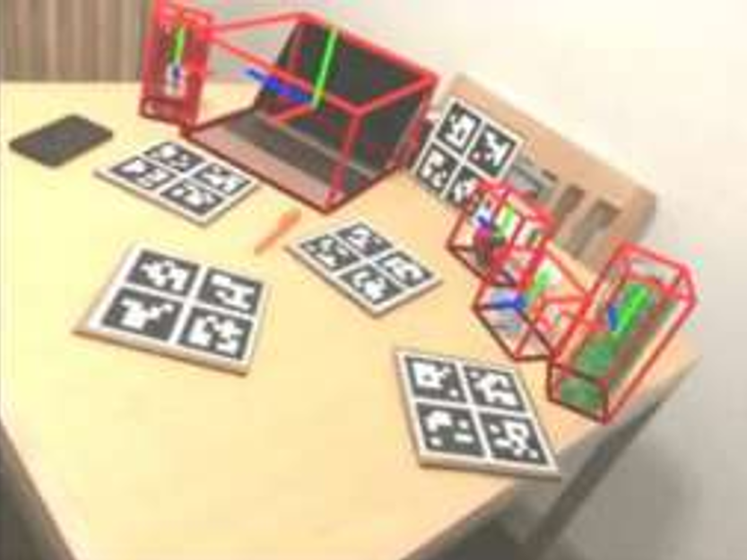

# 6d位姿估计

## 6d位姿估计概念

- 3D目标检测
  3D 目标检测任务是计算机视觉领域的传统任务之一，与简单的图像识别任务不同，3D目标检测不仅需要识别出图像上存在的物体、分辨其对应的类别，还需要以最小包围框的形式给出该物体在图像中的位置
  - 一般将使用RGB图像作为输入、目标物体类别和二维最小包围框作为输出的检测方法称为2D目标检测
  - 将使用RGB图像、RGB-D深度图像和激光点云等数据作为输入、物体类别及最小三维包围框或最小包围框在图像上的二维投影作为输出的检测方法称为3D目标检测
- 6D位姿估计
  6D位姿估计，是估计相机与目标物体在三维空间中的位姿关系的统称，即估计三维空间中平移和旋转，将以目标物体为原点建立的坐标系作为世界坐标系时，6D位姿估计就是求解世界坐标系与相机坐标系的位姿变换
  > 位姿是目标位置和姿态的统称，位姿估计则是指求解目标物体与相机之间的位姿关系的过程，一般使用平移关系和旋转关系进行描述。

  

## 6D位姿估计方法

### 基于CAD模型的物体位姿估计

基本假设：这种方法假定给定对象的CAD模型，这是其训练和测试的基础。
技术方法：通常通过直接回归或建立2D-3D对应关系后使用PnP算法（Perspective-n-Point）或最小二乘法拟合来求解姿态问题。
局限性：
严重依赖于精确的CAD模型。
不能推广到新类别的对象，只能处理训练时已知的特定实例。
类别级方法虽然放宽了对特定实例的依赖，但仍限于预定义的类别。

## 基于YOLO算法思想的3D目标检测算法

### 网络结构

在2D的目标检测任务中，YOLO算法通过对目标分割、预测生成一个S×S×(5×B+C)的张量来表示各个栅格对应的2D 包围框的像素坐标、置信度、类别。
与2D目标检测不同的是，在3D目标检测问题中目标的包围框不再是二维图像上的矩形框，而是三维的立方体在二维图像上的投影，因此需要在YOLO算法的基础上进行改进才能使其适用于对3D 包围框的预测。

显然不能使用“中心像素坐标加偏移量”的方式来描述图 2.3 中的包围框，考虑到立方体在投影到二维平面时会因投影角度导致包围框在平面上往往不是两个矩形简单的叠加，因此需要使用八个顶点和一个中心点的像素坐标位置来描述一个 3D 包围框。 基于 YOLO 算法的思想，为了实现对 3D 目标进行检测，在将输入 RGB 图像栅格化后，每个栅格预测 B 个包围框时不再预测中心点和偏移量而是预测九个关键点的像素坐标，其网络的输出应为S×S×(19×B+C)。

### 损失函数

损失函数是用来评价模型预测值和真实值之间差异大小的一种函数，对于深度学习模型，通常损失函数越小其性越好。损失函数主要在模型的训练阶段发挥作用，每个批次的数据进入网络通过正向传播后输出预测值，损失函数计算预测值与真实值之间的差异，依靠上述差异值并结合学习率实现反向传播阶段各个参数的更新，不断迭代此过程可使得预测值与真实值不断接近，最终使神经网络实现学习的目标。

### PNP算法

PNP（Perspective-n-Point）算法是一种求解相机位姿的算法，其基本思想是通过已知相机内参、相机外参、目标三维点、目标三维点在相机坐标系下的投影点，通过最小化重投影误差来求解相机位姿。

## 6D位姿估计数据集

### 数据集组成（以LINEMOD数据集为例）

- depth：深度图像
- JPEGImages：RGB图像
- labels：标签文件，包含目标三维信息
- models：物体模型文件
- mask: 掩码图像，用于训练时忽略部分目标
- transforms: 拍摄时的外参文件

### 数据集制作

#### 采集

目标物体四周需布置打印的彩色aruco标记

##### aruco标记

aruco 标记本质上是一种类似于二维码的编码，其特点是有明显的四个角点和内部的二进制编制码。由于边框有利于其在图像中的快速检测且二进制编码允许错误检测和纠正技术的应用，aruco 标被广泛用于增加二维世界映射到三维世界时的信息量，如位姿估计、相机矫正等场景

## 当前6D位姿估计模型

### FoundationPose

We present FoundationPose, a unified foundation model for 6D object pose estimation and tracking, supporting both model-based and model-free setups. Our approach can be instantly applied at test-time to a novel object without fine-tuning, as long as its CAD model is given, or a small number of reference images are captured. We bridge the gap between these two setups with a neural implicit representation that allows for effective novel view synthesis, keeping the downstream pose estimation modules invariant under the same unified framework. Strong generalizability is achieved via large-scale synthetic training, aided by a large language model (LLM), a novel transformer-based architecture, and contrastive learning formulation. Extensive evaluation on multiple public datasets involving challenging scenarios and objects indicate our unified approach outperforms existing methods specialized for each task by a large margin. In addition, it even achieves comparable results to instance-level methods despite the reduced assumptions.

#### 复现笔记

https://github.com/NVlabs/FoundationPose?tab=readme-ov-file

