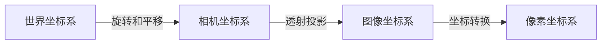
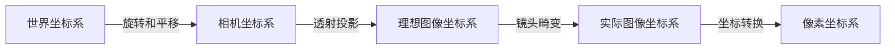

# 相机标定

- [OpenCV 相机标定与3D重建](https://docs.opencv.ac.cn/4.13.0/d9/d0c/group__calib3d.html)
- [相机标定：从入门到实战](https://zhuanlan.zhihu.com/p/698229692)

相机标定的目的是为了建立物体从三维世界到成像平面上各坐标点的对应关系，三维空间中的点坐标投影到二维图像平面上的坐标的空间变换关系如下：

- 世界坐标系：描述物体在三维空间中的位置和姿态，通常以某个固定点为原点，单位为米
- 相机坐标系：以相机的光心为原点，单位为米
- 图像坐标系：以图像的中心为原点，单位为毫米
- 像素坐标系：以图像的左上角为原点，单位为像素

不同于上面理想相机的坐标变换，实际相机的坐标变换还需要考虑镜头畸变的影响。最常见的畸变模型是布朗模型，包含径向畸变和切向畸变两部分
- 径向畸变：由镜头的制造工艺引起，导致图像边缘部分的点向外（桶形畸变）或向内（枕形畸变）偏移，用三个参数（k1, k2, k3）来描述
- 切向畸变：由镜头安装不当引起，导致图像中的点沿切线方向偏移，用两个参数（p1, p2）来描述
将焦距(fx, fy)、主点位置（u0, v0）称为内参，旋转矩阵和平移向量称为外参，K1 K2 K3 P1 P2称为畸变参数，从而有修正后的坐标变换关系：


## 张正友标定法

要标定实际相机，考虑镜头畸变这一非线性模型，需要通过非线性标定方法求解。常见的非线性标定方法是张正友标定法：

其主要特征：
1. 用二维靶标代替三维标靶（区别于传统标定方法）
2. 用棋盘格的角点作为特征点
3. 只考虑了径向畸变，没有考虑切向畸变，故标定后得到的畸变参数只有k1 k2 k3，没有p1 p2（为0）

原理：通过相机拍摄不同位姿的棋盘格图像，提取图像棋盘格角点，以重投影误差为目标函数，通过LM算法进行非线性参数优化，[张氏法相机标定原理](https://zhuanlan.zhihu.com/p/24651968)

注意事项：
- 标定板注意事项
  - 必须保证打印的棋盘格的平整性，尽可能贴平在一个平面上，避免出现弯曲或者褶皱
- 拍摄注意事项
  - 把图像分成四个象限，标定板平均分布在每个象限，每个象限至少拍两个不同倾斜角度的图片
  - 标定板图片需要覆盖整个测量视场，标定图片的数量通常在15~25张之间
  - 标定板的成像面积应大致占整幅画面的1/3~1/4
  - 标定板成像过暗就需要用辅助光源补光，过亮就调整曝光时间，保证标定板的亮度足够且均匀
  - 标定过程，相机的光圈、焦距不能发生改变，改变需要重新标定

标定工具：
- OpenCV
- MATLAB
- ROS

### OpenCV实现

[OpenCV相机标定教程与相关库函数](https://docs.opencv.ac.cn/4.13.0/d9/d0c/group__calib3d.html)

程序设计思路：
1. 定义一个类`CameraCalibrator`，包含以下成员变量：
  - `ChessboardSize`：棋盘格内角点的数量，格式为(width, height)
  - `SquareSize`：棋盘格每个小格子的边长，单位为毫米
  - `ObjectPoints`：世界坐标系中的角点坐标列表
  - `ImagePoints`：图像坐标系中的角点坐标列表
  - `cameraMatrix`：相机内参矩阵
  - `distCoeffs`：相机畸变系数
  - `rvecs`：旋转向量列表
  - `tvecs`：平移向量列表
2. 定义一个方法`get_object_points`，根据棋盘格的属性生成世界坐标系中的角点坐标`ObjectPoints`
3. 定义一个方法`get_image_points`，读取棋盘格图片，检测角点位置，并进行亚像素级精确化，生成图像坐标系中的角点坐标`ImagePoints`
4. 定义一个方法`calibrate`，传入图像尺寸、`ObjectPoints`和`ImagePoints`，调用OpenCV的`cv::calibrateCamera`函数进行相机标定，得到相机内参矩阵`cameraMatrix`、畸变系数`distCoeffs`、旋转向量列表`rvecs`和平移向量列表`tvecs`
5. 定义一个方法`undistort`，使用标定得到的`cameraMatrix`和`distCoeffs`对输入图像进行去畸变处理，返回去畸变后的图像
6. 在主函数中创建`CameraCalibrator`对象，调用上述方法完成相机标定和去畸变处理，并显示结果图像

具体实现：
```cpp
#include <opencv2/opencv.hpp>
#include <iostream>
#include <vector>
#include <string>
#include <filesystem>

typedef std::vector<std::vector<cv::Point3f>> ObjectPoints;
typedef std::vector<std::vector<cv::Point2f>> ImagePoints;

class CameraCalibrator 
{
public:
    cv::Size ChessboardSize;            // 棋盘格内角点数量 (width, height)
    float SquareSize;                   // 棋盘格每个小格子的边长（单位：毫米）
    ObjectPoints objectPoints;          // 世界坐标系中的角点坐标列表
    ImagePoints imagePoints;            // 图像坐标系中的角点坐标列表
    cv::Mat cameraMatrix, distCoeffs;   // 相机内参和畸变系数
    std::vector<cv::Mat> rvecs, tvecs;  // 旋转向量和平移向量
    // 构造函数
    CameraCalibrator(cv::Size boardSize, float squareSize)
        : ChessboardSize(boardSize), SquareSize(squareSize) {}
    // 生成世界坐标系中的角点坐标
    std::vector<cv::Point3f> get_object_points()
    {
        std::vector<cv::Point3f> objp;
        for (int i = 0; i < ChessboardSize.height; ++i) {
            for (int j = 0; j < ChessboardSize.width; ++j) {
                objp.emplace_back(j * SquareSize, i * SquareSize, 0);
            }
        }
        return objp;
    }
    // 读取图片，检测角点并亚像素精确化
    void get_image_points(const std::string& img_dir, const std::string& img_ext) 
    {
        std::vector<std::string> img_files;
        for (const auto& entry : std::filesystem::directory_iterator(img_dir)) {
            if (entry.path().extension() == img_ext)
                img_files.push_back(entry.path().string());
        }
        std::vector<cv::Point3f> objp = get_object_points();
        for (const auto& file : img_files) {
            cv::Mat img = cv::imread(file);
            if (img.empty()) {
                std::cerr << "Could not read image: " << file << std::endl;
                continue;
            }
            cv::Mat gray;
            cv::cvtColor(img, gray, cv::COLOR_BGR2GRAY);
            std::vector<cv::Point2f> corners;
            bool found = cv::findChessboardCorners(gray, ChessboardSize, corners); // 查找棋盘格角点
            if (found) {
                cv::cornerSubPix(gray, corners, cv::Size(11, 11), cv::Size(-1, -1), 
                    cv::TermCriteria(cv::TermCriteria::EPS + cv::TermCriteria::MAX_ITER, 30, 0.001)); // 亚像素级精确化
                imagePoints.push_back(corners);
                objectPoints.push_back(objp);
                // 可视化角点检测结果
                cv::drawChessboardCorners(img, ChessboardSize, corners, found);
                cv::imshow("Corners", img);
                cv::waitKey(1000);
            }
        }
        cv::destroyAllWindows();
    }
    // 相机标定
    void calibrate(const cv::Size& imageSize) {
        double rms = cv::calibrateCamera(
          objectPoints, imagePoints, imageSize, cameraMatrix, distCoeffs, rvecs, tvecs); // 标定
        std::cout << "RMS error: " << rms << std::endl; // 输出RMS(重投影误差的均方根值)误差，数值越小表示标定结果越好
        std::cout << "Camera Matrix:\n" << cameraMatrix << std::endl; // 输出相机内参矩阵
        std::cout << "Distortion Coefficients:\n" << distCoeffs << std::endl; // 输出畸变系数
    }
    // 图像去畸变，返回去畸变后的图像
    cv::Mat undistort(const cv::Mat& img) {
        cv::Mat undistorted;
        cv::undistort(img, undistorted, cameraMatrix, distCoeffs); // 去畸变处理
        return undistorted;
    }
};

int main() {
    // 参数设置
    cv::Size boardSize(8, 7); // 棋盘格内角点数量 (width, height)
    float squareSize = 25.0f; // 棋盘格每个小格子的边长（单位：毫米）
    std::string img_dir = "./calib_imgs"; // 棋盘格图片文件夹
    std::string img_ext = ".jpg";         // 图片扩展名

    CameraCalibrator calibrator(boardSize, squareSize);
    calibrator.get_image_points(img_dir, img_ext);
    // 假设所有图片尺寸一致，读取第一张图片获取尺寸
    std::string first_img = img_dir + "/1" + img_ext;
    cv::Mat img = cv::imread(first_img);
    if (img.empty()) {
        std::cerr << "No image found!" << std::endl;
        return -1;
    }
    calibrator.calibrate(img.size());
    // 去畸变并显示
    cv::Mat undistorted = calibrator.undistort(img);
    cv::Mat Combination;
    cv::hconcat(img, undistorted, Combination); // 将原图和去畸变后的图像水平拼接显示
    cv::imshow("Combination", Combination);
    cv::waitKey(0);
    return 0;
}
```

写入和读取标定数据：
```cpp
// 保存标定结果到文件
void save_calibration(const std::string& filename) {
    cv::FileStorage fs(filename, cv::FileStorage::WRITE);
    fs << "CameraMatrix" << cameraMatrix;
    fs << "DistCoeffs" << distCoeffs;
    fs.release();
}

// 从文件读取标定结果
void load_calibration(const std::string& filename) {
    cv::FileStorage fs(filename, cv::FileStorage::READ);
    fs["CameraMatrix"] >> cameraMatrix;
    fs["DistCoeffs"] >> distCoeffs;
    fs.release();
}
```

双目相机标定的实现：

- [OpenCV 双目摄像头标定+测距教程](https://zhuanlan.zhihu.com/p/685376354)

`cv::stereoCalibrate`函数的原型如下：
```cpp
```
