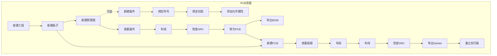

# PCB设计笔记

## 知识补充

### 差分信号与差分线

- 单端信号：信号的检测基于信号线与参考基准线(通常是GND)之间的电平变化，比如串口通信有三根线(TX、RX和GND)，发送和接收信号都是基于GND的电平而言的
- 差分信号:接收端收到的信号是两根信号之间的电平差，而且两个信号线的极性是相反的，无需共地，两根信号线绞合在一起

相较于单端信号，差分信号放大了有效信号，此外，单端信号受到外界噪声信号时噪声会叠加在信号上，而差分信号的两根线（差分线）受到的噪声是相同的，外界噪声会被抵消掉，因此差分信号具有更强的抗干扰能力，适用于远距离信号传输

传输差分信号的两根线称为差分线，其绘制要求见下文`布线原则`

常见的需要使用差分信号的场景有高速信号传输（如USB）、时钟信号传输（如晶振信号线）等

对于Type-C接口，DP和DM/DN线对是差分信号线，DP线为正极，DM/DN线为负极

### 封装

封装指的是PCB上元器件的物理尺寸和引脚排列方式。常见的封装类型有：

- DIP（通孔直插封装）
  - DIP(双列直插封装)，引脚两排平行伸出，间距 2.54mm（标准排针间距），体积较大，适用于低成本单片机和一些简单的功能模块，方便插拔
  - SIP（单列直插封装），引脚单排伸出
- QFP（方形扁平封装）
  - LQFP（低引脚数四边扁平封装），适用于中高端 MCU、需要较多引脚的芯片，DIY友好
  - TQFP（薄型四边扁平封装），适用于便携式设备、可穿戴设备的核心芯片
- BGA（球栅阵列封装）
  - 芯片的引脚不再像传统封装那样从侧面伸出（如 LQFP 封装），而是以微小的球形焊点（锡球）的形式排列在封装底部的栅格上，通过锡球与 PCB 板连接
- QFN（无引脚封装）
  - QFN（四边扁平无引脚封装），芯片四周无伸出引脚，靠封装底部的焊盘与 PCB 连接，体积极小，散热好，适用于空间受限的应用
  - DFN（双边扁平无引脚封装），仅芯片两侧有焊盘，体积比 QFN 更窄，适用于简单模拟芯片、小型电源管理芯片
- SO（小外形封装）
  - SOP（小外形封装），引脚从两侧伸出，间距较小，适用于中小型芯片，如运算放大器、逻辑芯片等
  - SSOP（超小外形封装），引脚间距更小，适用于高密度电路设计
  - TSSOP（薄型超小外形封装），厚度更薄，适用于便携式设备
  - SOIC（小外形集成电路封装），引脚弯曲向下，适用于空间受限的应用

## PCB设计

### 嘉立创专业版快捷键

- Shift + X：选中某个元件跳转至原理图或PCB的对应位置
- Ctrl + Shift + X：布局传递

- Q：切换单位
- Alt + W: 布线模式
- Alt + D：差分线布线模式
- Alt + T：切换图层至顶层top，如果此时处于布线模式，则会在当前布线末端设过孔移至顶层继续布线
- Alt + B: 切换图层至底层bottom，如果此时处于布线模式，则会在当前布线末端设过孔移至底层继续布线
- Alt + V：放置过孔

放置过孔、图形时按Tab键可设置尺寸等配置

### PCB设计流程

### 原理图设计

对于芯片类元件，为避免多个引脚引出电路重叠，为每个引脚添加网络标签，随后右键元件，点击扇出网络标签选项，右键选中所有引脚，选择扇出网络标签，即可将引脚名填入标签名
对于不使用的引脚，放置非连接标识符

### PCB布局

1. 绘制板框：选择板框层，添加四角过孔
2. 在原理图中选中某一电路模块，进行布局传递，将该模块的元件布局传递至PCB中，理清模块布局
3. 在每个模块中微调元件位置，确保元件布局合理

注意事项：

- Type-C接口等高速接口元件应放置于边缘，接口伸出PCB板外一小部分，方便连接
- 晶振要远离板边缘，靠近芯片引脚

### PCB布线

#### 布线类别

- 电源线
- 信号线

#### 布线顺序

在开始布线时，先在工程设计-网络列表中隐藏VCC和GND网络的飞线，避免干扰布线视图。布线时遵循：**关键元件优先、关键信号线优先、密度优先**

1. 密度优先原则:从单板上连线最密集的区域开始布线
2. 优先关键元器件:如DDR、射频等核心部分应优先布线,类似信号传输线应提供专层、电源、地回路,其他次要信号要顾全整体,不可以和关键信号相抵触
3. 关键信号线优先:电源、模拟信号、高速信号、时钟信号和同步信号等关键信号优先布线

#### 布线原则

1. **不要使用自动布线**
2. **顶层优先**原则: 尽量在顶层布线，遇到不得不交叉的地方再使用过孔**换层布线**
3. **电源线**尽量**加粗**: 因为电源线是要给电路板各个模块供电的,电源线加粗有利于电流在主干道上流通。一般让线宽略小于供电焊盘宽度（差距小于1mil）
   补充：在25℃时,对于铜厚为10z(盎司)的导线,10mil线宽能够承载0.65A电流,40mil线宽能够承载2.3A电流
4. **同一层内走线大于90度**: 同一层走线禁止90度或者走锐角,从原理上讲,锐角直角走线会造成走线阻抗不连续,对于信号的传输有影响,推荐走线135度
5. 注意**电容**的摆放位置: 电源输入要先经过滤波电容再传至后级，故滤波电容要尽量靠近电源引脚，同时先经过大电容，再经过小电容；去耦电容要贴近芯片电源引脚放置，并就近接地，电容并联放置，较小的电容放在芯片引脚附近，大电容放在稍远的位置
   > 去耦电容是电路中装设在元件的电源端的电容，此电容可以提供较稳定的电源，同时也可以降低元件耦合到电源端的噪声，间接可以减少其他元件受此元件噪声的影响
6. **高频信号线**尽可能短,并做好与其他信号的屏蔽隔离，尽量不要从芯片元件下经过，在晶振元件及信号线周围打地过孔（GND过孔，并用20mil导线将GND焊盘与过孔相连）并使用禁止布线层包裹晶振与导线（禁止布线层属性：图层为多层；禁止选项为禁止铺铜）此外：
   - 为了降低相邻走线之间的串扰,尽量避免相邻层平行走线,走线应遵循3W(线距为三倍线宽)原则
   - 相邻层信号线应采用正交方向布线
   - 对于晶振两信号线，选择差分对布线方式，差分线的绘制要求：
      1. 差分线尽量短
      2. 优先绘制差分线
      3. 差分线上尽量不超过两对过孔(过孔会增加线路的寄生电感,影响信号完整性)
      4. 平行紧密走线,避免直角锐角走线
      5. 长度差尽量小(控制在5mil以内)
      6. 与其它信号网络以及地的距离尽量在20mil以上
      7. 注意阻抗匹配(90欧姆差分阻抗)
7. **PC口**布线要尽量远离安装孔与电路板边缘:在PCB钻孔加工中,很容易会切掉一部分导线,为了电路板功能,应尽量远离这些位置
8. 导线和导线、过孔和导线连接处需要添加**泪滴**，泪滴在导线和导线、过孔和导线的连接处形成一个小三角形，有助于增强机械强度，防止导线和导线、过孔和导线连接断裂，设计完成后添加
9. GND网络使用**铺铜**方式连接，首先应在GND焊盘附近放置地过孔阵列，一是连接各GND，形成网络；二是连接至底层地平面，提供回流路径。工具栏选择铺铜工具，框选整个PCB区域，属性中选择多层，网络选择GND

### 丝印绘制

图层选择顶/底层丝印层，放置文本，图形，图像等，注意：

1. 丝印内容不要放置在焊盘上，避免影响焊接
2. 可使用实心圆标注开关、按键的开启方向
