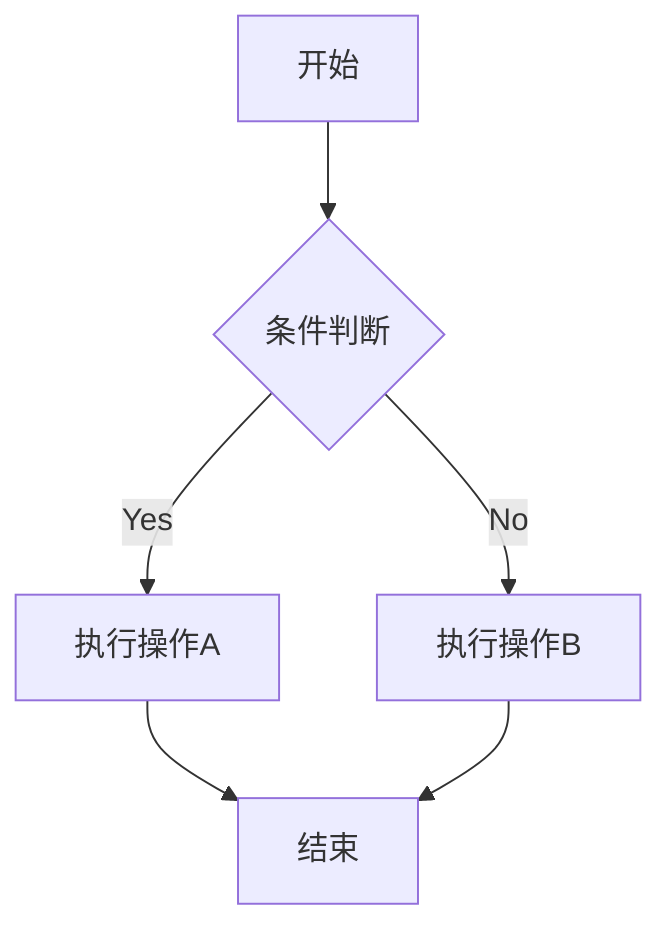
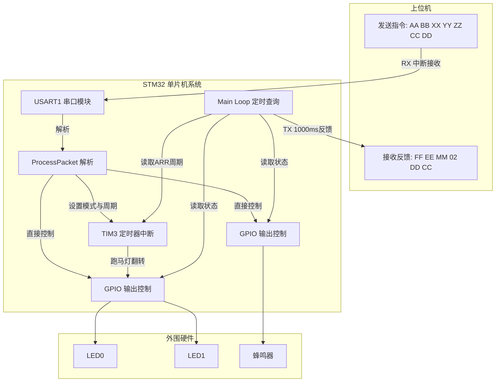

# Mermaid

Mermaid 是最流行的 Markdown 图表工具之一，它使用简单的文本语法生成各种图表

使用前需要确保你的 Markdown 编辑器或渲染器支持 Mermaid 语法。可下载插件：名称: 
[Markdown Preview Mermaid Support](https://marketplace.visualstudio.com/items?itemName=bierner.markdown-mermaid)

## 支持的图表类型

- 流程图 (Flowchart)
- 序列图 (Sequence Diagram)
- 类图 (Class Diagram)
- 状态图 (State Diagram)
- 甘特图 (Gantt Chart)
- 饼图 (Pie Chart)

## 流程图

- 流程图方向
  - TD 或 TB：从上到下
  - BT：从下到上
  - RL：从右到左
  - LR：从左到右
- 节点形状
  - A矩形
  - B圆角矩形
  - C菱形（决策）
  - D圆形
  - E旗帜形
- 连接线类型
  - --> 实线箭头
  - -.-> 虚线箭头
  - ==> 粗实线箭头
  - -- 实线
  - -. 虚线

示例：

