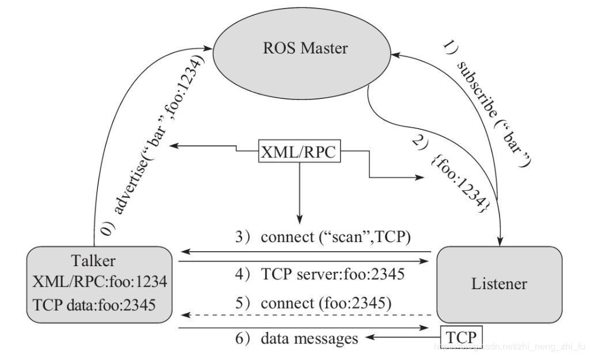
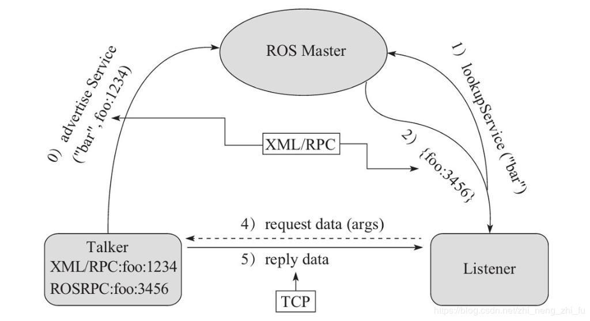
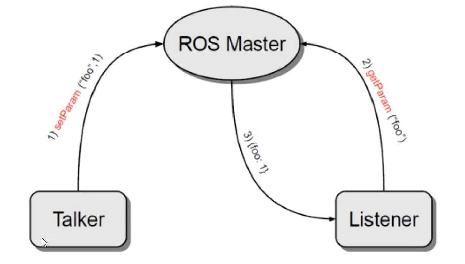

# ROS节点通信

ROS是进程（也称为Nodes）的分布式框架，在ROS中每一个功能包都是一个单独的进程，每一个进程都是独立运行的。部分进程甚至还可分布于不同主机，不同主机协同工作，从而分散计算压力

ROS 中的基本通信机制主要有如下三种实现策略:
- 话题通信(发布订阅模式)
- 服务通信(请求响应模式)
- 参数服务器(参数共享模式)

## ROS Master

master: 节点管理器, master在整个网络通信架构里相当于管理中心，管理着各个node。node首先在master处进行注册，之后master会将该node纳入整个ROS程序中，node之间的通信也是先由master进行“牵线”，才能两两的进行点对点通信。当ROS程序启动时，第一步首先启动master，由节点管理器处理依次启动node
```bash
roscore #此时ROS master启动，同时启动的还有rosout和parameter server
```

## 话题通信(Topic)

话题通信是基于发布订阅模式的，也即:一个节点发布消息，另一个节点订阅该消息

### 理论模型



1. Talker启动后，会通过RPC在 ROS Master 中注册自身信息，其中包含所发布消息的话题名称。ROS Master 会将节点的注册信息加入到注册表中。
2. Listener启动后，也会通过RPC在 ROS Master 中注册自身信息，包含需要订阅消息的话题名。ROS Master 会将节点的注册信息加入到注册表中。
3. ROS Master 会根据注册表中的信息匹配Talker 和 Listener，并通过 RPC 向 Listener 发送 Talker 的 RPC 地址信息。
4. Listener 根据接收到的 RPC 地址，通过 RPC 向 Talker 发送连接请求，传输订阅的话题名称、消息类型以及通信协议(TCP/UDP)。
5. Talker 接收到 Listener 的请求后，也是通过 RPC 向 Listener 确认连接信息，并发送自身的 TCP 地址信息。
6. Listener 根据步骤4 返回的消息使用 TCP 与 Talker 建立网络连接。
7. Talker 与 Listener 建立连接后，Talker 会将消息通过 TCP 连接发送给 Listener。

- 注意1: 上述实现流程中，前五步使用的 RPC协议，最后两步使用的是 TCP 协议
- 注意2: Talker 与 Listener 的启动无先后顺序要求
- 注意3: 一个话题可以有多个发布者，也可以有多个订阅者
- 注意4：一个节点可以发布多个话题，也可以订阅多个话题
- 注意5: 一个节点既可以是发布者，也可以是订阅者，可以订阅自己发布的话题
- 注意6: Talker 与 Listener 连接建立后，不再需要 ROS Master。也即，即便关闭ROS Master，Talker 与 Listern 照常通信。

### C++实现

**发布方：**

```cpp
#include "ros/ros.h"
#include "std_msgs/String.h"
int main(int argc,char *argv[]){
    ros::init(argc,argv,"publisher");//初始化ROS节点，命名为publisher
    ros::NodeHandle nh; //实例化ROS句柄，节点和ros通讯的关键
    ros::Publisher pub=nh.advertise<std_msgs::String>("first_topic",10); //实例化发布者对象
    //pub就是发布者对象，advertise是发布话题的函数，为一个泛型函数：模板参数是消息类型，参数1是话题名称，参数2是消息队列长度
    std_msgs::String msg; //实例化消息
    ros::Rate rate(1); //设置循环频率,1HZ
    while(ros::ok()){
        ROS_INFO("Node running"); //输出日志信息
        msg.data="hello subscriber!"; //给消息赋值
        pub.publish(msg); //发布消息
        rate.sleep(); //按照循环频率延时
    }
    return 0;
}
```

**接收方：**

```cpp
#include<ros/ros.h>
#include<std_msgs/String.h>
void callback(std_msgs::String msg){ //回调函数，类似于单片机中断函数，参数是接收到的消息
    ROS_INFO("node receive: %s",msg.data.c_str()); //打印接收到的消息，c_str()将string转换为字符数组
}
int main(int argc,char* argv[]){
    ros::init(argc,argv,"subscriber");
    ros::NodeHandle nh;
    ros::Subscriber sub=nh.subscribe("first_topic",10,callback);//实例化订阅者对象
    //sub就是订阅者对象，subscribe是订阅话题的函数，参数1是话题名称，参数2是消息队列长度，参数3是回调函数名
    while(ros::ok()){
        ros::spinOnce(); //调用一次回调函数
        // ros::spin(); //循环调用回调函数，和上面两行代码等价
    }
    return 0;
}
```

**cmakelists.txt:**

```txt
add_executable(first_publisher src/first_publisher.cpp)
add_executable(first_subscriber src/first_subscriber.cpp)
target_link_libraries(first_publisher ${catkin_LIBRARIES}) #可执行文件名最好和cpp文件名一致，不然容易混淆
target_link_libraries(first_subscriber ${catkin_LIBRARIES})
```

**编译与运行:**

```bash
catkin_make # 编译工作空间
roscore # 启动ROS主节点
# 新开一个终端
source ~/ros_ws/devel/setup.bash # 配置环境变量
rosrun learn_topic publisher
# 新开一个终端
source ~/ros_ws/devel/setup.bash
rosrun learn_topic subscriber
```

### Python实现

在创建软件包后，需先编译一次，以便让ros能找到该包
> 由于Python脚本不需要编译，所以在创建完软件包后，只需编译一次即可，以后修改Python脚本后无需再编译

新建`scripts`文件夹，并在该文件夹下创建`second_publisher.py`和`second_subscriber.py`

**发布方：**

```python
#!/usr/bin/env python3
#coding=utf-8
import rospy
from std_msgs.msg import String

if __name__ == "__main__":
    rospy.init_node("publisher02") # 初始化节点,参数为节点名
    rospy.logwarn("publisher02 start...") # 输出日志信息
    pub=rospy.Publisher("second_topic",String,queue_size=10) # 实例化发布者对象, 参数1为话题名称,参数2为消息类型,参数3为消息队列长度
    msg=String() # 实例化消息
    rate=rospy.Rate(1) # 设置循环频率
    while not rospy.is_shutdown(): # 循环，直到节点关闭
        rospy.loginfo("Node running") # 输出日志信息
        msg.data="hello subscriber! I am publisher02" # 给消息赋值
        pub.publish(msg) # 发布消息
        rate.sleep() # 按照循环频率延时
```

**接收方:**

```python
#!/usr/bin/env python3
#coding=utf-8
import rospy
from std_msgs.msg import String

def callback02(msg):
    rospy.loginfo("Node receive form second_topic: %s",msg.data)
def callback(msg):
    rospy.loginfo("Node receive from first_topic: %s",msg.data)
if __name__ == "__main__" :
    rospy.init_node("subscriber02")
    sub=rospy.Subscriber("second_topic",String,callback02,queue_size=10)
    sub=rospy.Subscriber("first_topic",String,callback,queue_size=10)
    # 此处尝试订阅两个话题，其中first_topic是C++发布的，second_topic是Python发布的
    rospy.spin()
```

**添加执行权限：**

```bash
chmod +x second_publisher.py
chmod +x second_subscriber.py
```

**运行：**

```bash
rosrun learn_topic second_publisher.py # 注意第二个参数是脚本名，与cpp文件要填写的节点名不同
rosrun learn_topic publisher # 运行C++发布节点
rosrun learn_topic second_subscriber.py # 运行Python订阅节点,可以发现两个话题都被订阅了
rosrun  # 运行节点查看器：
```

### 问题解决与优化

ROS_INFO()函数不显示中文字符？

ROS_INFO()的编码方式受程序的Locale环境变量影响，C语言的Locale默认是叫做"C"的Locale设置，会让一些输出函数只支持英文字符显示

解决方法：在程序开头添加`setlocale(LC_ALL,"zh_CN.UTF-8")`,第一个参数表示设置所有的Locale信息，第二个参数表示设置为系统默认的Locale，如果系统默认的Locale是中文环境，则设置为"“，不填

如何用一个订阅者节点订阅多个话题？
```cpp
...
void callback(std_msgs::String msg){
    ROS_INFO("subscriber1: %s",msg.data.c_str());
}
void callback2(std_msgs::String msg){
    ROS_INFO("subscriber2: %s",msg.data.c_str());
}
...
ros::Subscriber sub1=nh.subscribe("first_topic",10,callback);
ros::Subscriber sub2=nh.subscribe("second_topic",10,callback2);
...
```

### 常用命令

```bash
rostopic bw     显示主题使用的带宽
rostopic delay  显示带有 header 的主题延迟
rostopic echo   打印消息到屏幕
rostopic find   根据类型查找主题
rostopic hz     显示主题的发布频率
rostopic info   显示主题相关信息
rostopic list   显示所有活动状态下的主题
rostopic pub    将数据发布到主题
rostopic type   打印主题类型
```

### 消息类型

ROS 常用的消息类型如下表：

| 消息类型         | 说明                   |
|:---------------:|:----------------------:|
| std_msgs/String | 字符串消息             |
| std_msgs/Int8/16/32/64  | 8/16/32/64位整型消息 |
| std_msgs/Float32/64| 32/64位浮点型消息         |
| std_msgs/Bool   | 布尔型消息             |
| std_msgs/Header | 消息头（时间戳等）     |
| geometry_msgs/Point   | 点（x, y, z）      |
| geometry_msgs/Pose    | 位姿（位置+姿态）  |
| geometry_msgs/Twist   | 速度（线速度+角速度）|
| sensor_msgs/Image     | 图像数据            |
| sensor_msgs/LaserScan | 激光雷达数据        |
| nav_msgs/Odometry     | 里程计数据          |
| actionlib_msgs/GoalID | 动作目标ID          |

常用命令

```bash
rosmsg show       显示消息描述
rosmsg info       显示消息信息
rosmsg list       列出所有消息
rosmsg md5        显示 md5 加密后的消息
rosmsg package    显示某个功能包下的所有消息
rosmsg packages   列出包含消息的功能包
```

### 自定义消息类型

创建msg文件自定义消息类型

可使用的字段类型有：
- int8, int16, int32, int64 (或者无符号类型: uint*)
- float32, float64
- string
- time, duration ROS中表示时间的特殊类型，time表示一个具体的时间点，duration表示一个时间段
- other msg files
- variable-length array[] 或定长数组
- Header(标头) ROS中的特殊类型，包含时间戳和ROS中常用的坐标帧信息。会经常看到msg文件的第一行具有Header标头。

#### 创建自定义消息类型

1. 在包的根目录下创建msg文件夹，并在该文件夹下创建`Person.msg`文件
    ```string name
    string name
    uint16 age
    float64 height
    ```
2. 修改package.xml
    ```xml
    <!-- 在现有内容中添加消息生成依赖 -->
    <build_depend>message_generation</build_depend>
    <exec_depend>message_runtime</exec_depend>
    ```
3. 修改CMakeLists.txt
    ```cmake
    ## 在现有内容中添加消息生成依赖
    find_package(catkin REQUIRED COMPONENTS
      roscpp
      rospy
      std_msgs
      message_generation # 添加消息生成依赖
    )
    ---
    ## 在注释处取消自定义消息文件代码的注释
    add_message_files(
      FILES
      Person.msg # 添加自定义消息文件
    )
    ---
    ## 生成消息
    generate_messages(
      DEPENDENCIES
      std_msgs # 生成消息时依赖于std_msgs
    )
    # 这段代码放在下面代码的上面
    ---
    ## 在注释处取消对执行时依赖代码的注释
    catkin_package(
    #  INCLUDE_DIRS include
    #  LIBRARIES demo02_talker_listener
      CATKIN_DEPENDS roscpp rospy std_msgs message_runtime # 添加执行时依赖
    #  DEPENDS system_lib
    )
    ```
4. 编译并查看中间文件
  - C++ 需要调用的中间文件路径`~/工作空间/devel/include/包名/xxx.h`
  - Python 需要调用的中间文件路径`~/工作空间/devel/lib/python3/dist-packages/包名/msg`

#### 使用自定义消息类型

首先需要配置vscode插件，让其能够识别自定义消息类型的头文件路径

打开`.vscode/c_cpp_properties.json`文件，在`includePath`中添加自定义消息头文件路径，注意不用把具体路径列出来，只需要写出功能包的include目录即可
```json
{
    "includePath": [
        "${workspaceFolder}/**",
        "/opt/ros/noetic/include/**",
        "/home/用户名/${工作空间名}/devel/include/**" // 添加自定义消息头文件路径
    ],
}
```

打开`.vscode/settings.json`文件，在`python.analysis.extraPaths`中添加自定义消息头文件路径

```json
{
    "python.analysis.extraPaths": [
        "/opt/ros/noetic/lib/python3/dist-packages",
        "/home/用户名/${工作空间名}/devel/lib/python3/dist-packages" // 添加自定义消息头文件路径
    ]
}
```

在调用自定义消息类型的节点中，需要包含自定义消息类型的头文件，C++需要包含`包名/xxx.h`，Python需要包含`包名.msg`，其中包名是创建自定义消息类型的功能包的名称，xxx是自定义消息类型的名称，例如：
```cpp
#include "learn_topic/Person.h" // C++包含自定义消息头文件
```
```python
from learn_topic.msg import Person # Python包含自定义消息头文件
```

调用自定义消息类型时，发布者和订阅者的消息类型都要改为自定义消息类型，例如：
```cpp
ros::Publisher pub=nh.advertise<learn_topic::Person>("topic_person",10); // C++发布者使用自定义消息类型
learn_topic::Person msg; // C++实例化自定义消息对象
hello_world::Person::_name_type name; // C++定义自定义消息字段类型的变量
hello_world::Person::_age_type age; // C++定义自定义消息字段类型的变量
hello_world::Person::_height_type height; // C++定义自定义消息字段类型的变量
msg.name=name;
msg.age=age;
msg.height=height; // 给自定义消息对象赋值

ros::Subscriber sub=nh.subscribe<learn_topic::Person>("topic_person",10,callback); // C++订阅者使用自定义消息类型
void callback(const learn_topic::Person::ConstPtr& person_p){ 
    // C++回调函数参数使用自定义消息类型的智能指针
    ROS_INFO("subscriber receive: name = %s, age = %d, height = %f",person_p->name.c_str(), person_p->age, person_p->height);
}
```
```python
pub=rospy.Publisher("topic_person",Person,queue_size=10) # Python发布者使用自定义消息类型
msg=Person() # Python实例化自定义消息对象
msg.name="Tom"
msg.age=10
msg.height=1.5 # 给自定义消息对象赋值

sub=rospy.Subscriber("topic_person",Person,callback,queue_size=10) # Python订阅者使用自定义消息类型
def callback(msg):
    # Python回调函数参数使用自定义消息类型
    rospy.loginfo("subscriber receive: name = %s, age = %d, height = %f",msg.name, msg.age, msg.height);
```

## 服务通信（Service）

服务通信是ROS中另一种常用的通信模式，服务通信是基于请求响应模式的，也即:一个节点提供服务，另一个节点请求该服务

### 理论模型



1. Server 启动后，会通过RPC在 ROS Master 中注册自身信息，其中包含提供的服务的名称。ROS Master 会将节点的注册信息加入到注册表中。
2. Client 启动后，也会通过RPC在 ROS Master 中注册自身信息，包含需要请求的服务的名称。ROS Master 会将节点的注册信息加入到注册表中。
3. ROS Master 会根据注册表中的信息匹配Server和 Client，并通过 RPC 向 Client 发送 Server 的 TCP 地址信息。
4. Client 根据步骤2 响应的信息，使用 TCP 与 Server 建立网络连接，并发送请求数据。
5. Server 接收、解析请求的数据，并产生响应结果返回给 Client。

- 注意1: 上述实现流程中，前三步使用的 RPC协议，最后两步使用的是 TCP 协议
- 注意2: 客户端请求被处理时，需要保证服务器已经启动
- 注意3: 服务端和客户端都可以存在多个。

### 常用命令

```bash
rosservice args    打印服务参数
rosservice call    使用提供的参数调用服务
rosservice find    按照服务类型查找服务
rosservice info    打印有关服务的信息
rosservice list    列出所有活动的服务
rosservice type    打印服务类型
rosservice url     打印服务的 ROSRPC url

rossrv show       显示服务消息详情
rossrv info       显示服务消息相关信息
rossrv list       列出所有服务信息
rossrv md5        显示 md5 加密后的服务消息
rossrv package    显示某个包下所有服务消息
rossrv packages   显示包含服务消息的所有包
```

### 自定义服务类型

#### 创建自定义服务类型

功能包下新建`srv`目录，添加`AddInts.srv`文件。服务通信中，数据分成两部分，请求与响应，在`srv`文件中请求和响应使用`---`分割

1. 创建srv文件自定义服务类型
    ```srv
    # 客户端请求时发送的两个数字
    int32 num1
    int32 num2
    ---
    # 服务器响应发送的数据
    int32 sum
    ```
2. 修改package.xml
    ```xml
    <build_depend>message_generation</build_depend>
    <exec_depend>message_runtime</exec_depend>
    ```
3. 修改CMakeLists.txt
    ```txt
    find_package(catkin REQUIRED COMPONENTS
      roscpp
      rospy
      std_msgs
      message_generation
    )
    add_service_files(
      FILES
      AddInts.srv
    )
    generate_messages(
      DEPENDENCIES
      std_msgs
    )
    ```
4. 编译并查看中间文件
  - C++ 需要调用的中间文件路径`~/工作空间/devel/include/包名/xxx.h`
  - Python 需要调用的中间文件路径`~/工作空间/devel/lib/python3/dist-packages/包名/srv`

#### 调用自定义SRV C++实现

如果以前已经配置过vscode插件且没有变更工作空间，不用再配置

**编写服务端节点**

```cpp
#include"ros/ros.h"
#include"learn_service/AddInts.h"
bool doReq(learn_service::AddInts::Request& req,learn_service::AddInts::Response& resp){
    int num1 = req.num1;
    int num2 = req.num2;
    ROS_INFO("服务器接收到的请求数据为:num1 = %d, num2 = %d",num1, num2);
    //逻辑处理
    if (num1 < 0 || num2 < 0){
        ROS_ERROR("提交的数据异常:数据不可以为负数");
        return false;
    }
    //如果没有异常，那么相加并将结果赋值给 resp
    resp.sum = num1 + num2;
    return true;
}
int main(int argc, char *argv[]){
    setlocale(LC_ALL,"");
    ros::init(argc,argv,"AddInts_Server");
    ros::NodeHandle nh;
    ros::ServiceServer server = nh.advertiseService("AddInts",doReq);
    ROS_INFO("服务已经启动....");
    ros::spin(); //记得调用
    return 0;
}
```

**编写客户端节点**

```cpp
#include "ros/ros.h"
#include "learn_service/AddInts.h"
int main(int argc, char *argv[]){
    setlocale(LC_ALL,"");
    //调用时动态传值,如果通过 launch 的 args 传参，需要传递的参数个数 +3
    // if (argc != 5)//launch 传参(0-文件路径 1传入的参数 2传入的参数 3节点名称 4日志路径)
    if (argc != 3){
        ROS_ERROR("请提交两个整数");
        return 1;
    }
    ros::init(argc,argv,"AddInts_Client");
    ros::NodeHandle nh;
    ros::ServiceClient client = nh.serviceClient<learn_service::AddInts>("AddInts");
    //等待服务启动成功
    //方式1
    ros::service::waitForService("AddInts");
    //方式2
    // client.waitForExistence();
    //组织请求数据
    learn_service::AddInts ai;
    ai.request.num1 = atoi(argv[1]);
    ai.request.num2 = atoi(argv[2]);
    //发送请求,返回 bool 值，标记是否成功
    bool flag = client.call(ai);
    //处理响应
    if (flag){
        ROS_INFO("请求正常处理,响应结果:%d",ai.response.sum);
    }
    else{
        ROS_ERROR("请求处理失败....");
        return 1;
    }
    return 0;
}
```

**cmakelists.txt**

省略

**运行**

```bash
roscore # 启动ROS主节点
# 新开一个终端
source ~/ros_ws/devel/setup.bash
rosrun learn_service AddInts_Server # 运行服务端节点
# 新开一个终端
source ~/ros_ws/devel/setup.bash
rosrun learn_service AddInts_Client 10 20 # 运行客户端节点,并传入两个整数参数
```

### 调用自定义SRV Python实现

如果以前已经配置过vscode插件且没有变更工作空间，不用再配置

**编写服务端节点**

```python
#! /usr/bin/env python
import rospy
from learn_service.srv import AddInts,AddIntsRequest,AddIntsResponse
# 回调函数的参数是请求对象，返回值是响应对象
def doReq(req):
    # 解析提交的数据
    sum = req.num1 + req.num2
    rospy.loginfo("提交的数据:num1 = %d, num2 = %d, sum = %d",req.num1, req.num2, sum)
    # 创建响应对象，赋值并返回
    # resp = AddIntsResponse()
    # resp.sum = sum
    resp = AddIntsResponse(sum)
    return resp
if __name__ == "__main__":
    rospy.init_node("addints_server_p")
    server = rospy.Service("AddInts",AddInts,doReq)
    rospy.spin()
```

**编写客户端节点**

```python
#! /usr/bin/env python
import rospy
from learn_service.srv import * # 导入所有服务类型,*为通配符
import sys
if __name__ == "__main__":
    #优化实现
    if len(sys.argv) != 3:
        rospy.logerr("请正确提交参数")
        sys.exit(1)
    rospy.init_node("AddInts_Client_p")
    client = rospy.ServiceProxy("AddInts",AddInts) # 实例化客户端对象

    # 请求前，等待服务已经就绪
    # 方式1:
    # rospy.wait_for_service("AddInts")
    # 方式2
    client.wait_for_service()

    # 发送请求,接收并处理响应
    # 方式1
    # resp = client(3,4)
    # 方式2
    # resp = client(AddIntsRequest(1,5))
     # 方式3
    req = AddIntsRequest()

    req.num1 = int(sys.argv[1])
    req.num2 = int(sys.argv[2]) 
    resp = client.call(req)
    rospy.loginfo("响应结果:%d",resp.sum)
```

**添加执行权限**

略

## 参数服务器（Parameter Server）

参数服务器在ROS中主要用于实现不同节点之间的数据共享。参数服务器相当于是独立于所有节点的一个公共容器，可以将数据存储在该容器中，被不同的节点调用，当然不同的节点也可以往其中存储数据

### 理论模型



1. Talker 通过 RPC 向参数服务器发送参数(包括参数名与参数值)，ROS Master 将参数保存到参数列表中。
2. Listener 通过 RPC 向参数服务器发送参数查找请求，请求中包含要查找的参数名。
3. ROS Master 根据步骤2请求提供的参数名查找参数值，并将查询结果通过 RPC 发送给 Listener。

- 参数可使用的数据类型
  - 32-bit integers（int32）
  - booleans（bools）
  - strings
  - doubles
  - iso8601 dates（符合 ISO 8601 标准的日期格式）
    > ISO 8601 是国际标准化的日期和时间表示方法，比如 - 2025-09-17T15:30:00Z，表示“2025年9月17日15点30分- （UTC时间）”。
  - lists（数组）
  - base64-encoded binary data（base64 编码后的二进制- 数据）
    > base64 是一种将二进制数据转换为文本字符串的编码方- 式，常用于在文本协议中传输图片、文件等二进制内容
  - 字典（键值对）
  > 注意:参数服务器不是为高性能而设计的，因此最好用于存储静态的非二进制的简单数据

### 常用命令

```bash
rosparam set     设置参数
rosparam get     获取参数
rosparam load    从外部文件加载参数
rosparam dump    将参数写出到外部文件
rosparam delete  删除参数
rosparam list    列出所有参数
```

> 其中`rosparam load`和`rosparam dump`命令可以用来实现参数的持久化存储，存储为yaml格式的文件

### C++实现

在 C++ 中实现参数服务器数据的增删改查，可以通过两套 API 实现:
- ros::NodeHandle
- ros::param

### Python实现

**增改参数**

```python
#!/usr/bin/env python3
#coding=utf-8
import rospy
if __name__ == "__main__":
    # 初始化
    rospy.init_node("set_param_p")
    # 设置
    rospy.set_param("p_int",10)
    rospy.set_param("p_double",3.14)
    rospy.set_param("p_bool",True)
    rospy.set_param("p_string","hello parameter server")
    rospy.set_param("p_list",[1,2,3,4])
    rospy.set_param("p_dict",{"name":"Stewie","age":5})
    # 修改
    rospy.set_param("p_int",100)
```

**获取参数**

```python
#!/usr/bin/env python3
#coding=utf-8
import rospy
if __name__ == "__main__":
    rospy.init_node("get_param_p")
    # 获取参数
    int_value = rospy.get_param("p_int",10) 
    # 第二个参数 10000 是默认值，当参数服务器中没有 "p_int" 这个参数时，返回默认值 10
    double_value = rospy.get_param("p_double")
    bool_value = rospy.get_param("p_bool")
    string_value = rospy.get_param("p_string")
    p_list = rospy.get_param("p_list")
    p_dict = rospy.get_param("p_dict")
    # 打印参数
    rospy.loginfo("获取的数据:%d,%.2f,%d,%s",
                int_value,
                double_value,
                bool_value,
                string_value)
    for ele in p_list:
        rospy.loginfo("ele = %s", ele)
    rospy.loginfo("name = %s, age = %d",p_dict["name"],p_dict["age"])
    # 获取缓存数据
    int_cached = rospy.get_param_cached("p_int")
    # 在set_param文件中被修改
    rospy.loginfo("缓存数据:%d",int_cached)
    # 获取参数名
    names = rospy.get_param_names()
    for name in names:
        rospy.loginfo("name = %s",name)
    rospy.loginfo("-"*80)
    # has_param
    flag = rospy.has_param("p_int")
    rospy.loginfo("包含p_int吗?: %d",flag)
    # search_param
    key = rospy.search_param("p_int")
    rospy.loginfo("搜索的键 = %s",key)
```

**删除参数**

```python
#!/usr/bin/env python3
#coding=utf-8
import rospy
if __name__ == "__main__":
    rospy.init_node("delete_param_p")
    try:
        rospy.delete_param("p_int")
    except Exception as e:
    # Exception是常规异常的基类，as e 表示把异常实例赋值给变量 e
        rospy.logerr("发生异常：%s",e)
```

