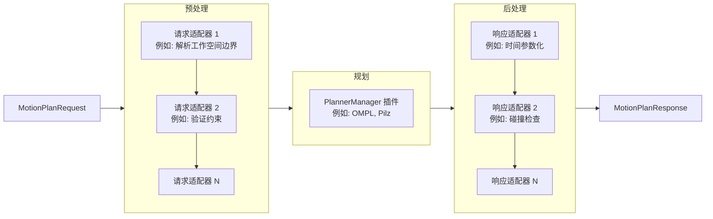

# MoveIt2

Prerequisites:

- [[ROS2建模]]
- [[ROS2Control]]

References:

- [MoveIt2 官方文档](https://moveit.picknik.ai/main/index.html)
- [MoveIt2 Wiki | DeepWiki](https://deepwiki.com/moveit/moveit2/1-moveit-2-overview/)
- [MoveIt2 Wiki | ZRead.AI](https://zread.ai/moveit/moveit2)
- [MoveIt2 视频教程 | Edouard](https://www.udemy.com/course/ros2-moveit2)
- [MoveIt2 运动规划教程 | 周舒畅](https://zsc.github.io/ros2_tutorial/chapter14.html)

## What is MoveIt2?

MoveIt2 is the robotic manipulation platform for ROS 2 and incorporates the latest advances in motion planning, manipulation, 3D perception, kinematics, control, and navigation.

## Install MoveIt2

两种方式：
1. 二进制安装 
2. 源码编译安装

二进制安装：

```bash
sudo apt install ros-humble-moveit*
```

源码编译安装：

拉取源码：
```bash
git clone https://github.com/ros-planning/moveit2_tutorials -b humble --depth 1 moveit2/src/moveit2_tutorials
```
  将工作空间 source 到环境中。安装 vcstool，自动读取 repo 文件并克隆其中的代码：
```bash
sudo apt install python3-vcstool
cd moveit2/src
vcs import < moveit2_tutorials/moveit2_tutorials.repos # 报错就把 repo 中地址加上镜像
```
安装依赖，使用 rosdepc：
```bash
wget http://fishros.com/install -O fishros && . fishros # 选3安装rosdepc
rosdepc update
cd moveit2
rosdepc install --from-paths src --ignore-src -y
```
编译：
```bash
cd moveit2
colcon build --cmake-args -DCMAKE_BUILD_TYPE=Release
```
编译报错找不到 moveit_msgs：
```bash
sudo apt update && sudo apt install -y ros-humble-moveit-msgs
```
编译 moveit_core 因内存不足被系统杀进程，cc1plus 报 Killed 错误
```bash
MAKEFLAGS="-j1" colcon build --executor sequential --cmake-args -DCMAKE_BUILD_TYPE=Release # 使用单核编译，一次只编译一个包，总编译时长约1小时30分钟，填 -j2 能缩短时间至10分钟左右
```
编译 moveit_task_constructor_core 时 Git 子模块拉取失败：
```bash
cd ~/moveit2/src/moveit_task_constructor/
rm -rf core/python/pybind11/ core/src/scope_guard/
nano .gitmodules # 编辑.gitmodules，添加镜像
git submodule update --init --recursive # 重新拉取子模块
```
编译完成后测试：
```bash
ros2 launch moveit2_tutorials demo.launch.py
```

### Update moveit2

从源码安装的好处就是可以及时更新，那么如何通过git更新？

```bash
cd ~/moveit2_ws/src
vcs pull
```

## Control model with MoveIt

### MoveIt Configuration

Create `my_robot_moveit_config` manually, or use the MoveIt Setup Assistant to automatically generate it given a robot description file (URDF or xacro).

- [手动配置](https://moveit.picknik.ai/main/doc/how_to_guides/moveit_configuration/moveit_configuration_tutorial.html)
- [使用Assistant配置 | 视频教程](https://www.bilibili.com/video/BV1rdxdzkES5?p=19)/ [MoveIt Setup Assistant | MoveIt Documentation](https://moveit.picknik.ai/main/doc/examples/setup_assistant/setup_assistant_tutorial.html#)

启动 MoveIt Setup Assistant，创建 MoveIt 配置包：

```bash
ros2 launch moveit_setup_assistant setup_assistant.launch.py
```

注意事项：

- 选择 Xacro 文件时可以选带 `<ros2_control>` 的 xacro，也可以选不带的（如果你是用 macro 写的那就没有选择了），`<ros2_control>` 这类标签对标准 URDF parser 来说是未知的 XML 元素，它不认识，跳过不报错。但是如果带了 `<ros2_control>` 注意最后 MSA 生成的 `config/my_robot.xacro` 会有两份 `<ros2_control>` （不过我们一般都自己写 ros2_control.xacro，不会用它生成的）
- 碰撞矩阵生成时直接拉满采样密度以获得良好的精度，在这一界面，如果 MSA 提示有必然碰撞的 link pairs，可以视情况禁用碰撞
- virtual_joint 不是必需，如果你在 URDF 里面已经定义了 `world → base_link` 的虚拟关节，这里就不用设置了
	- virtual_joint 的类型：如果机械臂底座固定不动就选 fixed，如果可以平面移动就选 planar，可以在三维空间中自由移动就选 floating；
	- virtual_joint 的 parent frame：如果机械臂装在移动底盘上，底盘控制会发送 `odom → base_footprint` 的 TF，此时 parent frame 就是 odom 而不是 world，child link 是 base_footprint
- Planning Group：只需要填 Joints or Chain，arm group 最好填 Chain，这个 Chain 不需要和之前的 virtual_joint 衔接；gripper group 填 Joints；group 的 IK solver 选择参考：[[MoveIt2#IK Solver]]. If the group is not made of links attached in a serial chain. Therefore, the group’s **Kinematic Solver** should be set to **None**
- 跳过 Setup ROS2 Controllers
- Setup Moveit Controllers：gripper_controller 的类型最好选 JointTrajectoryController
- Configure Desired Launch Files：只选 `setup_assistant.launch.py`，其它的没用

当只修改了 URDF 中定义的关节方向或关节限位等，需要重新生成 moveit config：

- 运行已有 config 包下 launch 文件：`setup_assistant.launch.py`
- 重新生成碰撞矩阵，因为关节方向、可运动范围改变了
- 更新 Robot Poses

功能包结构：

```bash
my_robot_moveit_config/
  config/
    my_robot.ros2_control.xacro # 不用，删去
    my_robot.srdf # 机器人语义描述文件，定义运动规划相关信息，如规划组、虚拟关节等，可以直接修改生成的 srdf 文件，无需再次运行 setup_assistant
    my_robot.xacro # include my_robot.ros2_control.xacro & my_robot.urdf.xacro，不用，删去
    joint_limits.yaml # 记得按照自己的硬件配置修改里面的默认设置
    ···
  launch/
    ···
  package.xml
  CMakeLists.txt
  .setup_assistant
```

### 常见问题

编译后运行 demo.launch.py 报错：

```bash
[move_group-3] what(): parameter 'robot_description_planning.joint_limits.joint1.max_velocity' has invalid type: expected [double] got [integer]
```

这是因为在 `joint_limits.yaml` 的 `max_velocity` 定义为整数，而 MoveIt 期望它是一个 double 类型的值，解决方法是将 `joint_limits.yaml` 的 `max_velocity` 定义修改为 double 类型，借此机会，修改 `joint_limits.yaml` 添加加速度限制：

```yaml
  default_velocity_scaling_factor: 0.1 # 默认速度缩放因子，表示实际速度为最大速度的百分之多少，值越小，运动越慢
  default_acceleration_scaling_factor: 0.1 # 默认加速度缩放因子，表示实际加速度为最大加速度的百分之多少，值越小，运动越平滑
  # joint1:
  # ...
  joint6:
    has_velocity_limits: true
    max_velocity: 1.0
    has_acceleration_limits: true
    max_acceleration: 1.0
```

重新编译后运行，发现动作无法正常执行，原因是控制器命名空间出错，解决方法是在 `moveit_controllers.yaml` 中添加：

```yaml
  arm_controller:
    type: FollowJointTrajectory
    joints:
      - joint1
      - joint2
      - joint3
      - joint4
      - joint5
      - joint6
    action_ns: follow_joint_trajectory # 新增语句
    default: true # 新增语句
```

此外，如果 `moveit_controllers.yaml` 中的 controller 名为：arm_group_controller，也应改为与`ros2_controller.yaml` 中同名

## Write launch file for MoveIt

MoveIt 的 `move_group` 必须取得 `robot_description`，但它只用其中的关节、link、碰撞体和 joint limits 来规划；执行时则通过 `moveit_controllers.yaml` 的 action 接口连接已启动的 `arm_controller` / `gripper_controller`

编写自己的launch文件用于启动 MoveIt，创建功能包`my_robot_bringup`

```bash
cd ~/moveit2_ws/src
ros2 pkg create my_robot_bringup
cd my_robot_bringup
rm -rf include/ src/
mkdir launch config
```

在包内 CMakeLists.txt 中删除 build 部分，添加 install 部分：

```cmake
install(
  DIRECTORY launch config
  DESTINATION share/${PROJECT_NAME}
)
```

- 将 MoveIt 配置包中的 ros2_controllers.yaml 移动至`my_robot_bringup/config/`目录下
- 将 MoveIt 配置包中的`my_robot.ros2_control.xacro`移动至`my_robot_description/urdf/`目录下，在`my_robot.urdf.xacro`中 include 该文件，在`my_robot.ros2_control.xacro`中移除所有的`xacro`标签，将剩余的引用变量替换为实际数值：`${name}`替换为`Arm`，`${initial_positions['joint1']}` 替换为`initial_positions.yaml`中定义的值，以此类推

这样做将机器人控制配置移出 MoveIt 配置包，避免被修改，同时也方便移植

下面先按顺序启动各个节点，了解总体流程，再编写最终的 launch 文件：

1. 启动 robot_state_publisher 节点，发布机器人状态信息

   ```bash
   ros2 run robot_state_publisher robot_state_publisher --ros-args -p robot_description:="$(xacro /home/bernard/moveit2_ws/src/my_robot_description/urdf/my_robot.urdf.xacro)"
   ```

1. 启动 ros2_control_node 节点，加载控制器配置文件

   ```bash
   ros2 run controller_manager ros2_control_node --ros-args --params-file ~/moveit2_ws/src/my_robot_bringup/config/ros2_controllers.yaml
   ```

   发现终端没有显示 "Loading hardware"，可能是因为 controller_manager 在寻找私有命名空间下的参数或话题，而 robot_state_publisher 发布的是全局命名空间的话题

    - 解决方法1：重定向话题

      ```bash
      ros2 run controller_manager ros2_control_node --ros-args -r /controller_manager/robot_description:=/robot_description --params-file ~/moveit2_ws/src/my_robot_bringup/config/ros2_controllers.yaml
      ```

    - 解决方法2：直接将 URDF 解析结果作为参数 param 传入:

      ```bash
      ros2 run controller_manager ros2_control_node --ros-args -p robot_description:="$(xacro /home/bernard/moveit2_ws/src/my_robot_description/urdf/my_robot.urdf.xacro)" --params-file ~/moveit2_ws/src/my_robot_bringup/config/ros2_controllers.yaml
      ```

     但使用该方法系统会提示该方式已弃用

1. 启动控制器

   ```bash
   ros2 run controller_manager spawner joint_state_broadcaster
   ros2 run controller_manager spawner arm_controller
   ros2 run controller_manager spawner gripper_controller
   ```

1. 启动 move_group 节点，提供运动规划服务

   ```bash
   ros2 launch my_robot_moveit_config move_group.launch.py
   ```

1. 启动 rviz2

   ```bash
   ros2 run rviz2 rviz2 -d ~/moveit2_ws/src/my_robot_description/rviz/urdf_config.rviz
   ```

   Add MotionPlanning 模块，点击`context`选择 Planing library 为`OMPL`，之后应该可以进行运动规划了

编写最终 launch 文件`my_robot_bringup/launch/bringup.launch.xml`，最终内容见下文

在编写较复杂的 launch 文件后，建议将引用的包添加至`package.xml`的依赖列表中，这样在编译时会检查依赖是否齐全，如果缺失就会自动安装，安装不了则报错，避免运行时才发现缺少依赖包：

```xml
<exec_depend>my_robot_description</exec_depend>
<exec_depend>robot_state_publisher</exec_depend>
<exec_depend>controller_manager</exec_depend>
<exec_depend>rviz2</exec_depend>
<exec_depend>my_robot_moveit_config</exec_depend>
```

编译后运行：

```bash
ros2 launch my_robot_bringup bringup.launch.xml
```

报错："Error: joint [joint1] has no type, check to see if it's a reference. Failed to parse robot description using: urdf_xml_parser/URDFXMLParser"

这是因为在`my_robot.urdf.xacro`中引用了`my_robot.ros2_control.xacro`，导致URDF解析失败，具体原因不详，很奇怪，通过命令行运行时可以正常解析，但是launch文件中就不行

解决方法：参考`my_robot_moveit_config/config/my_robot.urdf.xacro`的写法，创建`my_robot_description/urdf/my_robot.xacro`，内容如下：

```xml
<?xml version="1.0"?>
<robot name="my_robot" xmlns:xacro="http://www.ros.org/wiki/xacro">
  <xacro:include filename="$(find my_robot_description)/urdf/my_robot.urdf.xacro" />
  <xacro:include filename="$(find my_robot_description)/urdf/my_robot.ros2_control.xacro" />
</robot>
```

记得取消`my_robot.urdf.xacro`中对`my_robot.ros2_control.xacro`的引用

最终的 launch 文件内容如下：

```xml
<?xml version="1.0" encoding="UTF-8"?>
<launch>
    <let name="description_path" value="$(find-pkg-share my_robot_description)/urdf/my_robot.xacro"/>
    <let name="rviz_config_path" value="$(find-pkg-share my_robot_bringup)/config/moveit_config.rviz"/>
    
    <node pkg="robot_state_publisher" exec="robot_state_publisher">
        <param name="robot_description" value="$(command 'xacro $(var description_path)')"/>
    </node>

    <node pkg="controller_manager" exec="ros2_control_node">
        <remap from="/controller_manager/robot_description" to="/robot_description"/>
        <param from="$(find-pkg-share my_robot_bringup)/config/ros2_controllers.yaml"/>
    </node>

    <node pkg="controller_manager" exec="spawner" args="joint_state_broadcaster"/>
    <node pkg="controller_manager" exec="spawner" args="arm_controller"/>
    <node pkg="controller_manager" exec="spawner" args="gripper_controller"/>

    <include file="$(find-pkg-share my_robot_moveit_config)/launch/move_group.launch.py"/>

    <node pkg="rviz2" exec="rviz2" output="screen" args="-d $(var rviz_config_path)"/>
</launch>
```

## Moveit cpp API 实例

创建功能包`my_robot_commander_cpp`，编写测试 moveit cpp API 的代码

```bash
ros2 pkg create my_robot_commander_cpp --build-type ament_cmake --dependencies rclcpp
cd my_robot_commander_cpp/src
touch test_moveit.cpp # 测试 moveit cpp API
```

test_moveit.cpp：

```cpp
#include <rclcpp/rclcpp.hpp>
#include <moveit/move_group_interface/move_group_interface.h>

int main(int argc, char **argv)
{
    rclcpp::init(argc, argv); // 初始化 ROS 2
    auto node = std::make_shared<rclcpp::Node>("test_moveit"); // 创建节点，名称为 test_moveit
    rclcpp::executors::SingleThreadedExecutor executor; // 创建单线程执行器
    executor.add_node(node); // 将节点添加到执行器中
    auto spinner = std::thread([&executor](){executor.spin();}); // 把执行器的把 spin() 放到独立线程，后台运行
    // 创建 MoveGroupInterface 对象，填入节点指针和规划组名称 "arm"
    auto arm = moveit::planning_interface::MoveGroupInterface(node, "arm"); 
    arm.setMaxVelocityScalingFactor(1.0); // 设置最大速度缩放因子
    arm.setMaxAccelerationScalingFactor(1.0); // 设置最大加速度缩放因子
    // home to pose_1
    arm.setStartStateToCurrentState(); // 设置起始状态为当前状态
    arm.setNamedTarget("pose_1"); // 设置目标状态为预定义的 "pose_1"
    moveit::planning_interface::MoveGroupInterface::Plan plan1; // 创建规划对象
    // 进行规划并检查是否成功
    bool success = (arm.plan(plan1) == moveit::core::MoveItErrorCode::SUCCESS); 
    // 如果规划成功则执行
    if (success) {
        arm.execute(plan1);
    }
    // pose_1 to pose_2
    arm.setStartStateToCurrentState();
    arm.setNamedTarget("pose_2");
    moveit::planning_interface::MoveGroupInterface::Plan plan2;
    bool success2 = (arm.plan(plan2) == moveit::core::MoveItErrorCode::SUCCESS);
    if (success2) {
        arm.execute(plan2);
    }
    rclcpp::shutdown(); // 关闭 ROS 2
    spinner.join(); // 等待线程结束
    return 0;
}
```

添加以下内容到 CMakeLists.txt 中

```cmake
# find dependencies
find_package(ament_cmake REQUIRED)
find_package(rclcpp REQUIRED)
find_package(moveit_ros_planning_interface REQUIRED)

add_executable(test_moveit src/test_moveit.cpp) # 添加可执行文件
ament_target_dependencies(test_moveit rclcpp moveit_ros_planning_interface) # 添加依赖，第一个参数为目标名

# 安装可执行文件至install目录
install(TARGETS
  test_moveit
  DESTINATION lib/${PROJECT_NAME}/
)
```

添加以下内容到 package.xml 中

```xml
<exec_depend>moveit_ros_planning_interface</exec_depend>
```

编译后运行

```bash
ros2 launch my_robot_bringup bringup.launch.xml
# 另开终端
ros2 run my_robot_commander_cpp test_moveit
```

可以看到机械臂依次运动到预定义的两个位置

上面的代码使用预设的`pose`进行运动规划，还可以通过设置各关节的目标值进行运动规划，例如：

```cpp
// 设置目标关节值，填入各关节的目标位置，顺序应与 urdf 中定义的关节顺序一致
std::vector<double> joints = {1.5, 0.5, 0.0, 1.5, 0.0, -0.7};
arm.setStartStateToCurrentState();
arm.setJointValueTarget(joints);
// 进行规划并执行
```

还可以通过设置目标位姿进行运动规划，例如：

```cpp
// 生成四元数，表示末端执行器的姿态，使用 tf2 库将欧拉角转换为四元数
tf2::Quaternion q;
q.setRPY(3.14, 0.0, 0.0);
q = q.normalize();
// 设置目标位姿，填入位置和姿态信息
geometry_msgs::msg::PoseStamped target_pose;
target_pose.header.frame_id = "base_link";
target_pose.pose.position.x = 0.0;
target_pose.pose.position.y = -0.7;
target_pose.pose.position.z = 0.4;
target_pose.pose.orientation.x = q.getX();
target_pose.pose.orientation.y = q.getY();
target_pose.pose.orientation.z = q.getZ();
target_pose.pose.orientation.w = q.getW();
arm.setStartStateToCurrentState();
arm.setPoseTarget(target_pose);
// 进行规划并执行
```

### Cartesian path planning (C++)

使用笛卡尔路径规划，需要我们定义轨迹`trajectory`

```cpp
// 上文已定义 pose
// Cartesian Path
std::vector<geometry_msgs::msg::Pose> waypoints; // 定义路径点列表
geometry_msgs::msg::Pose pose1 = arm.getCurrentPose().pose; // 将当前位姿赋值给 pose1
pose1.position.z += -0.2; // 修改 pose1 的位置
waypoints.push_back(pose1); // push_back() 将 pose1 添加到路径点列表中
geometry_msgs::msg::Pose pose2 = pose1;
pose2.position.y += 0.2;
waypoints.push_back(pose2);
geometry_msgs::msg::Pose pose3 = pose2;
pose3.position.y += -0.2;
pose3.position.z += 0.2;
waypoints.push_back(pose3);

moveit_msgs::msg::RobotTrajectory trajectory; // 定义轨迹对象
// computeCartesianPath() 计算笛卡尔路径，返回成功规划的路径点占总路径点的比例，参数依次为：路径点列表、每个路径点之间的最大距离、跳跃阈值、轨迹对象、是否启用避障
double fraction = arm.computeCartesianPath(waypoints, 0.01, 0.0, trajectory, true); // 第二个参数越小，规划的路径越接近直线
// 如果成功规划的路径点占总路径点的比例为 1，则执行轨迹
if (fraction > 0.99) { // 这里使用 0.99 而不是 1 是为了容错，避免由于数值误差导致的规划失败
    arm.execute(trajectory);
}
```

### Integrate API into OOP node

使用 MoveIt cpp API 编写一个面向对象的 ROS 2 节点

首先编写一个基本的 ROS2 节点，将节点命名为 `Commander`，在`my_robot_commander_cpp/src/commander_template.cpp`中编写以下代码

```cpp
#include <rclcpp/rclcpp.hpp>
#include <moveit/move_group_interface/move_group_interface.h>

int main(int argc, char **argv)
{
    rclcpp::init(argc, argv);
    auto node = std::make_shared<rclcpp::Node>("commander");
    rclcpp::spin(node);
    rclcpp::shutdown();
    return 0;
}
```

和之前的`test_moveit.cpp`相比，这个节点在主线程直接调用了`rclcpp::spin()`，而没有创建单独的线程来运行执行器，那么代码会阻塞在`spin()`函数上，无法继续执行后续的 MoveIt 相关代码，可以通过订阅一个话题来执行相关代码

下面编写`Commander`类，将 MoveIt 相关的代码封装在类的成员函数中，订阅一个话题用于控制夹爪的开合，代码如下：

```cpp
#include <rclcpp/rclcpp.hpp>
#include <moveit/move_group_interface/move_group_interface.h>
#include <example_interfaces/msg/bool.hpp>
using MoveGroupInterface = moveit::planning_interface::MoveGroupInterface; // 定义别名，简化代码
using Bool = example_interfaces::msg::Bool;
using namespace std::placeholders; // 引入 std::placeholders 命名空间，方便使用占位符 _1、_2 等
class Commander // 包含 node 的类而不是作为 node 的类
{
public:
    Commander(std::shared_ptr<rclcpp::Node> node) // 类的构造函数，接受一个 ROS2 节点指针作为参数
    {
        node_ = node; // 将传入的节点指针赋值给类的成员变量 node_
        arm_ = std::make_shared<MoveGroupInterface>(node_, "arm"); // make_shared() 用于创建对象并返回指向该对象的智能指针 shared_ptr，这里创建了一个 MoveGroupInterface 对象，传入节点指针和规划组名称 "arm"
        arm_->setMaxVelocityScalingFactor(1.0); // arm_ 是一个智能指针，使用 -> 运算符调用成员函数
        arm_->setMaxAccelerationScalingFactor(1.0);
        gripper_ = std::make_shared<MoveGroupInterface>(node_, "gripper");
        // 创建一个订阅者，订阅 "open_gripper" 话题，消息类型为 Bool，队列大小为 10，回调函数为 openGripperCallback，使用 std::bind 将成员函数绑定到当前对象上
        gripper_cmd_sub_ = node_->create_subscription<Bool>("cmd_gripper", 10, std::bind(&Commander::gripperCmdCallback, this, _1));
    }
    void goToNamedTarget(const std::string &name)
    {
        arm_->setStartStateToCurrentState();
        arm_->setNamedTarget(name);
        planAndExecute(arm_);
    }
    void goToJointTarget(const std::vector<double> &joints)
    {
        arm_->setStartStateToCurrentState();
        arm_->setJointValueTarget(joints);
        planAndExecute(arm_);
    }
    void goToPoseTarget(double x, double y, double z, 
                        double roll, double pitch, double yaw, bool cartesian_path=false)
    {
        tf2::Quaternion q;
        q.setRPY(roll, pitch, yaw);
        q = q.normalize();
        geometry_msgs::msg::PoseStamped target_pose;
        target_pose.header.frame_id = "base_link";
        target_pose.pose.position.x = x;
        target_pose.pose.position.y = y;
        target_pose.pose.position.z = z;
        target_pose.pose.orientation.x = q.getX();
        target_pose.pose.orientation.y = q.getY();
        target_pose.pose.orientation.z = q.getZ();
        target_pose.pose.orientation.w = q.getW();
        arm_->setStartStateToCurrentState();
        if (!cartesian_path) {
            arm_->setPoseTarget(target_pose);
            planAndExecute(arm_);
        } else {
            std::vector<geometry_msgs::msg::Pose> waypoints;
            waypoints.push_back(target_pose.pose);
            moveit_msgs::msg::RobotTrajectory trajectory;
            double fraction = arm_->computeCartesianPath(waypoints, 0.01, 0.0, trajectory, true);
            if (fraction == 1) {
                arm_->execute(trajectory);
            }
        }
    }
    void openGripper()
    {
        gripper_->setStartStateToCurrentState();
        gripper_->setNamedTarget("gripper_open");
        planAndExecute(gripper_);
    }
    void closeGripper()
    {
        gripper_->setStartStateToCurrentState();
        gripper_->setNamedTarget("gripper_closed");
        planAndExecute(gripper_);
    }
private:
    void planAndExecute(const std::shared_ptr<MoveGroupInterface> &interface)
    {
        MoveGroupInterface::Plan plan;
        bool success = (interface->plan(plan) == moveit::core::MoveItErrorCode::SUCCESS);
        if (success) {
            interface->execute(plan);
        }
    }
    void gripperCmdCallback(const Bool &msg)
    {
        if (msg.data) {
            openGripper();
        } else {
            closeGripper();
        }
    }
    std::shared_ptr<rclcpp::Node> node_;
    std::shared_ptr<MoveGroupInterface> arm_;
    std::shared_ptr<MoveGroupInterface> gripper_;
    rclcpp::Subscription<Bool>::SharedPtr gripper_cmd_sub_; // 订阅器成员变量
};
```

在 main 函数中创建 Commander 对象并调用成员函数测试

```cpp
// auto node = std::make_shared<rclcpp::Node>("commander");
auto commander = Commander(node);
// rclcpp::spin(node);
```

在package.xml中添加依赖，在 CMakeLists.txt 中添加可执行文件和依赖

```cmake
find_package(ament_cmake REQUIRED)
find_package(rclcpp REQUIRED)
find_package(moveit_ros_planning_interface REQUIRED)
find_package(example_interfaces REQUIRED)

add_executable(test_moveit src/test_moveit.cpp)
ament_target_dependencies(test_moveit rclcpp moveit_ros_planning_interface)

add_executable(commander src/commander_template.cpp)
ament_target_dependencies(commander rclcpp moveit_ros_planning_interface example_interfaces)

install(TARGETS
  test_moveit
  commander
  DESTINATION lib/${PROJECT_NAME}/
)
```

编译后运行

```bash
ros2 launch my_robot_bringup bringup.launch.xml
# 另开终端
ros2 run my_robot_commander_cpp commander
# 另开终端
ros2 topic info /cmd_gripper # 查看话题信息
ros2 topic pub -1 /cmd_gripper example_interfaces/msg/Bool "{data: true}" # 发布消息打开夹爪
ros2 topic pub -1 /cmd_gripper example_interfaces/msg/Bool "{data: false}" # 发布消息关闭夹爪
```

现在我们想增加更多的订阅话题，实现通过 joints value 和 target pose 控制机械臂运动的功能

对于 joints value 首先要选定话题消息类型，使用`example_interfaces/msg/Flaot64MultiArray`

```cpp
// 1. 引用消息类型
#include <example_interfaces/msg/float64_multi_array.hpp>
using FloatArray = example_interfaces::msg::Float64MultiArray;
// 2. 在私有成员变量中定义一个订阅器指针
rclcpp::Subscription<FloatArray>::SharedPtr joint_cmd_sub_;
// 3. 定义回调函数
void jointCmdCallback(const FloatArray &msg)
{
    auto joints = msg.data;
    if (joints.size() == 6) {
        goToJointTarget(joints);
    } else {
        RCLCPP_ERROR(node_->get_logger(), "Invalid joint command size: expected 6, got %zu", joints.size());
    }
}
// 4. 在构造函数中创建订阅器
joint_cmd_sub_ = node_->create_subscription<FloatArray>("cmd_joint", 10, std::bind(&Commander::jointCmdCallback, this, _1));
```

#### Custom Message

对于 target pose ，使用`geometry_msgs/msg/PoseStamped`将无法覆盖`bool cartesian_path`，此外，在上面的两个话题中，我们使用了example_interfaces，在实际应用中不应使用示例消息，而是使用自定义消息(在ROS2中，我们使用 interface 统称msg, srv, action)

- [interface 列表](https://github.com/ros2/common_interfaces)
- [自定义消息](https://roboticsbackend.com/ros2-create-custom-message/)

创建消息包：

```bash
cd ~/moveit2_ws/src
ros2 pkg create my_robot_interfaces
cd my_robot_interfaces
rm -r src/ include/
mkdir -p msg
```

package.xml

```xml
<!-- 添加 -->
  <buildtool_depend>rosidl_default_generators</buildtool_depend>
  <exec_depend>rosidl_default_runtime</exec_depend>
  <member_of_group>rosidl_interface_packages</member_of_group>
  <!-- <member_of_group> 似乎不能出现在 <test_depend> 之前 -->
```

CMakeLists.txt

```cmake
# 添加
find_package(rosidl_default_generators REQUIRED)
rosidl_generate_interfaces(${PROJECT_NAME}
  "msg/PoseCommand.msg"
 )
ament_export_dependencies(rosidl_default_runtime)
```

创建消息文件：`msg/PoseCommand.msg`

```msg
float64 x
float64 y
float64 z
float64 roll
float64 pitch
float64 yaw
bool cartesian_path
```

编译后测试：

```bash
colcon build --packages-select my_robot_interfaces
source install/setup.bash
ros2 interface show my_robot_interfaces/msg/PoseCommand
```

在使用自定义消息之前，在`.vscode/c_cpp_properties.json`中的`includePath`中添加: `"/home/bernard/moveit2_ws/install/my_robot_interfaces/include/**"`

还需要在`my_robot_commander_cpp/package.xml`中添加`my_robot_interfaces`的依赖，`my_robot_commander_cpp/CMakeLists.txt`中添加：

```cmake
find_package(my_robot_interfaces REQUIRED)
ament_target_dependencies(commander rclcpp moveit_ros_planning_interface example_interfaces my_robot_interfaces)
```

按照之前所述添加Subscriber的流程，订阅`"cmd_pose"`，定义回调函数如下：

```cpp
void poseCmdCallback(const PoseCmd &msg)
{
    goToPoseTarget(msg.x, msg.y, msg.z, msg.roll, msg.pitch, msg.yaw, msg, cartesian_path);
}
```

编译后运行：

```bash
ros2 launch my_robot_bringup bringup.launch.xml
# 另开终端
ros2 run my_robot_commander_cpp commander
# 另开终端
ros2 topic info /cmd_joint
ros2 topic pub -1 /cmd_joint example_interfaces/msg/Float64MultiArray "{data: [0.5, 0.5, 0.5, 0.5, 0.5, 0.5]}"
ros2 topic info /cmd_pose
ros2 topic pub -1 /cmd_pose my_robot_interfaces/msg/PoseCommand "{x: 0.7, y: 0.0, z: 0.4, roll: 3.14, pitch: 0.0, yaw: 0.0, cartesian_path: false}"
ros2 topic pub -1 /cmd_pose my_robot_interfaces/msg/PoseCommand "{x: 0.7, y: 0.0, z: 0.7, roll: 3.14, pitch: 0.0, yaw: 0.0, cartesian_path: true}"
```

## Planning Scene

- [tutorial planning_around_objects 使用PlanningSceneInterface，提供了FurtherReading](https://moveit.picknik.ai/main/doc/tutorials/planning_around_objects/planning_around_objects.html)
-[tutorial planning_scene_monitor](https://www.ncnynl.com/ros2docs/cn/moveit2/doc/examples/planning_scene_monitor/planning_scene_monitor_tutorial.html)
-[tutorial planning_scene_ros_api](https://www.ncnynl.com/ros2docs/cn/moveit2/doc/examples/planning_scene_ros_api/planning_scene_ros_api_tutorial.html)

- PlanningScene 类是包含 RobotState 和任意数量的碰撞对象的世界快照。PlanningScene可用于碰撞检查以及获取有关环境的信息
- PlanningSceneMonitor 类使用 ROS 接口包装 PlanningScene，以使 PlanningScene 保持最新状态
- PlanningSceneInterface 类是 MoveIt 中用于管理和更新规划场景的接口，提供了添加、删除、修改场景中物体和环境信息的功能，相较于PlanningScene，PlanningSceneInterface 提供了更高层次的抽象，简化了与规划场景交互的过程，适用于大多数常见的场景管理任务

### Add an object into the environment

```cpp
#include <moveit/move_group_interface/move_group_interface.h>
#include <shape_msgs/msg/solid_primitive.hpp>
#include <moveit_msgs/msg/collision_object.hpp>
#include <geometry_msgs/msg/pose.hpp>

//定义一个lambda函数，直接赋值给collision_box变量
auto const collision_box = [frame_id = <MoveGroupName>.getPlanningFrame()]() {
    geometry_msgs::msg::Pose box_pose;
    box_pose.orientation.w = 1.00;
    box_pose.position.x = 0.00;
    box_pose.position.y = 0.50;
    box_pose.position.z = 0.60;

    shape_msgs::msg::SolidPrimitive primitive;
    primitive.type = primitive.BOX;
    primitive.dimensions.resize(3);
    primitive.dimensions[primitive.BOX_X] = 0.30;
    primitive.dimensions[primitive.BOX_Y] = 0.10;
    primitive.dimensions[primitive.BOX_Z] = 0.30;

    moveit_msgs::msg::CollisionObject collision_object;
    collision_object.id = "box";
    collision_object.header.frame_id = frame_id.empty() ? "base_link" : frame_id;
    collision_object.primitives.push_back(primitive);
    collision_object.primitive_poses.push_back(box_pose);
    collision_object.operation = collision_object.ADD;
    return collision_object;
}();
```

```python
from geometry_msgs.msg import Pose
from shape_msgs.msg import SolidPrimitive
from moveit_msgs.msg import CollisionObject

def _make_collision_box(self, object_id:str, dimensions:list[float], pose_values:list[float])->CollisionObject:
    pose = Pose()
    pose.position.x = float(pose_values[0])
    pose.position.y = float(pose_values[1])
    pose.position.z = float(pose_values[2])
    pose.orientation.x = float(pose_values[3])
    pose.orientation.y = float(pose_values[4])
    pose.orientation.z = float(pose_values[5])
    pose.orientation.w = float(pose_values[6])

    primitive = SolidPrimitive()
    primitive.type = SolidPrimitive.BOX
    primitive.dimensions = [float(dimensions[0]), float(dimensions[1]), float(dimensions[2])]

    collision_object = CollisionObject()
    collision_object.id = object_id
    collision_object.header.frame_id = self.frame_id
    collision_object.primitives.append(primitive)
    collision_object.primitive_poses.append(pose)
    collision_object.operation = CollisionObject.ADD
    return collision_object

collision_box = _make_collision_box("box", [0.3, 0.1, 0.3], [0.0, 0.5, 0.6, 0.0, 0.0, 0.0, 1.0])
```

从上面的示例代码中可以看出构造碰撞体的一般步骤：

1. 设置物体的 ID 和参考坐标系（frame_id）
2. 定义物体的位姿位置和姿态，通常使用 geometry_msgs/Pose 消息类型
3. 定义物体的形状和尺寸，通常使用 shape_msgs/SolidPrimitive 消息类型
   - type类型包括 BOX、SPHERE、CYLINDER 和 CONE(锥体)
   - demensions 数组的长度和含义取决于 type，例如 BOX 需要三个维度（长、宽、高），SPHERE 需要一个维度（半径），CYLINDER 需要两个维度（半径和高度）
4. 创建一个 moveit_msgs/CollisionObject 消息对象，填入物体的 ID、参考坐标系、形状和位姿信息，并设置操作类型（例如 ADD、REMOVE、MOVE等）

构造好碰撞体变量后，将其添加至场景中的最简步骤：

1. 创建 PlanningSceneInterface 对象
2. 设置碰撞体的操作类型为 ADD，此步骤在上面的代码中已经完成
3. 调用 applyCollisionObject() 方法将碰撞体添加到场景中

```cpp
#include <moveit/planning_scene_interface/planning_scene_interface.h>
moveit::planning_interface::PlanningSceneInterface planning_scene_interface;
planning_scene_interface.applyCollisionObject(collision_box);
```

在python(moveit2)中，不存在PlanningSceneInterface这个类，需要走 PlanningScene 消息 + /apply_planning_scene 服务的方式来更新场景

### Attach or detach an object from the robot

附加一个对象需要两个操作

1. 从环境中移除原始对象
2. 将物体连接到机器人

### Remove the object from the collision world

## Pipeline

在 MoveIt2 中，管线（Pipeline）是指一系列连续的处理步骤，用于完成特定的任务，例如运动规划、碰撞检测、路径优化等。每个步骤都可以看作是一个独立的模块，负责处理输入数据并生成输出结果，这些模块可以组合在一起形成一个完整的处理流程

### Perception Pipeline

- [tutorial perception_pipeline](https://moveit.picknik.ai/main/doc/examples/perception_pipeline/perception_pipeline_tutorial.html)
- [感知原理](https://moveit.picknik.ai/main/doc/concepts/planning_scene_monitor.html)
- [手眼标定](https://moveit.picknik.ai/main/doc/examples/hand_eye_calibration/hand_eye_calibration_tutorial.html)
- [深度学习抓取](https://moveit.picknik.ai/main/doc/examples/moveit_deep_grasps/moveit_deep_grasps_tutorial.html)

### Planning Pipeline

Planning Pipeline 将规划器插件与适配器插件串联成一个连贯的运动规划工作流。它在[planning_pipeline](https://github.com/moveit/moveit2/blob/main/moveit_ros/planning/planning_pipeline/src/planning_pipeline.cpp)中实现，使用 [[ROS2Pluginlib]] 进行运行时插件加载，这意味着你可以完全通过配置来替换规划器或添加前/后处理适配器，无需重新编译

Planning Pipeline 分三个连续阶段处理规划请求，其实现在`PlanningPipeline::generatePlan`函数中：



- 预处理阶段：PlanningRequestAdapters 对输入的 MotionPlanRequest 进行修改或增强，例如解析工作空间边界、验证约束条件等。默认的适配器配置见[default_request_adapters_plugin_description.xml](https://github.com/moveit/moveit2/blob/main/moveit_ros/planning/default_request_adapters_plugin_description.xml)，该xml文件利用了 pluginlib 的机制，即通过配置文件指定从库中加载哪些适配器插件类
- 规划阶段：PlannerManager 加载[[MoveIt2#Motion Planner]]进行规划，支持加载多个规划器插件依次尝试——前一个规划器的解作为后一个的参考轨迹（通过 trajectory_constraints 传递）
- 后处理阶段：PlanningResponseAdapters 对规划结果进行修改或增强，例如rviz可视化、碰撞检查等，然后生成 MotionPlanResponse，即最终的规划结果。默认的适配器配置见[default_response_adapters_plugin_description.xml](https://github.com/moveit/moveit2/blob/main/moveit_ros/planning/default_response_adapters_plugin_description.xml)

## Motion Planner

MoveIt2 内置支持 4 种运动规划器插件，代码见[moveit_planners](https://github.com/moveit/moveit2/tree/main/moveit_planners):

- **OMPL** — 采样型规划器
  最常用的规划器，内含大量采样算法：RRT、RRT*、PRM、BIT*、FMT、KPIECE 等。适合通用场景，对复杂约束和自由空间搜索能力强，但路径质量依赖后处理平滑
- **CHOMP** — 协变梯度优化器
  基于协变哈密顿优化的轨迹优化方法。从一条初始轨迹出发，通过梯度下降迭代优化，减少碰撞代价和光滑性代价。适合对初始路径做局部优化，但容易陷入局部极小值
- **STOMP** — 随机轨迹优化器
  基于随机扰动的轨迹优化方法。不依赖梯度，通过在当前轨迹附近添加噪声采样多条候选轨迹，选取代价最小的更新。无需梯度意味着可以处理不可导的代价函数，且天然避局部极小值
- **Pilz 工业规划器**
  专为工业场景设计的确定性规划器，支持：
  - PTP（点到点运动）
  - LIN（直线插补）
  - CIRC（圆弧插补）
  不采样、不优化——直接计算解析轨迹，可重复性强，适合工业重复作业

| 规划器 | 类型 | 路径质量 | 可重复性 | 适用场景 |
| --- | --- | --- | --- | --- |
| OMPL | 采样型 | 中等（需后处理） | 不确定性 | 通用、复杂环境 |
| CHOMP | 梯度优化 | 较好 | 确定性 | 路径平滑、避障优化 |
| STOMP | 随机优化 | 较好 | 不确定性 | 不可导代价函数、避局部极小值 |
| Pilz | 解析计算 | 最优 | 完全确定性 | 工业重复作业（PTP/LIN/CIRC） |

所有这些插件都继承自基类：`planning_interface::PlannerManager`，由 Planning Pipeline 在运行时通过 pluginlib 动态加载

当 OMPL 等采样规划器需要为目标约束（如"末端到达某个位姿"）生成合法的关节空间配置时，它调用`ConstraintSampler`，而`ConstraintSampler`内部调用 [[MoveIt2#IK Solver]] 来求解 IK，获取满足约束的关节配置。因此 IK 求解器是采样规划器能否成功生成路径的关键因素之一

## IK Solver

IK求解器（Inverse Kinematics Solver）是 Motion Planner 中的关键组件，负责逆运动学解算。MoveIt2 内置了 4 种 IK求解器插件，全部继承自基类[kinematics::KinematicsBase](https://github.com/moveit/moveit2/blob/main/moveit_core/kinematics_base/src/kinematics_base.cpp)，这个基类定义了 IK求解器的核心接口

内置的 IK求解器插件见[moveit_kinematics](https://github.com/moveit/moveit2/tree/main/moveit_kinematics)，包括：

- kdl_kinematics_plugin/KDLKinematicsPlugin
- ikfast_kinematics_plugin/IKFastKinematicsPlugin
- cached_ik_kinematics_plugin/CachedIKKinematicsPlugin
- srv_kinematics_plugin/SRVKinematicsPlugin

除了这些内置插件，还有第三方插件，例如:

- [pick_ik](https://github.com/PickNikRobotics/pick_ik)
  - pick_ik 结合了全局优化器和局部优化器。全局优化器利用进化算法在解空间中探索不同的解决方案，从而找到全局最优解。在获得全局优化器的结果之后，局部优化器会采用梯度下降法对解进行迭代优化。局部优化器以全局优化器提供的潜在最优解为输入，旨在提高其准确性，最终达到最优解
  - 部署参考[pick_ik_tutorial](https://moveit.picknik.ai/main/doc/how_to_guides/pick_ik/pick_ik_tutorial.html)
- [trac_ik](https://bitbucket.org/traclabs/trac_ik/src/rolling/)
  - trac-ik 通过结合 KDL 和 SQP（Sequential Quadratic Programming），并行运行多个求解器实例，提供了更快的求解速度和更高的成功率，尤其适用于冗余机械臂和复杂约束场景
  - 部署参考[trac_ik_tutorial](https://moveit.picknik.ai/main/doc/how_to_guides/trac_ik/trac_ik_tutorial.html)

### IK 求解器插件配置

运动学插件通过 Moveit Setup Assistant 生成的 kinematics.yaml 进行配置。可以指定求解器类型、它服务的规划组以及特定于求解器的参数：

```yaml
<move_group_name>:
  kinematics_solver: kdl_kinematics_plugin/KDLKinematicsPlugin
  kinematics_solver_search_resolution: 0.005
  kinematics_solver_timeout: 0.05
  kinematics_solver_attempts: 3
```

- kinematics_solver_search_resolution：冗余关节的离散搜索步长，单位是弧度。这个参数只在机械臂有冗余关节（即 DOF > 6）时才有实质意义。KDL 会把冗余关节在其关节范围内按这个步长离散采样，对每个固定值求解其余关节的 IK。步长越小，搜索越密集，找到解的概率越高，但耗时也越长
- kinematics_solver_timeout: 单次 IK 求解的时间上限，单位是秒。直接对应 KDL 的`searchPositionIK()`里的超时循环，在这个时间窗口内，KDL 会：
  - 第 1 次用给定的 seed state 迭代求解
  - 失败后随机生成新的 seed，继续迭代
  - 直到找到解或超时
- kinematics_solver_attempts: 这个参数 KDL 插件本身并不读取，它是 KinematicsPluginLoader 读取的参数，含义是在超时后，上层最多再重新发起几次完整的 IK 调用。每次调用都是一个新的、完整的 timeout 时间窗口。因此总的 IK 求解时间上限 = kinematics_solver_timeout * (1 + kinematics_solver_attempts)

### 5-DOF 机械臂的 IK 求解

5-DOF 机械臂由于缺乏一个自由度，无法在所有情况下找到满足末端位姿的解，因此 IK 求解器可能会失败。解决方法包括：

- 给机械臂模型添加一个虚拟关节，补齐末端执行器的自由度，使其成为 6-DOF 机械臂，从而使 IK 求解器能够找到解。这样做的缺点是你需要在实际控制时忽略这个虚拟关节的运动，此外虚拟关节的运动不对应任何真实连杆运动，可能产生规划上合法但执行上不可达的轨迹
- 在规划时放宽约束，例如只约束位置而非姿态，或者允许一定的姿态误差，以增加 IK 求解成功的概率
  - 只约束位置：默认的 KDL 求解器支持只约束位置的 IK 求解，可以在 kinematics.yaml 配置中设置 `position_only_ik: true` 来启用位置约束模式，或者将`setPoseTarget()`替换为`setPositionTarget()`来只设置位置目标
  - 允许姿态误差：可以在 kinematics.yaml 中设置 `orientation_vs_position: 0.1`，降低姿态权重。也可以在规划请求中设置 `goal_constraints` 的 `position_constraints` 和 `orientation_constraints`，并为姿态约束设置较大的容忍度（tolerance），以增加 IK 求解成功的概率。也可以选择只指定某一个姿态分量的约束，例如只约束 roll 角，而不约束 pitch 和 yaw，实现方法是创建一个 `orientation_constraints`，但只设置 roll 角的约束，并将 pitch 和 yaw 的约束设置为较大的容忍度
  - 一些辅助措施：
    - 适当增大 `kinematics_solver_timeout`，给 KDL 更多时间做随机重采样，`kinematics_solver_attempts`也可以适当增加，进一步提高成功率
    - 注意`setPoseTarget()`或`setPositionTarget()`会让 MoveIt 在规划阶段继续做 IK 采样，为了增加成功率，可以在 IK 求解器计算出关节解后，直接使用 `setJointValueTarget()` 来设置关节目标，跳过 IK 采样阶段
    - 更换 IK Solver，可以选择 pick_ik

## MoveGroupInterface

MoveGroupInterface 是 MoveIt 最高层的 C++ API，将 move_group 节点暴露的所有 ROS 2 action、service 和 topic 封装到一个直观的单一类中。适合大多数需要运动规划和执行，但不需要 [[MoveIt2#MoveItCpp]] 提供的细粒度控制的应用

## MoveItCpp

Prerequisites:

- [[Cpp#Eigen]]

## MoveIt Task Constructor

- [tutorial moveit_task_constructor](https://moveit.picknik.ai/main/doc/concepts/moveit_task_constructor/moveit_task_constructor.html)
- [Pick and Place with MoveIt Task Constructor](https://moveit.picknik.ai/main/doc/tutorials/pick_and_place_with_moveit_task_constructor/pick_and_place_with_moveit_task_constructor.html)
- [github moveit_task_constructor](https://github.com/moveit/moveit_task_constructor/tree/ros2/)

MoveIt任务构建器（MTC）框架帮助将复杂的规划任务拆解为多个相互依赖的Stage，使用MoveIt来解决Stage，Stage中的信息会通过InterfaceState对象传递


每个Stage都有不同的功能，可以分为三个阶段：

- Generator stage: 生成初始运动轨迹或状态，为后续阶段提供初始条件
- Propagator stage: 在不同阶段之间传播状态信息，进行状态转换，例如从关节空间转换到笛卡尔空间
- Connector stage: 连接不同的Stage，实现信息的传递和转换

官方 API 文档入口：

- [MTC API reference](https://moveit.github.io/moveit_task_constructor/api.html)
- [MTC C++ API (Doxygen)](https://moveit.github.io/moveit_task_constructor/_static/index.html)
- [MoveIt 2 API 主页](https://moveit.picknik.ai/main/doc/api/api.html)
- [MTC msgs (ROS 2 Rolling)](https://docs.ros.org/en/rolling/p/moveit_task_constructor_msgs/)

## rviz 配置

```rviz
# 关闭plan轨迹的播放循环
Loop Animation: false
# 显示末端执行器轨迹（蓝线）
          wrist_link:
            Alpha: 1
            Show Axes: false
            Show Trail: true
            Value: true
# 显示的轨迹长度
Trail Step Size: 100
```
