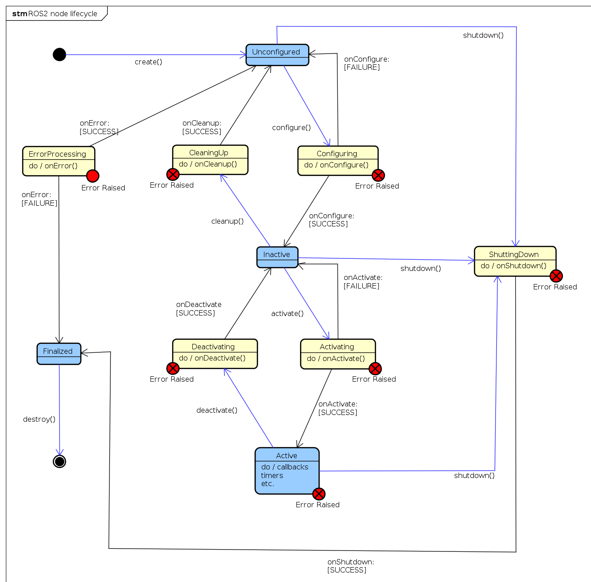

# ROS2 Node

在ROS2中，节点（Node）是ROS2系统中的基本执行单元。每个节点都是一个独立的进程，可以在不同的机器上运行，并通过ROS2的通信机制进行交互

ROS2中提供了两种节点类型：

- `Node()`是和ROS1中一样的节点基类
- `LifecycleNode()`是可管理状态的节点基类

## Node

### CLI Tools

```bash
ros2 node list # 列出当前系统中所有正在运行的节点
ros2 node info <node_name> # 获取指定节点的信息，包括订阅的话题、发布的话题、服务、参数等
ros2 node ping <node_name> # 检测指定节点是否在线
ros2 node kill <node_name> # 终止指定节点的运行
```

## Lifecycle Node

references:

- [Managed nodes](https://design.ros2.org/articles/node_lifecycle.html)
- [使用LifecycleNode管理节点起停等状态](https://www.guyuehome.com/wap/detail?id=1825484898194784258)

ROS2 引入了托管节点(Managed Nodes)的概念，这类节点也被称为生命周期节点(LifecycleNode)，旨在解决 ROS1 中的以下问题：

- 节点的启动无序，没有考虑节点启动时存在的相互依赖关系
- 无法控制节点的状态，当要关闭某些功能时只能直接关闭节点

LifecycleNode 内部包含一个**有限状态机**，其状态分为两类：

- Primary States (steady states):
  - unconfigured：当一个节点被创建时，它首先会进入到 Unconfigured 状态
  - inactive：在这个状态下，节点已经被配置好了，但不响应 topic 等数据交互，下一步激活就可以正常执行功能
  - active：该状态是节点的运行状态，可以接受数据交互，执行功能
  - finalized：该状态是节点待销毁前的一个状态。在该状态下执行destroy() 将释放节点的资源
- Transition States (intermediate states):
  - configuring
  - activating
  - deactivating
  - cleaningup
  - shuttingdown
  - errorprocessing

状态间的转换如下图所示：



### LifecycleNode 编程

从图上可以看出，LifecycleNode 类型节点切换状态是通过执行一系列的函数实现的。这些函数在继承 LifecycleNode 类型节点时需要重新实现
> 需要注意的是，LifecycleNode 类型节点目前只可以在 C++ 中使用

在 `rclcpp_lifecycle/node_interfaces/lifecycle_node_interface.hpp` 中定义了以下函数：

```cpp
class LifecycleNodeInterface
{
protected:
  RCLCPP_LIFECYCLE_PUBLIC // 宏定义，用于导出符号使其在库外可见
  LifecycleNodeInterface() {}
public:
  enum class CallbackReturn : uint8_t // 定义一个枚举类型 CallbackReturn，表示回调函数的返回值
  {
    SUCCESS = lifecycle_msgs::msg::Transition::TRANSITION_CALLBACK_SUCCESS,
    FAILURE = lifecycle_msgs::msg::Transition::TRANSITION_CALLBACK_FAILURE,
    ERROR = lifecycle_msgs::msg::Transition::TRANSITION_CALLBACK_ERROR
  };
  RCLCPP_LIFECYCLE_PUBLIC
  virtual CallbackReturn // 定义一个纯虚函数 on_configure，需要在派生类中实现
  on_configure(const State & previous_state); // 用const定义强引用参数（不可修改原对象，避免复制）
  // 还有on_cleanup(), on_activate(), on_deactivate(), on_shutdown(), on_error()，以及空析构函数
}
```

一个简单的 LifecycleNode 类型节点示例如下：

```cpp
#include <memory>
#include <string>

#include "rclcpp/rclcpp.hpp"
#include "rclcpp_lifecycle/lifecycle_node.hpp"
#include "rclcpp_lifecycle/lifecycle_publisher.hpp"
#include "std_msgs/msg/string.hpp"

using CallbackReturn = rclcpp_lifecycle::node_interfaces::LifecycleNodeInterface::CallbackReturn;

class MyLifecycleNode : public rclcpp_lifecycle::LifecycleNode
{
public:
  explicit MyLifecycleNode(const std::string & node_name)
  : rclcpp_lifecycle::LifecycleNode(node_name)
  {
  }
  // 该函数主要负责配置好节点，包括初始化节点内要使用的资源，读取参数，新建话题发布器订阅器，服务，action等等
  // onConfigure()运行成功，节点将从Unconfigured切换到Inactive状态，如果运行失败则仍然处于Unconfigured状态。如果运行返回错误则进行错误处理，即执行onError()
  CallbackReturn on_configure(const rclcpp_lifecycle::State & previous_state) override
  {
    (void)previous_state;
    publisher_ = create_publisher<std_msgs::msg::String>("lifecycle_chatter", 10);
    RCLCPP_INFO(get_logger(), "on_configure: create publisher");
    return CallbackReturn::SUCCESS;
  }
  // 在该函数里一般做一些节点功能运行前的最后准备工作。比如激活话题订阅器发布器等等
  // onActivate()运行成功，节点将从Inactive切换到Active状态。如果运行返回错误则进行错误处理，即执行onError()
  CallbackReturn on_activate(const rclcpp_lifecycle::State & previous_state) override
  {
    (void)previous_state;
    if (publisher_) {
      publisher_->on_activate();
      std_msgs::msg::String msg;
      msg.data = "Lifecycle node activated";
      publisher_->publish(msg);
    }
    RCLCPP_INFO(get_logger(), "on_activate: publisher activated and a message published");
    return CallbackReturn::SUCCESS;
  }
  // 在该函数里执行的操作一般与onActivate()相反。比如复位话题订阅器发布器等等
  // onDeactivate()运行成功，节点将从Active切换到Inactive状态。如果运行返回错误则进行错误处理，即执行onError()
  CallbackReturn on_deactivate(const rclcpp_lifecycle::State & previous_state) override
  {
    (void)previous_state;
    if (publisher_) {
      publisher_->on_deactivate();
    }
    RCLCPP_INFO(get_logger(), "on_deactivate: publisher deactivated");
    return CallbackReturn::SUCCESS;
  }
  // 主要用于清除节点的状态。使节点内各状态数据恢复到节点刚刚创建的时候
  // onCleanup()运行成功，节点将从Inactive切换到Unconfigured状态。如果运行返回错误则进行错误处理，即执行onError()
  CallbackReturn on_cleanup(const rclcpp_lifecycle::State & previous_state) override
  {
    (void)previous_state;
    publisher_.reset();
    RCLCPP_INFO(get_logger(), "on_cleanup: release resources");
    return CallbackReturn::SUCCESS;
  }
  // 在这里主要执行节点销毁前的一些操作。除了Finalized状态外，其他任何状态下都可以运行该函数使节点状态切换至Finalized状态
  // onShutdown()运行成功，节点将目前状态切换到Finalized状态。如果运行返回错误则进行错误处理（即onError()
  CallbackReturn on_shutdown(const rclcpp_lifecycle::State & previous_state) override
  {
    (void)previous_state;
    RCLCPP_INFO(get_logger(), "on_shutdown: node is shutting down");
    return CallbackReturn::SUCCESS;
  }
  // 在任何状态下，执行状态转换函数返回错误(ERROR)时，节点都会执行on_error()
  // 如果执行成功则节点转换到Unconfigured状态。如果执行失败则节点转换到Finalized状态
  CallbackReturn on_error(const rclcpp_lifecycle::State & previous_state) override
  {
    (void)previous_state;
    publisher_.reset();
    RCLCPP_ERROR(get_logger(), "on_error: cleanup after transition failure");
    return CallbackReturn::SUCCESS;
  }

private:
  using LifecycleStringPublisher = rclcpp_lifecycle::LifecyclePublisher<std_msgs::msg::String>;
  LifecycleStringPublisher::SharedPtr publisher_;
};

int main(int argc, char * argv[])
{
  rclcpp::init(argc, argv);
  auto lifecycle_node = std::make_shared<MyLifecycleNode>("my_lifecycle_node");
  rclcpp::executors::SingleThreadedExecutor exec;
  exec.add_node(lifecycle_node->get_node_base_interface()); // 需要将LifecycleNode的NodeBaseInterface添加到executor中才能执行生命周期状态转换
  RCLCPP_INFO(lifecycle_node->get_logger(), "Lifecycle node running. Use `ros2 lifecycle set my_lifecycle_node <transition>` to change state (e.g. configure, activate).");
  exec.spin();
  rclcpp::shutdown();
  return 0;
}
```

使用CLI工具可以查看节点的生命周期状态以及触发状态转换：

```bash
ros2 lifecycle list <node_name> # 列出一个或多个节点可用的transition
ros2 lifecycle get <node_name> # 获取一个或多个节点的生命周期状态
ros2 lifecycle set <node_name> <transition> # 触发生命周期状态转换
ros2 lifecycle nodes # 输出具有生命周期的节点列表
```

### LifecycleNode 应用

在 ROS2 Control 中，我们通过继承`hardware_interface::SystemInterface`类来实现一个系统接口类，而`SystemInterface`类就是继承自`rclcpp_lifecycle::node_interfaces::LifecycleNodeInterface`，详情参考[[ROS2Control#Write Hardware Interface]]
