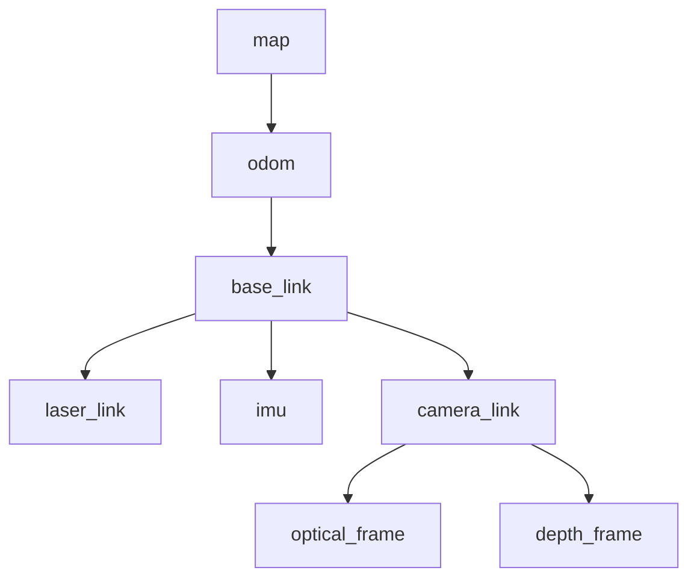

# TF2

tf2（Transform Framework 2）是 ROS2 中处理坐标变换的核心框架，它管理着机器人系统中所有坐标系之间的关系

## 变换的数学表示

坐标变换在 tf2 中使用齐次变换矩阵表示：

$$T = \begin{bmatrix} R & t \\ 0 & 1 \end{bmatrix} = \begin{bmatrix} r_{11} & r_{12} & r_{13} & t_x \\ r_{21} & r_{22} & r_{23} & t_y \\ r_{31} & r_{32} & r_{33} & t_z \\ 0 & 0 & 0 & 1 \end{bmatrix}$$
其中 $R \in SO(3)$ 是旋转矩阵，$t \in \mathbb{R}^3$ 是平移向量

四元数表示法更常用于避免万向锁问题：

$$q = w + xi + yj + zk, \quad |q| = 1$$

## 坐标系规范

坐标系命名规范：

| 坐标系名称          | 含义       | 特点                   |
| -------------- | -------- | -------------------- |
| map or world   | 全局固定坐标系  | 不随时间漂移，用于全局定位        |
| odom           | 里程计坐标系   | 连续但可能漂移，用于局部运动估计     |
| base_link      | 机器人本体坐标系 | 刚性附着在机器人底盘上          |
| base_footprint | 机器人投影坐标系 | base_link 在地面的 2D 投影 |
| sensor_frame   | 传感器坐标系   | 各类传感器的测量参考系          |

### 相机坐标系

相机坐标系遵循 REP 103 标准，需区分两种坐标系：

- **相机本体坐标系（Camera Frame）**：遵循 REP 103 中传感器的通用约定，即 X 轴向前、Y 轴向左、Z 轴向上（右手系）。对相机而言，X 轴指向镜头正前方。该坐标系通常以 `camera_link` 或 `camera_frame` 命名，用于描述相机的物理安装位置与姿态
- **光学坐标系（Optical Frame）**：遵循 OpenCV 惯例，即 Z 轴向前（指向视线方向）、X 轴向右、Y 轴向下（右手系）。该坐标系与图像像素坐标方向一致（X 对应图像列，Y 对应图像行），但是像素坐标系原点在图像左上角，光学坐标系坐标在图像中心。`sensor_msgs/CameraInfo` 中 `header.frame_id` 指向的正是它
	- 光学坐标系通常在本体坐标系名称内加 `_optical` 名词，如 `camera_frame` 对应 `camera_optical_frame`；带该后缀的帧必须遵守 Z 前、X 右、Y 下的约定

## TF2 坐标树

tf2 将机器人系统中的所有坐标系组织成一棵树状结构，每个坐标系作为树的一个节点，坐标系之间的变换关系作为边。这种设计保证了任意两个坐标系之间都存在唯一的变换路径：

树结构的核心特性：
- 无环性：不允许形成环路，保证变换路径唯一
- 连通性：所有坐标系必须连接到同一棵树上
- 有向性：每个变换都有明确的父子关系

## TF2 静态变换

静态变换描述固定不变的坐标系关系，通常用于传感器安装位置

发布静态变换的示例代码：
```cpp
#include <rclcpp/rclcpp.hpp>
#include <tf2_ros/static_transform_broadcaster.h>
#include <geometry_msgs/msg/transform_stamped.hpp>

using TransformStamped = geometry_msgs::msg::TransformStamped;

class StaticTFBroadcaster : public rclcpp::Node
{
public:    
    StaticTFBroadcaster() : Node("static_tf_broadcaster")
    {
        broadcaster_ = std::make_shared<tf2_ros::StaticTransformBroadcaster>(this);
        static_tf = TransformStamped();
        static_tf.header.frame_id = "base_link";
        static_tf.child_frame_id = "camera_link";
        static_tf.transform.translation.x = 0.3;
        static_tf.transform.translation.z = 0.2;
        static_tf.transform.rotation.w = 1.0;
        broadcaster_->sendTransform(static_tf);
    }
private:
    std::shared_ptr<tf2_ros::StaticTransformBroadcaster> broadcaster_;
    geometry_msgs::msg::TransformStamped static_tf;
};
int main(int argc, char *argv[])
{
    rclcpp::init(argc, argv);
    auto node = std::make_shared<StaticTFBroadcaster>();
    rclcpp::spin(node); // 保持节点运行，这样 DDS 的 transient local 缓存一直可用，能让后启动节点接收到TF信息
    rclcpp::shutdown();
    return 0;
}
```

在CmakeLists.txt与package.xml中需要添加tf2_ros依赖

订阅静态变换的示例代码：
```cpp
#include <rclcpp/rclcpp.hpp>
#include <tf2_ros/buffer.h>
#include <tf2_ros/transform_listener.h>
#include <geometry_msgs/msg/transform_stamped.hpp>

class StaticTFListener : public rclcpp::Node
{
public:
    StaticTFListener() : Node("static_tf_listener"), buffer_(this->get_clock()), listener_(buffer_)
    {
        timer_ = this->create_wall_timer(std::chrono::milliseconds(500),
            std::bind(&StaticTFListener::onTimer, this));
    }
private:
    void onTimer()
    {
        try {
            auto tf = buffer_.lookupTransform("base_link", "camera_link", tf2::TimePointZero);
            RCLCPP_INFO(this->get_logger(), "x=%.2f z=%.2f",
                tf.transform.translation.x, tf.transform.translation.z);
            rclcpp::shutdown();
        } catch (const tf2::TransformException &e) {
            RCLCPP_WARN(this->get_logger(), "%s", e.what());
        }
    }
    tf2_ros::Buffer buffer_;
    tf2_ros::TransformListener listener_;
    rclcpp::TimerBase::SharedPtr timer_;
};

int main(int argc, char *argv[])
{
    rclcpp::init(argc, argv);
    auto node = std::make_shared<StaticTFListener>();
    rclcpp::spin(node);
    rclcpp::shutdown();
    return 0;
}
```


## TF2 CLI Tool

这些工具主要涉及到两个功能包：`tf2_ros`和`tf2_tools`：
- `tf2_ros`包中提供的常用节点如下：
    - `static_transform_publisher`：该节点用于广播静态坐标变换
    - `tf2_monitor`：该节点用于打印所有或特定坐标系的发布频率与网络延迟
    - `tf2_echo`：该节点用于打印特定坐标系的平移旋转关系
    ```bash
    ros2 run tf2_ros static_transform_publisher --x x --y y --z z --yaw yaw --pitch pitch --roll roll --frame-id frame_id --child-frame-id child_frame_id
    ros2 run tf2_ros static_transform_publisher --x x --y y --z z --qx qx --qy qy --qz qz --qw qw --frame-id frame_id --child-frame-id child_frame_id
    ros2 run tf2_ros tf2_monitor <> <> # 打印所有坐标系的发布频率与网络延迟，如果加入坐标系参数则只打印该坐标系的信息
    ros2 run tf2_ros tf2_echo <> <> # 打印两个坐标系之间的平移旋转关系
    ```
- `tf2_tools`包中提供的节点如下：
    - `view_frames`：该节点可以生成显示坐标系关系的 pdf 文件，该文件包含树形结构的坐标系图谱
    ```bash
    ros2 run tf2_tools view_frames  # 生成坐标系关系的 pdf 文件，默认保存在当前目录下的 frames.pdf 中
    ```
- `rqt_tf_tree`：该插件可以在 rqt 中以树形结构的方式可视化坐标系关系
  - 需要下载：`sudo apt install ros-<distro>-rqt-tf-tree`
  - 安装完成后，再次打开 rqt 工具，`Plugins`->`Visualization`->`TF Tree`

## TF 可视化

在 rviz2 中可以通过添加 TF 显示类型来可视化坐标系关系，红色坐标轴表示X轴，绿色坐标轴表示Y轴，蓝色坐标轴表示Z轴

