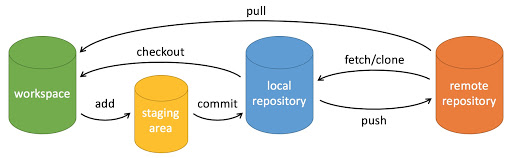

# Git 使用笔记

## Git 基本操作



- `git pull`：从远程仓库拉取最新代码到本地
- `git add .`：将修改的代码添加到暂存区
- `git commit -m "提交说明"`：将暂存区的代码提交到本地仓库，并添加提交说明
- `git push`：将本地仓库的代码推送到远程仓库

### Git Clone

```bash
git clone <repository_url> # 克隆远程仓库到本地
git clone -b <branch_name> <repository_url> # 指定克隆分支
# 克隆后会在当前目录下创建一个新的文件夹，文件夹名称与仓库名称相同，如果想指定文件夹名称，可以在命令末尾添加一个参数
git clone <repository_url> <folder_name>
```

Git Clone 可以选择 https 或者 ssh 方式

#### HTTPS

```bash
git clone https://github.com/username/repository.git
```

如果克隆私有仓库，会提示输入 GitHub 用户名和密码，注意密码一栏要填入**个人访问令牌（Personal Access Token）**，而不是 GitHub 密码

生成个人访问令牌：

1. 登录 GitHub，进入 `Settings → Developer settings → Personal access tokens → Tokens (classic) → Generate new token`
2. 选择repo权限，生成令牌
3. 复制令牌，保存好
4. 使用时在密码栏填入该令牌

#### SSH

1. 生成SSH密钥：`ssh-keygen`
   一路回车即可，默认会生成在 `~/.ssh/id_ed25519`
2. 添加公钥到 GitHub：
   打开公钥文件`id_ed25519.pub`
   登录 `GitHub → Settings → SSH and GPG keys → New SSH key` 粘贴进去
3. 测试连接：`ssh -T git@github.com`
   如果成功，会出现 `Hi username! You've successfully authenticated, but GitHub does not provide shell access.`
4. 克隆仓库：`git clone git@github.com:username/repository.git`

#### 镜像

使用镜像源加速 Clone：

- 临时使用镜像：
```bash
git clone https://gitclone.com/<要克隆的Github地址>
```

- 使用 `git config` 设置永久镜像源：
```bash
git config --global url."https://gitclone.com/".insteadOf https://
nano ~/.gitconfig # 查看配置是否生效
```

### .gitignore

.gitignore 文件用于让git在add时忽略某些文件或文件夹，写法为：
```bash
# 忽略单个文件
config.ini
# 忽略整个文件夹
build/
# 忽略特定类型的文件
*.log
# 忽略特定目录下的文件
logs/*.log
temp/**
# 不忽略某个文件（即使父目录被忽略）
!important.txt
```

### branch

```bash
git checkout branch_name # 切换到已有分支
  -b new_branch_name # 创建并切换到新分支
git branch # 查看所有分支
```

### add & commit

配置用户名和邮箱：
```bash
git config --global user.name "your name"
git config --global user.email "your email"
# 如果去掉 --global 参数只对当前仓库有效
```

初始化仓库：
```bash
git init
touch .gitignore && nano .gitignore
```

修改文件后，add 至暂存区：
```bash
git add <file> # 添加单个文件
git add . # 添加当前目录下的所有文件
```

查看当前状态：
```bash
git status
git diff --cached # 查看已 add 的文件的修改内容
```

提交到本地仓库：
```bash
git commit -m "commit message"
```

### pull & push

链接远程仓库：
```bash
# shortname 可以是 origin 或其他自定义名称
git remote add <shortname> https://github.com/username/repo.git 
# 切换分支
git checkout -b <newbranch>
# 查看当前分支
git branch
```

从远程仓库拉取最新代码：
```bash
git pull <remote> <branch>
```

将本地代码推送到远程仓库：
```bash
git push <remote> <branch>
```

远程提交先于本地提交时的解决方法：

选取合并策略：
```bash
git config pull.rebase false  # merge，表示使用合并的方式将远程提交和本地提交合并，保留两者的提交历史
git config pull.rebase true   # rebase，表示使用变基的方式将远程提交和本地提交合并，重写提交历史，使其看起来像是本地提交在远程提交之后进行的
git config pull.ff only       # fast-forward only，表示只允许快进合并，如果远程提交先于本地提交，则拒绝合并，要求先将本地提交推送到远程仓库
git config --global pull.rebase false  # 设置全局默认合并策略为 merge
```
再次推送后，编辑器提示有冲突，使用冲突编辑器解决冲突，将冲突解决后，add 解决后的文件，commit 后再次 push 即可

### Git Release

管理 Release Tag：
```bash
# 创建一个新的 Tag
git tag -a v1.0.0 -m "Release version 1.0.0"
# 查看所有 Tag
git tag
# 删除本地 Tag
git tag -d v1.0.0
# 删除远程 Tag
git push origin --delete v1.0.0
```

### 设置代理

```bash
git config --global http.proxy http://proxyserver:port
git config --global https.proxy http://proxyserver:port
```

打开 v2rayN，左下角看到`本地:[mixed:<port>]`，故代理地址为 `http://127.0.0.1:<port>`

### Git 凭证管理

使用 VSCode 的 Git 功能时，弹出 git-credential-manager

如何管理 Git 凭证：
```bash
git credential-manager github list
git credential-manager github logout 要移除的账号名称
```

使用Git时总是需要反复填入用户名和密码（HTTPS协议），如何配置凭据缓存？

- 方案1：永久存储密码
   ```bash
   git config --global credential.helper store
   ```
   下次 `git push/pull` 输入一次用户名密码后，会永久存储到 `~/.git-credentials` 文件（明文），之后不再需要输入密码，但不安全，不推荐
- 方案2：使用 SSH 密钥
  - 生成 SSH 密钥：`ssh-keygen -t ed25519 -C "你的邮箱"`
  - 复制公钥：`cat ~/.ssh/id_ed25519.pub`
  - 添加到 Gitee：登录 Gitee → 右上角头像 → 设置 → SSH 公钥 → 粘贴刚才复制的内容
  - 切换远程地址为 SSH：`git remote set-url origin git@gitee.com:openrover/OpenRover.git`
  - 测试：`ssh -T git@gitee.com`
  - 之后 push/pull 不再需要密码

## 删库跑路

如何取消本地的Git管理：

```bash
rm -rf .git
```

## Git 基本原理

- [原来我一点都不懂Git](https://www.bilibili.com/video/BV18ZiFB3EUy)