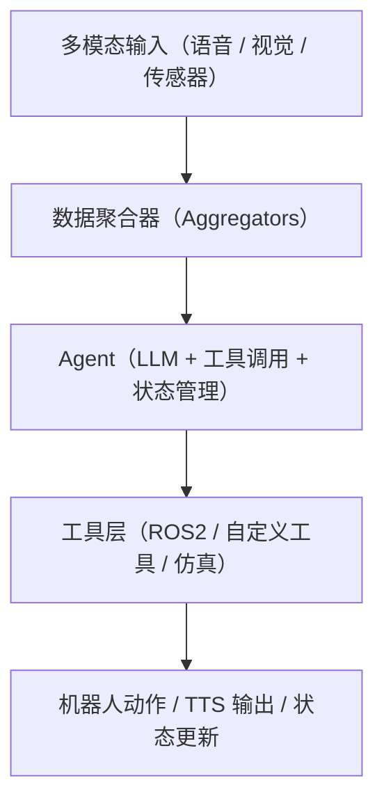

# Agent

## Claude Code

禁用Claude Code的登录
```bash
# ~/.claude/config.json
{
  "primaryApiKey": "any-string-is-ok-here" 
  # 填写假的API Key，Claude Code会认为用户已经登录
}
```

配置使用DeepSeek api：[deepseek anthropic api](https://api-docs.deepseek.com/zh-cn/guides/anthropic_api)
```bash
# ~/.bashrc
export ANTHROPIC_BASE_URL=https://api.deepseek.com/anthropic
export ANTHROPIC_AUTH_TOKEN=${DEEPSEEK_API_KEY}
export API_TIMEOUT_MS=600000
export ANTHROPIC_MODEL=deepseek-chat
export ANTHROPIC_DEFAULT_HAIKU_MODEL=deepseek-chat
export CLAUDE_CODE_DISABLE_NONESSENTIAL_TRAFFIC=1
```

## RAI



# MCP

- [Prompt, Agent, MCP 是什么](https://www.bilibili.com/video/BV1aeLqzUE6L/)

MCP 是 Anthropic 推出的一套开放的标准化协议，核心逻辑是：将各工具程序的接口进行统一规范化，使得 Agent 可以通过标准化的接口调用不同的工具程序，而不需要关心工具程序的具体实现细节

## 使用Python实现MCP

- [Python MCP](https://pypi.org/project/mcp/#what-is-mcp)
- [8分钟入门MCP](https://www.bilibili.com/list/watchlater?bvid=BV1nyVDzaE1x)

编写MCP，本质上就是编写给AI Agent调用的函数，MCP Server 不像是服务器，更像是一个脚本

### 编写MCP Server

假设我们要编写一个获取主机信息的MCP Server，首先需要编写一个工具函数来获取主机信息，例如：
```python
# tools.py
import platform
import psutil
import json

def get_host_info() -> str:
    """get host information
    Returns:
        str: the host information in JSON string
    """
    info: dict[str, str] = {
        "system": platform.system(),
        "release": platform.release(),
        "machine": platform.machine(),
        "processor": platform.processor(),
        "memory_gb": str(round(psutil.virtual_memory().total / (1024**3), 2)),
    }
    return json.dumps(info)
```
工具函数的编写需要注意以下几点：

- 工具函数的输入参数最好为字符串类型
- 工具函数需要返回字符串类型的数据
- 工具函数需要处理好异常情况，避免抛出未捕获的异常，可以通过返回错误信息的字符串来告知Agent发生了错误
- 工具函数名称需要具有描述性，必要时使用"""docstring"""来说明函数的功能和输入输出

```python
# main.py
from mcp.server.fastmcp import FastMCP
import tools
mcp = FastMCP("host info mcp") # MCP名称，可以随意取，建议具有描述性
mcp.add_tool(tools.get_host_info)
@mcp.tool()
def foo():
    return ""
def main():
    mcp.run("stdio")
if __name__ == "__main__":
    main()
```
工具函数的注册有两种方法：

- 使用装饰器`@mcp.tool()`，将函数注册为工具
- 直接调用`mcp.add_tool()`方法，将函数注册为工具，这种方法更适用于工具函数跨文件使用的情况
MCP Server和Agent之间的通信有三种机制：
- stdio：简单的标准输入输出通信机制，适用于server和agent在同一台机器上的情况
- sse: 基于HTTP协议的单向通信机制，适用于server和agent不在同一台机器上的情况
- streamable-http: 基于HTTP协议的双向通信机制，适用于server和agent不在同一台机器上的情况

通过`mcp.run()`方法启动MCP Server，传入通信方式，例如：
```python
mcp.run("stdio") # 参数可以是"stdio"、"sse"、"streamable-http"，分别对应三种通信机制
```

### 将 custom MCP 添加至 Agent

- [claude code mcp | 菜鸟教程](https://www.runoob.com/claude-code/claude-code-mcp.html)

以Claude Code为例：

Claude Code中管理MCP的命令：
```bash
claude mcp list # 列出当前已注册的MCP
claude mcp get <mcp_name> # 查看已注册的MCP的详细信息
claude mcp remove <mcp_name> # 移除已注册的MCP
/mcp # 在对话框中查询已注册的MCP连接状态
```

添加MCP：
```bash
# 本地 stdio 服务器
claude mcp add --transport stdio [--env 环境变量] <服务器名称> -- <启动命令> # --env参数可选，启动命令可以是任何可执行的命令，例如python脚本、nodejs脚本等
# 远程 sse 服务器
claude mcp add --transport sse <服务器名称> <服务器URL>
# 远程 streamable-http 服务器
claude mcp add --transport http <服务器名称> <服务器URL>
# 示例：带身份验证的HTTP服务器
claude mcp add --transport http secure-api https://api.example.com/mcp --header "Authorization: Bearer 你的令牌"
# 添加后
claude mcp list # 可以看到新添加的MCP
/mcp # 查看连接状态
```

可以在`.claude.json`文件中查看已注册的MCP信息，例如：
```json
"mcpServers": {
  "MecMoveMCP": {
    "type": "stdio",
    "command": "ros2",
    "args": [
      "run",
      "robot_agent",
      "mec_mcp_server"
    ],
    "env": {}
  }
},
```

# STT&TTS

STT（Speech-to-Text）和TTS（Text-to-Speech）是语音交互系统中的两个核心组件，分别负责将语音转换为文本和将文本转换为语音。在Agent系统中，STT可以用于接收用户的语音输入，而TTS可以用于向用户提供语音反馈

以Faster Whisper和piper为例：

- Faster Whisper是一个基于Whisper模型的高性能语音识别系统，支持多种语言和方言，适用于实时语音转文本的场景
- Piper是一个开源的文本转语音系统，支持多种语言和声音，可以用于生成自然流畅的语音输出

# VLM

VLM（Vision-Language Model）是指能够同时处理视觉和语言信息的模型，通常用于多模态任务，例如图像描述、视觉问答等。在Agent系统中，VLM可以用于理解和生成与视觉内容相关的语言信息，例如根据图像内容生成描述性文本，或者根据文本描述生成相应的图像内容

以Moondream2为例