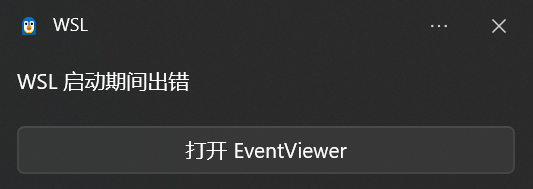

# WSL2

## WSL2 管理工具

[wsl-dashboard](https://github.com/owu/wsl-dashboard)

## WSL 命令

发行版管理相关：

```powerShell
wsl --list --online # 列出可用发行版
wsl --install -d <发行版名称> # 安装指定发行版
wsl --unregister <发行版名称> # 卸载指定发行版
wsl --list --verbose # 查看已安装的发行版
wsl --set-default-version 2 # 设置默认启动版本
wsl -d <发行版名称> # 进入指定发行版
```

系统管理相关：

```powerShell
wsl # 启动默认发行版
wsl --version # 查看当前版本
wsl --update # 更新 WSL
wsl --status # 查看WSL状态
wsl --shutdown # 关闭WSL2实例
wsl --manage <发行版名称> --resize 196GB # 调整Ubuntu发行版的磁盘大小，要求事先关闭WSL2实例
```

## WSL+WSLg

WSLg 是 WSL 的一个扩展，允许在 WSL2 中运行 Linux GUI 应用程序

声明环境变量从而使用 NVIDIA 显卡进行渲染

```bash
export MESA_D3D12_DEFAULT_ADAPTER_NAME=NVIDIA
glxinfo | grep "renderer string" # 查看渲染器信息
```

可以使用的Linux GUI应用程序包括：

- Gedit：文本编辑器
- GIMP：图像编辑器
- Nautilus：文件管理器
- VLC：VLC媒体播放器
- X11 apps：X11应用程序
- Google Chrome

使用apt安装即可

## 双系统文件访问

- 访问Windows文件:
  - `cd /mnt/c`
  - mnt文件夹作为被挂载的文件系统的挂载点，在WSL2中，此处挂载了C盘
- windows访问WSL2文件:
  - 资源管理器查看即可

## WSL2配置

在`%UserProfile%`目录下编辑`.wslconfig`文件，内容如下：

```INI
; WSL2 全局配置
[wsl2]
; 镜像网络模式
networkingMode=mirrored
; 自动使用系统代理
autoProxy=true
; 内存上限
memory=16GB
; 交换分区大小
swap=4GB
; 关闭 DNS 隧道，使用主机 DNS 设置
dnsTunneling=false
```

## 遇到的问题

### vscode 打开 wsl2 卡在下载服务器

尝试排查是否是网络问题，但是没解决，暂且更改 VSCode 的设置，设置中搜索`remote.downloadExtensionsLocally`，勾选；`remote.SSH.localServerDownload`，设置为`always`，这样 VSCode 将会在主机下载服务器和扩展，然后通过 scp 传输到 WSL2 中，虽然不太优雅，但至少能正常使用了

如果之后还遇到这个问题，可以删除 WSL2 中的`~/.vscode-server`，删除后再次连接 WSL2

### WSL 启动期间出错

开机后右下角弹窗：



直接点击`打开Event Viewer`竟然没反应？！只能 win + R 输入`eventvwr.msc`打开事件查看器，直接看到了一个来源为WSL的警告：`Invalid key name in /etc/wsl.conf:3`，说明是`/etc/wsl.conf`文件的第3行有问题
> `/etc/wsl.conf` 文件用于配置每个 WSL 发行版的启动行为

打开`/etc/wsl.conf`：

```INI
[boot]
systemd=true
-e # 这一行是错误的，删除
[user]
default=bernard
```

删除`-e`这一行，保存后重启 WSL2，问题解决
