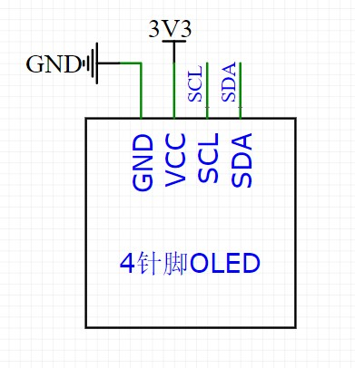
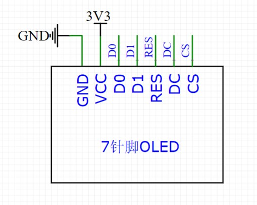

# OLED显示屏

## OLED简介

- OLED（Organic Light Emitting Diode）：有机发光二极管
- OLED显示屏：性能优异的新型显示屏，具有功耗低、响应速度快、宽视角、轻薄柔韧等特点
- OLED模块的工作原理
  - OLED显示屏由多个像素点组成，每个像素点可以独立发光
  - 通过控制每个像素点的亮度，可以显示不同的图形和文字
  - I2C/SPI通信协议用于与微控制器进行数据传输

## 0.96寸OLED显示屏

- 供电：3~5.5V，通信协议：I2C/SPI，分辨率：128*64，驱动芯片：SSD1306/SSD1315
- 电路连接
  
  

  stm32引脚上电后，如果不初始化，默认为浮空输入模式，下图的电路连接中B7引脚与VCC联通，不会造成损害。
  也可以直接用引脚给显示屏端口输出高电平或低电平（不规范操作）。

  
  

- 引脚定义
  - VCC：供电正极
  - GND：供电负极
  - SCL：时钟线（I2C/SPI）
  - SDA：数据线（I2C/SPI）
  - RES：复位引脚
  - DC：数据/命令选择引脚
  - CS：片选引脚（SPI模式）

### 驱动代码移植

选择的驱动文件是`OLED-V2.0`，
[下载地址](https://jiangxiekeji.com/download.html)。

#### 驱动文件功能

驱动文件提供了OLED显示屏的完整功能，包括：

- 硬件初始化与通信协议
  - 完成 OLED 显示屏的引脚初始化、I2C 通信协议的底层实现，包括起始、终止、字节发送等操作。
  - 支持 SSD1306/SSD1315 驱动芯片的初始化配置。
- 显存管理与数据刷新
  - 通过显存数组管理屏幕显示内容，所有显示操作均在显存数组上进行，最后通过刷新函数将数据同步到 OLED 屏幕。
  - 支持全屏和指定区域的清空、取反、刷新等操作。
- 字符与图形显示
  - 支持显示单个字符、字符串、数字（整数、浮点数、十六进制、二进制）、图像等。
  - 支持中英文混合显示，字符集可选 UTF-8 或 GB2312。
  - 提供多种字体大小（如 8x16、6x8）和字模数据管理。
- 绘图功能
  - 实现点、线、矩形、三角形、圆、椭圆、弧等基本图形的绘制，支持空心和填充模式。
  - 提供像素点读写、区域判定等工具函数，方便实现复杂图形显示。
- 驱动文件结构化与可移植性
  - 头文件定义了所有接口和数据结构，便于移植和扩展。
  - 支持不同字符编码格式的切换，适应多种应用场景。

##### 实现方式

```c
/**
  * 数据存储格式：
  * 纵向8点，高位在下，先从左到右，再从上到下
  * 每一个Bit对应一个像素点
  * 
  *      B0 B0                  B0 B0
  *      B1 B1                  B1 B1
  *      B2 B2                  B2 B2
  *      B3 B3  ------------->  B3 B3 --
  *      B4 B4                  B4 B4  |
  *      B5 B5                  B5 B5  |
  *      B6 B6                  B6 B6  |
  *      B7 B7                  B7 B7  |
  *                                    |
  *  -----------------------------------
  *  |   
  *  |   B0 B0                  B0 B0
  *  |   B1 B1                  B1 B1
  *  |   B2 B2                  B2 B2
  *  --> B3 B3  ------------->  B3 B3
  *      B4 B4                  B4 B4
  *      B5 B5                  B5 B5
  *      B6 B6                  B6 B6
  *      B7 B7                  B7 B7
  * 
  * 坐标轴定义：
  * 左上角为(0, 0)点
  * 横向向右为X轴，取值范围：0~127
  * 纵向向下为Y轴，取值范围：0~63
  * 
  *       0             X轴           127 
  *      .------------------------------->
  *    0 |
  *      |
  *      |
  *      |
  *  Y轴 |
  *      |
  *      |
  *      |
  *   63 |
  *      v
  * 
  */
```

#### 驱动文件函数

驱动文件包含以下主要函数：

```c
/*初始化函数*/
void OLED_Init(void);

/*更新函数*/
void OLED_Update(void);
void OLED_UpdateArea(int16_t X, int16_t Y, uint8_t Width, uint8_t Height);

/*显存控制函数*/
void OLED_Clear(void);
void OLED_ClearArea(int16_t X, int16_t Y, uint8_t Width, uint8_t Height);
void OLED_Reverse(void);//全屏反色
void OLED_ReverseArea(int16_t X, int16_t Y, uint8_t Width, uint8_t Height);//区域反色

/*显示函数*/
void OLED_ShowChar(int16_t X, int16_t Y, char Char, uint8_t FontSize);
void OLED_ShowString(int16_t X, int16_t Y, char *String, uint8_t FontSize);//显示字符串，中英混合
void OLED_ShowNum(int16_t X, int16_t Y, uint32_t Number, uint8_t Length, uint8_t FontSize);
void OLED_ShowSignedNum(int16_t X, int16_t Y, int32_t Number, uint8_t Length, uint8_t FontSize);
void OLED_ShowHexNum(int16_t X, int16_t Y, uint32_t Number, uint8_t Length, uint8_t FontSize);
void OLED_ShowBinNum(int16_t X, int16_t Y, uint32_t Number, uint8_t Length, uint8_t FontSize);
void OLED_ShowFloatNum(int16_t X, int16_t Y, double Number, uint8_t IntLength, uint8_t FraLength, uint8_t FontSize);
void OLED_ShowImage(int16_t X, int16_t Y, uint8_t Width, uint8_t Height, const uint8_t *Image);//显示图像
void OLED_Printf(int16_t X, int16_t Y, uint8_t FontSize, char *format, ...);//格式化输出字符串

/*绘图函数*/
void OLED_DrawPoint(int16_t X, int16_t Y);//绘制点
uint8_t OLED_GetPoint(int16_t X, int16_t Y);//获取点的状态
void OLED_DrawLine(int16_t X0, int16_t Y0, int16_t X1, int16_t Y1);//绘制线段
void OLED_DrawRectangle(int16_t X, int16_t Y, uint8_t Width, uint8_t Height, uint8_t IsFilled);//绘制矩形
void OLED_DrawTriangle(int16_t X0, int16_t Y0, int16_t X1, int16_t Y1, int16_t X2, int16_t Y2, uint8_t IsFilled);//绘制三角形
void OLED_DrawCircle(int16_t X, int16_t Y, uint8_t Radius, uint8_t IsFilled);//绘制圆
void OLED_DrawEllipse(int16_t X, int16_t Y, uint8_t A, uint8_t B, uint8_t IsFilled);//绘制椭圆
void OLED_DrawArc(int16_t X, int16_t Y, uint8_t Radius, int16_t StartAngle, int16_t EndAngle, uint8_t IsFilled);//绘制弧线
```

#### 驱动移植步骤

字符编码格式：

- UTF-8使用1到4个字节表示一个字符，兼容ASCII码，适用于多种语言环境。
  广泛应用于移动端。
- GB2312是中国国家标准的汉字编码方案，使用双字节编码表示汉字，主要用于简体中文字符集。
  目前windows系统和嵌入式领域仍然大量使用GB2312编码。

UTF-8编码格式移植步骤：

- 打开工程模板，检查工程配置界面`Encoding`是否为`UTF-8`，如果不是，修改为`UTF-8`。
- 复制下载的驱动文件：`OLED.c`、`OLED.h`、`OLED_Data.c`、`OLED_Data.h`，移动到工程文件夹（存放在`Hardware`文件夹）
- 在Keil中将文件添加到工程依赖
- 编译后会出现报错，因为Keil默认不支持将UTF-8编码的中文字符写入执行代码中。
  解决方法：在Keil中打开`Options for Target`，选择`C/C++`，在`Misc Controls`中添加控制参数`--no-multibyte-chars`，然后重新编译。

GB2312编码格式移植步骤：

步骤与UTF-8类似，但需要注意以下几点：

1. 驱动文件若为UTF-8编码，需要转换为GB2312编码。
   使用下载资料中的批量编码转换软件将UTF-8编码转换为GB2312编码。
2. 无需更改Keil的编译选项，也无需添加控制参数，直接添加GB2312编码的驱动文件到工程中。
3. 在`OLED_Data.h`文件中，修改中文字符字节宽度的宏定义

#### 驱动文件的本地化

##### 更换OLED模块引脚

如果OLED模块的引脚定义与驱动文件中的不一致，需要修改驱动文件中的引脚定义。

打开`OLED.c`文件，

1. 修改`OLED_W_SCL`函数
2. 修改`OLED_W_SDA`函数
3. 修改`OLED_Init`函数

##### 添加汉字字模

在`OLED_Data.c`文件中，找到`OLED——CF16x16`数组，按注释要求添加汉字字模数据。

> 字模是字符在显示设备上的点阵表示方式，通常以二进制形式存储每个字符的像素点信息。

使用下载资料中的取模软件：`PCtoLCD2002.exe`，可以将汉字转换为字模数据:

1. 打开字模选项，配置取模方式：
   - 点阵格式：阴码/阳码，阴码表示点亮的像素，阳码表示未点亮的像素。
   - 取模方式：选择列行式，与驱动文件的存储格式一致。
   - 取模走向：选择低位在前，符合驱动文件的存储格式。
   - 输出数字：16进制
   - 自定义格式：C51格式，行前缀的`{`和行后缀的`}`删掉，行后缀逗号保留。
2. 输入汉字，点击取模按钮，生成字模数据。
3. 将生成的字模数据复制到`OLED_Data.c`文件中的`OLED——CF16x16`数组中。
   将数据对应汉字的注释添加到数组前面作为索引

##### 添加图像字模

手绘：

1. 打开取模软件，选择图像选项
2. 选择尺寸，手绘图像
3. 点击取模按钮，生成图像字模数据
4. 将生成的字模数据复制到`OLED_Data.c`文件中，
   定义一个新的数组，记得在头文件中声明该数组

图片导入：

1. 图像预处理
   - 使用图像处理软件（如Photoshop）
   - 凸显图像的轮廓和细节，选择`滤镜`->`风格化`->`查找边缘`，或者其他方法。
   - 图像二值化：`图像`->`调整`->`阈值`，将图像转换为黑白两色，同时调整合适的阈值。
   - 调整图像大小：将图像缩放：选择`图像`->`图像大小`，将图像缩放到128x64像素。
   - 再次二值化，做微调。
   - 将图像保存为BMP格式。
2. 打开取模软件，选择图像选项
   - 导入BMP图像，做像素微调
   - 点击取模按钮，生成图像字模数据，记得先设置导出格式。
3. 将生成的字模数据复制到`OLED_Data.c`文件中，
   定义一个新的数组，记得在头文件中声明该数组

### OLED显示原理

#### OLED模块结构
