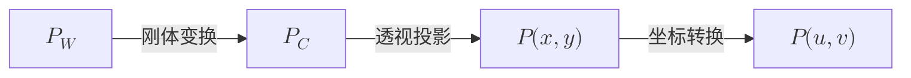
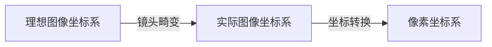

# 相机标定

References: 
- [OpenCV 相机标定与3D重建](https://docs.opencv.ac.cn/4.13.0/d9/d0c/group__calib3d.html)
- [相机标定：从入门到实战](https://zhuanlan.zhihu.com/p/698229692)

## 相机成像模型

相机标定的目的是为了建立物体从三维世界到成像平面上各坐标点的对应关系，三维空间中的点坐标投影到二维图像平面上的坐标的空间变换关系如下：

![[空间坐标系变换关系.jpg | 500]]


- 世界坐标系：描述物体在三维空间中的位置和姿态，通常以某个固定点为原点，单位为米
- 相机坐标系：以相机的光心为原点，单位为米
- 图像坐标系：以图像的中心为原点，单位为毫米
- 像素坐标系：以图像的左上角为原点，单位为像素

称 $K$ 是**相机内参矩阵**：
$$
K=
\begin{bmatrix}
f_x&0&u_0\\
0&f_y&v_0\\
0&0&1
\end{bmatrix}
$$
- $f_x,f_y$：以像素为单位的水平、垂直方向焦距
- $u_0,v_0$：主点的像素坐标，即光轴与成像平面交点的位置

## 畸变模型

不同于上面理想相机的坐标变换，实际相机的坐标变换还需要考虑镜头畸变的影响。最常见的畸变模型是布朗模型，包含径向畸变和切向畸变两部分

- 径向畸变：由镜头的制造工艺引起，导致图像边缘部分的点向外（桶形畸变）或向内（枕形畸变）偏移，用三个参数 $k_1, k_2, k_3$ 来描述
- 切向畸变：由镜头安装不当引起，导致图像中的点沿切线方向偏移，用两个参数 $p_1, p_2$ 来描述

用 $D$ 来概括**镜头畸变参数**：
$$
D=(k_1,k_2,p_1,p_2,k_3)
$$

从而有修正后的坐标变换关系：



## 张正友标定法

要标定实际相机，考虑镜头畸变这一非线性模型，需要通过非线性标定方法求解。常见的非线性标定方法是张正友标定法：

其主要特征：

1. 用二维靶标代替三维标靶（区别于传统标定方法）
2. 用棋盘格的角点作为特征点
3. **只考虑了径向畸变**，没有考虑切向畸变，故标定后得到的畸变参数只有k1 k2 k3，没有p1 p2（为0）

原理：通过相机拍摄不同位姿的棋盘格图像，提取图像棋盘格角点，以重投影误差为目标函数，通过LM算法进行非线性参数优化：[张氏法相机标定原理](https://zhuanlan.zhihu.com/p/24651968)

算法的输入输出：
$$
\text{多张标定图片}
\quad\longrightarrow\quad
\underbrace{K,D}_{\text{相机固有属性}}
,\quad
\underbrace{(R_1,t_1),(R_2,t_2),\ldots,(R_n,t_n)}_{\text{每张图片各一组}}
$$

## 标定实践

- 什么时候需要重新标定
	- 镜头或成像几何改变：更换相机或镜头、改变变焦倍率或对焦位置、镜头重新安装后，内参或畸变参数可能改变，需要重新标定；测量时应固定焦距和对焦位置
	- 分辨率改变不一定需要重标定，若只是同一视场的纯缩放，可以按横、纵缩放比例分别换算 $f_x、u_0$ 和 $f_y、v_0$，畸变参数不变。例如宽、高都减半，这四个内参也相应减半
	- 图像裁剪不一定需要重标定，若从原图坐标 $(x_0,y_0)$ 开始裁剪，焦距和畸变参数不变，主点改为 $u_0'=u_0-x_0$、$v_0'=v_0-y_0$；若裁剪后再缩放，还需继续换算内参
	- 图像翻转或旋转不一定需要重标定：软件水平翻转、垂直翻转或旋转只是改变像素坐标。最简单的做法是在去畸变前，将图像恢复到标定时的方向；若直接在变换后的图像上计算，需同步变换像素坐标和相关标定模型，不能照用原参数
	- 双目相机左右相对位置改变：基线、夹角发生变化后，需要重新标定双目外参并重新计算立体校正；若各自镜头和对焦未变，单目内参可以验证后复用
	- 仅改变曝光、增益、白平衡或帧率通常不需要重标定，但模糊、过曝会降低特征定位和测量精度
- 标定板
	- 最好使用专业的标定板
	- 如果打印标定棋盘格，必须保证打印的棋盘格的**平整性**，尽可能贴平在一个平面上，避免出现弯曲或者褶皱
- 拍摄标定图像
	- 把图像分成四个象限，标定板平均分布在每个象限，每个象限至少拍两个不同倾斜角度的图片
	- 标定板图片需要覆盖整个测量视场，标定图片的数量通常在15~25张之间
	- 标定板的成像面积应大致占整幅画面的1/3~1/4
	- 标定板成像过暗就需要用辅助光源补光，过亮就调整曝光时间，保证标定板的亮度足够且均匀
	- 标定过程，相机的光圈、焦距不能发生改变，改变需要重新标定

### MATLAB 标定

![[你还能有Matlab聪明？.png|300]]

双目和单目相机可以通过 Matlab 标定，开箱即用。参考教程：[保姆级双目测距原理及代码](https://zhuanlan.zhihu.com/p/1962924833072451649)

Matlab 的 Stereo Camera Calibrator 只支持把标定的参数导出到工作区，我们可以用以下函数将标定参数转换为 OpenCV 可用的参数：

```m
[cameraMatrixL, distCoeffL, cameraMatrixR, distCoeffR, R, T] = ...
    stereoParametersToOpenCV(stereoParams);
```

让 AI 编写 matlab 脚本将工作区参数导出为用于 OpenCV 的 npz 文件或用于 ROS 的 ROS 标准标定 YAML

### OpenCV 标定

[OpenCV相机标定教程与相关库函数](https://docs.opencv.ac.cn/4.13.0/d9/d0c/group__calib3d.html)

程序设计思路：
1. 定义一个类`CameraCalibrator`，包含以下成员变量：
  - `ChessboardSize`：棋盘格内角点的数量，格式为(width, height)
  - `SquareSize`：棋盘格每个小格子的边长，单位为毫米
  - `ObjectPoints`：世界坐标系中的角点坐标列表
  - `ImagePoints`：图像坐标系中的角点坐标列表
  - `cameraMatrix`：相机内参矩阵
  - `distCoeffs`：相机畸变系数
  - `rvecs`：旋转向量列表
  - `tvecs`：平移向量列表
2. 定义一个方法`get_object_points`，根据棋盘格的属性生成世界坐标系中的角点坐标`ObjectPoints`
3. 定义一个方法`get_image_points`，读取棋盘格图片，检测角点位置，并进行亚像素级精确化，生成图像坐标系中的角点坐标`ImagePoints`
4. 定义一个方法`calibrate`，传入图像尺寸、`ObjectPoints`和`ImagePoints`，调用 OpenCV 的`cv::calibrateCamera`函数进行相机标定，得到相机内参矩阵`cameraMatrix`、畸变系数`distCoeffs`、旋转向量列表`rvecs`和平移向量列表`tvecs`
5. 定义一个方法`undistort`，使用标定得到的`cameraMatrix`和`distCoeffs`对输入图像进行去畸变处理，返回去畸变后的图像
6. 在主函数中创建`CameraCalibrator`对象，调用上述方法完成相机标定和去畸变处理，并显示结果图像