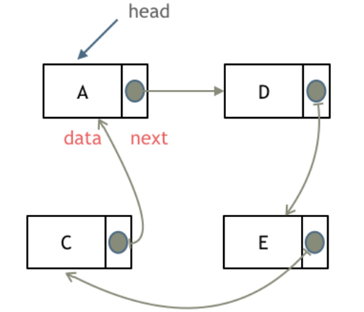
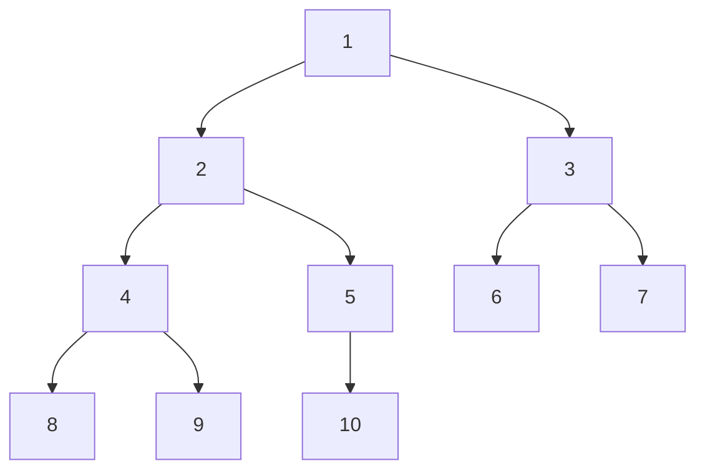
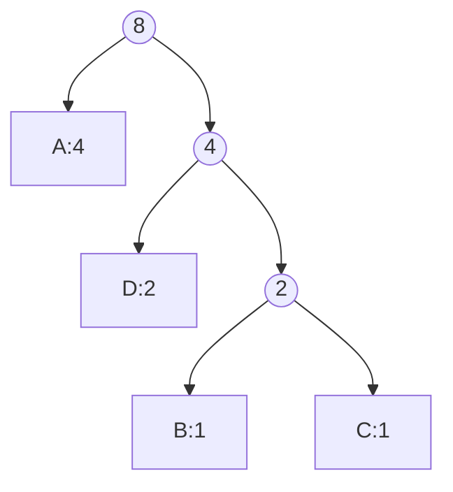
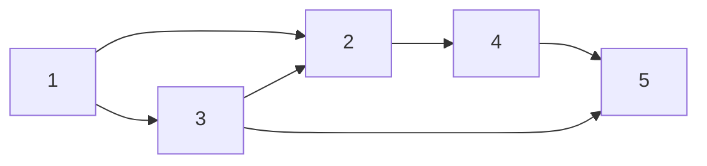
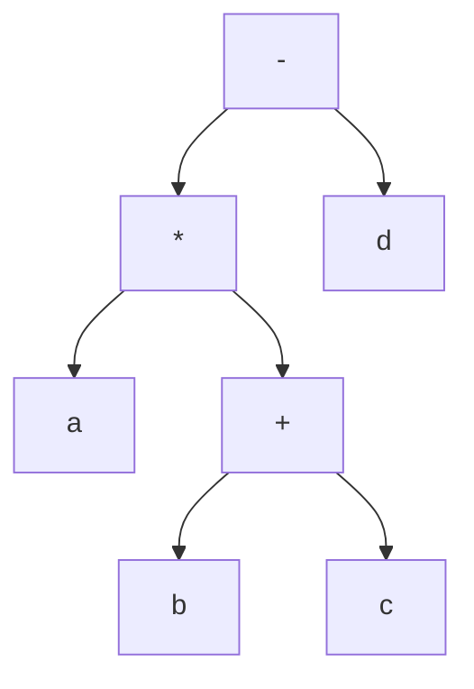

# 数据结构与算法

## 数据结构

数据的逻辑结构：

- 集合：数据元素之间没有关系
- 线性结构：数据元素之间存在一对一的关系
- 树形结构：数据元素之间存在一对多的关系
- 图状结构：数据元素之间存在多对多的关系

数据的存储结构：

- 顺序存储结构：数据元素在内存中是连续分布的，通常使用数组来实现
- 链式存储结构：数据元素在内存中不是连续分布的，而是通过指针链接内存中各个地址，通常使用链表来实现

### 数组

数组是存放在连续内存空间上的相同类型数据的集合

数组的特点：

- 数组下标都是从0开始的
- 数组内存空间的地址是连续的，至少在C++中是这样。所以我们在删除或者增添元素的时候，就难免要移动其他元素的地址，因此**数组的增删操作效率较低**，但由于内存空间的连续性，**数组的访问效率较高**

#### 矩阵

矩阵可认为是二维数组

##### 稀疏矩阵

稀疏矩阵是指在一个矩阵中，非零元素的数量远远小于零元素的数量的矩阵。稀疏矩阵的存储方式一般为三元组（行号，列号，值），只存储非零元素的信息，从而节省空间

### 链表

链表是一种通过指针串联在一起的线性结构，每一个节点由两部分组成，一个是数据域一个是指针域（存放指向下一个节点的指针）。最后一个节点的指针域指向 null，链表的入口节点称为 head，注意 head 相当于一个虚拟头节点，其 next 指针指向链表的第一个节点，head 本身不存储数据，引入 head 是便于进行链表的增删操作，避免了对第一个节点的特殊处理

#### 链表的类型

- 单链表：每个节点只有一个指针域，指向下一个节点，其判空条件为：`L.head->next == NULL`

  

- 双链表：每个节点有两个指针域，一个指向下一个节点，一个指向上一个节点

  

- 循环链表：链表的最后一个节点的指针域指向头结点，形成一个环，其判空条件为：`CL.head->next == CL.head`

  

#### 链表的存储方式

数组是在内存中是连续分布的，但是链表在内存中不是连续分布的，而是通过指针域的指针链接内存中各个地址。因此**链表的增删操作效率较高**，因为不需要移动其他元素的地址，只需要修改指针即可，但**链表的访问效率较低**，因为需要从头节点开始逐个访问，直到找到目标节点为止

链表的定义：

CPP 固然提供了 list 这种双向链表的实现，但要用到其它类型的链表，就需要自己定义了，下面是单链表的定义：

```cpp
struct ListNode {
    int val;  // 节点上存储的元素
    ListNode *next;  // 指向下一个节点的指针
    ListNode(int x) : val(x), next(NULL) {}  // 节点的构造函数
};
// 使用自定义构造函数创建一个链表的头结点，值为 5
ListNode* head = new ListNode(5);
```

类的设计参考：[设计链表](https://leetcode.cn/problems/design-linked-list/description/)

#### 链表的操作

- 删除节点，只要将C节点的next指针 指向E节点就可以，但是D节点依然存在于内存中，所以在C++里最好手动释放这个D节点，释放这块内存。其他语言例如Java、Python，有自己的内存回收机制就不用手动释放了

  

- 插入节点，例如在C节点和D节点之间插入F节点，只要将C节点的next指针指向F节点，然后将F节点的next指针指向D节点就可以了

  

可以看出链表的增添和删除都是O(1)操作，也不会影响到其他节点。但是要注意，要是删除第X个节点，需要从头节点查找到第X-1个节点通过next指针进行删除操作，查找的时间复杂度是O(n)

|      | 插入/删除（时间复杂度） | 查询（时间复杂度） | 适用场景                         |
| ---- | ----------------------- | ------------------ | -------------------------------- |
| 数组 | O(n)                    | O(1)               | 数据量固定，频繁查询，较少增删   |
| 链表 | O(1)                    | O(n)               | 数据量不固定，频繁增删，较少查询 |

### 栈与队列

#### 队列

队列（queue）是一种先进先出（FIFO, First In First Out）的线性表，只允许在表的一端进行插入操作，在另一端进行删除操作，插入的一端称为队尾（rear），删除的一端称为队首（front）

队列的存储方式有两种：

顺序存储：

- 顺序循环队列，其判空条件为 `SQ.front == SQ.rear`，判满条件为 `(SQ.rear + 1) % MAXSIZE == SQ.front`，其中 MAXSIZE 为队列的最大容量，这种条件是建立在少用一个存储单元的基础上的

链式存储：

- 链式队列使用链表实现，与单链表一样，使用一个虚拟头结点 head，head 的 next 指针指向队列的第一个节点，并使队头指针 front 指向 head，队尾指针 rear 则指向队列的最后一个节点，rear 的 next 指针指向 null
- 链式循环队列，是将链式队列 rear 的 next 指针指向 head，形成一个环，其判空条件为 `LQ.rear->next == LQ.rear`

### 树

树的相关概念：

- 结点的度：结点拥有的子树的个数
- 树的度：树中结点的最大度
- 结点的层次：根结点为第一层，根结点的子树为第二层，以此类推
- 树的深度：树中结点的最大层次

树的性质：

- 结点数 = 边数+1 = 所有结点度数之和+1
  推导：
  1. 将结点和与之相连的上一条边看作一个整体，那么根结点没有上一条边，其他结点都有一条上一条边，所以结点数 = 边数+1
  2. 边数自然等于所有结点的度数之和，所以结点数 = 所有结点度数之和+1

#### 树、森林、二叉树的转换

树->二叉树的转换：

由于树的结点没有左右之分，所以将树的孩子结点按从左到右的顺序编号，从1开始，然后遵循以下的步骤：

1. 加线：在所有兄弟结点之间加一条线，将兄弟结点连接起来
2. 去线：只保留每个结点的第一个孩子结点和它的父结点之间的线，其他的线都去掉
3. 调整：将树调整为二叉树的结构

经此三步操作后，树就变成了二叉树，转换后的二叉树没有右子树

森林->二叉树的转换：

1. 将森林的每棵树转换为二叉树
2. 将所有二叉树按从左到右的顺序连接起来，后一个二叉树作为前一个二叉树的右子树

### 二叉树

references：

- [二叉树&amp;完全二叉树(定义, 性质)](https://www.bilibili.com/video/BV1eQ3RzxEoS)
- [二叉树理论基础](https://programmercarl.com/二叉树理论基础.html#算法公开课)

二叉树的递归定义：二叉树是一个空树或者一个由根节点和左右子树组成的树，其中左右子树也是二叉树

二叉树的性质：

- 二叉树左子树和右子树的顺序不能颠倒，区别于普通的树，不区分左右子树
- 二叉树的度最大为2，二叉树不一定是度为2的树
- $n_0=n_2+1$
  推导：
  1. $n=n_0+n_1+n_2$
  2. 由树的性质：结点数 = 所有结点度数之和+1，即$n= n_1 + 2 \times n_2 + 1$
  3. 将1和2式相减，得到$n_0=n_2+1$
- 二叉树的第$i$层最多有$2^{i-1}$个结点
- 深度为$h$的二叉树最多有$2^h-1$个结点
  推导：
  1. 由二叉树的性质：第$i$层最多有$2^{i-1}$个结点，所以深度为$h$的二叉树最多有$2^0+2^1+2^2+...+2^{h-1}=2^h-1$个结点
  2. 由等比数列求和公式：$sum=\frac{a_1(1-q^n)}{1-q}$，其中$a_1=1$，$q=2$，$n=h$，所以$sum=2^h-1$

#### 二叉树的种类

二叉树有两种主要的形式：满二叉树和完全二叉树

##### 完全二叉树

定义：一棵二叉树中，除了最底层节点可能没填满外，其余每层节点数都达到最大值，并且最下面一层的节点必须从左到右连续排列

性质：

首先我们对完全二叉树从上到下从左到右编号，根结点编号为1，共有n个结点



- 对于编号为$i$的结点：
  - 父结点编号为$\lfloor\frac{i}{2}\rfloor$，表示下取整
  - 左子树编号为$2i$
  - 右子树编号为$2i+1$
- 最后一个叶子结点的编号为$n$，最后一个分支结点的编号为$\lfloor\frac{n}{2}\rfloor$
- 完全二叉树叶结点只可能在最后两层
- 叶结点数目为$n-\lfloor\frac{n}{2}\rfloor$
- 完全二叉树结点数为奇数时，没有度为1的结点，结点数为偶数时，只有一个度为1的结点，且编号为$\lfloor\frac{n}{2}\rfloor$，只有左孩子
- 深度为$h$的完全二叉树最少有$2^{h-1}$个结点，最多有$2^h-1$个结点
  推导：
  1. 最多的情况即为满二叉树，故最多有$2^h-1$个结点
  2. 最少的情况即将满二叉树最后一层只保留一个结点，故最少有$2^{h-1}-1+1=2^{h-1}$个结点
- 具有$n$个结点的完全二叉树高度为$h=\lceil\log_2(n+1)\rceil$，注意是向上取整
  推导：
  1. 由上一条性质：$n$在$[2^{h-1},2^h-1]$之间
  2. $[2^{h-1},2^h-1]$也可以写成：$(2^{h-1}-1, 2^h-1]$，也即：
     $$
     2^{h-1}<n+1\leq 2^h
     $$
  3. 对不等式取对数，得到：
     $$
     h-1<\log_2(n+1)\leq h
     $$

     ，由于$h$为整数，所以$h=\lceil\log_2(n+1)\rceil$

##### 满二叉树

定义：一棵二叉树只有度为0的结点和度为2的结点，并且度为0的结点在同一层上，满二叉树是完全二叉树的一种特例，满二叉树的最后一层都被节点填满了

性质：

- 满二叉树第$i$层有$2^{i-1}$个结点
- 深度为$h$的满二叉树有$2^h-1$个结点

#### 二叉树的存储方式

##### 二叉树的顺序存储

#### 二叉树的遍历

二叉树的遍历次序（限定先左后右）：

- 前序遍历：根->左->右
- 中序遍历：左->根->右
- 后序遍历：左->右->根

前序遍历的递归实现：

```cpp
void preOrder(TreeNode* root) {
    if (root == nullptr) return;
    cout << root->val << " ";  // 访问根节点
    preOrder(root->left);      // 遍历左子树
    preOrder(root->right);     // 遍历右子树
}
```

后序遍历和中序遍历只需要调整访问根节点的顺序即可

### 哈夫曼树

路径的概念:

- 路径：从树的一个结点到另一个结点所走过的路程
- 路径长度：一个结点到另一个结点之间的分支数目
  - 树的路径长度：树根到每一个结点的路径长度的和
- 带权路径长度：结点到树根的路径长度乘以结点的权值
  - 树的带权路径长度：叶子结点的带权路径长度的和

哈夫曼树就是带权路径长度最短的树，也称最优二叉树。哈夫曼树是一种特殊的二叉树，树中只有叶子结点和度为2的结点

#### 哈夫曼树构造算法

为使带权路径最短，则权值越小的结点越远离根结点，权值越大的结点越接近根结点

1. 将所有的权值作为一个森林，每个权值对应一个结点
2. 从森林中选出两个权值最小的结点作为左右子树，构造一个新的结点作为它们的父节点，父节点的权值为左右子树的权值之和
3. 将新的结点加入森林中，重复步骤2，直到森林中只剩下一个结点为止，这个结点就是哈夫曼树的根节点

#### 哈夫曼编码

哈夫曼编码是一种**前缀**编码，它为每个字符分配一个唯一的二进制字符串，使得任何字符的编码都不是另一个字符编码的前缀。在确保不会出现歧义的前提下，哈夫曼编码可以有效地压缩数据，因为频率高的字符会被分配较短的编码，而频率低的字符会被分配较长的编码，从而减少整体编码长度

以电报的传输为例，假设有四个字符A、B、C、D，它们的出现频率分别为4、1、1、2，那么可以构造如下的哈夫曼树：



假设左子树为0，右子树为1，那么可以得到如下的哈夫曼编码：

| 字符 | 编码 |
| ---- | ---- |
| A    | 0    |
| D    | 10   |
| B    | 110  |
| C    | 111  |

### 图

图是由顶点和边组成的集合

#### 图的相关概念

- 顶点的度
  - 无向图：与顶点相连的边数
  - 有向图：入度Indegree（指向该顶点的边数）和出度Outdegree（从该顶点出发的边数）之和
  - 顶点的度与边数满足：$e=\frac{1}{2}\sum_{i=1}^{n}d_i$，其中$e$为边数，$d_i$为顶点$i$的度数，$n$为顶点数
- 生成树
  - 生成树是一个无向图的子图，它包含了图中的所有顶点，并且是一棵树，即没有环路，且连通
  - 若有$n$个顶点，则生成树有$n-1$条边
  - 一个无向图的生成树不一定是唯一的
- 连通图
  - 连通图是指无向图中任意两个顶点之间都存在路径的图
  - 若一个无向图是连通图，则它至少有$n-1$条边，若有$n-1$条边，则它一定是连通图
  - 极大连通子图（连通分量）是指在一个无向图中，无法再添加任何边而保持连通性的最大连通子图
  - 强连通图是指有向图中任意两个顶点之间都存在双向路径的图，即对于任意两个顶点u和v，存在从u到v的路径，也存在从v到u的路径
- 稀疏图/稠密图
  - 稀疏图满足：$e < n\log_{2} n$，即边数远小于顶点数的平方
  - 稠密图满足：$e \geq n\log_{2} n$，即边数接近顶点数的平方
- 网：指带权图，即图中的边有权值

#### 图的存储方式

邻接矩阵：

- 使用二维数组来表示图结构，有多少节点就申请多大的二维数组，适用于稠密图，空间复杂度为 O(n^2)
- 用二维矩阵的下标表示两个节点的关系，若有边则为1（对于有权图，则为权值），无边则为0（对于无权图，用无穷表示）
  - 在无向图的邻接矩阵中，$M[i][j]=1$表示顶点$i$和顶点$j$之间存在边
  - 在有向图的邻接矩阵中，$M[i][j]=x$表示从顶点$i$指向顶点$j$，权值为$x$，**行表示出度，列表示入度**
- 遍历边时间复杂度为 O(n^2)
- 检查任意两个顶点间是否存在边的操作非常快，时间复杂度为 O(1)

邻接表：

- 使用数组+链表来表示图结构，适用于稀疏图，空间复杂度为 O(n+m)
- 表头结点表（数组）存储每个顶点，包含顶点的数据域和指向顶点边表的第一个结点的链域
- 边表（链表）存储单个节点中存储依附于该顶点的边（对于有向图来说是出边，对于无向图来说是所有边），其中的结点分为三个域：
  - 邻接点域：存储与该顶点相邻的顶点位置
  - 权值域：存储边的权值（对于有权图）
  - 指针域：指向下一个邻接点
- 遍历整张图的时间复杂度为 O(n+m)，其中 n 是节点数，m 是边数
- 检查任意两个顶点间是否存在边的操作较慢，时间复杂度为 O(k)，其中 k 是该顶点的度数

#### 图的遍历算法

[[数据结构与算法#DFS&BFS]]

#### 有向无环图

有向无环图（Directed Acyclic Graph, DAG）

##### 拓扑排序

拓扑排序是指对有向无环图（DAG）中的顶点进行排序，使得对于每一条有向边 (u, v)，顶点 u 在排序中都出现在顶点 v 之前，拓扑排序也可以用来鉴别有向图是否为有向无环图，如果一个有向图存在拓扑排序，则该图一定是有向无环图

拓扑排序的算法：

1. 在有向图中选择一个入度为0的顶点，将其输出，并从图中删除该顶点及其所有出边
2. 重复步骤1，直到图中没有入度为0的顶点为止，如果此时图中仍有顶点，则说明图中存在环，无法进行拓扑排序



对于上面的DAG，拓扑排序的结果是：1, 3, 2, 4, 5

##### DAG的应用

DAG可用于描述工程或系统的进行过程

AOV：Activity On Vertex

- 顶点表示活动，边表示活动之间的优先关系

AOE：Activity On Edge

- 边表示活动，AOE是一个带权的DAG，弧的权表示活动的持续时间，顶点表示事件，事件是活动的开始或结束
- AOE网只有一个入度为0的源点和一个出度为0的汇点，源点表示整个工程的开始，汇点表示整个工程的结束

## 算法

### 双指针法

双指针法主要用于解决数组或链表中的问题

#### 快慢指针法

快慢指针法，通过一个快指针和慢指针在一个for循环下完成两个for循环的工作，从而达到优化时间复杂度的目的

以[移除元素](https://programmercarl.com/0027.移除元素.html#思路)为例，首先明确双指针的各自含义：

- 快指针：寻找新数组的元素 ，新数组就是不含有目标元素的数组
- 慢指针：指向更新新数组下标的位置

那么快指针就作为 for 循环的循环变量，遍历整个数组，遇到不等于目标元素的数，就把这个数赋值给慢指针指向的位置（慢指针初始化为0），然后慢指针向右移动一位，继续遍历，直到快指针遍历完整个数组，最后数组前面的k个元素就是不含有目标元素的数组，k就是慢指针的值

例题：

- [删除链表的倒数第N个节点](https://leetcode.cn/problems/remove-nth-node-from-end-of-list/description/)
- [相交链表](https://leetcode.cn/problems/intersection-of-two-linked-lists-lcci/description/)

#### 滑动窗口法

所谓滑动窗口，就是不断的调节子序列的起始位置和终止位置，从而得出我们想要的结果

以[长度最小的子数组](https://leetcode.cn/problems/minimum-size-subarray-sum/description/)为例，我们通过维护一个滑动窗口来解决这个问题：

- 滑动窗口的 right 通过 for 循环来遍历数组，right 每次向右移动一位，就把当前元素加入窗口的和中
- 在单次循环内，我们通过 while 循环来判断当前窗口的和是否大于等于目标值，如果是，就更新最小长度，并且把窗口的左边界 left 向右移动一位，同时把 left 指向的元素从窗口的和中减去，继续判断，直到窗口的和小于目标值为止，这样就可以得到一个满足条件的最小长度
- 最后当 right 遍历完整个数组后，如果最小长度没有被更新过，说明没有满足条件的子数组，返回0，否则返回最小长度

例题：

- [水果成篮](https://leetcode.cn/problems/fruit-into-baskets/description/)
- [最小覆盖子串](https://leetcode.cn/problems/minimum-window-substring/description/)

#### 左右指针法

左右指针法，通过一个左指针和右指针同时遍历数组，分别从数组左右开始，向中间靠拢，适用于有序数组或者需要从两端同时处理的情况

以[有序数组的平方](https://programmercarl.com/0977.有序数组的平方.html#算法公开课)为例，已知一个非递减排序的整数数组 A，返回每个数字的平方组成的新数组，要求新数组也要按非递减排序的顺序排列：

整数数组A中的元素可能是负数，负数的平方可能会比正数的平方更大，又因为A是非递减排序的，所以A中绝对值最大的数一定在数组的两端，所以我们可以使用左右指针法，分别从数组的两端开始，比较左右指针指向的元素的平方，较大的平方值就放在新数组的末尾，然后对应的指针向中间移动一位，继续比较，直到左右指针相遇为止，这样就可以得到一个非递减排序的新数组

### [前/中/后缀表达式](https://www.bilibili.com/video/BV1aV4y1771G)

- 前缀表达式，运算符前置，如：+ a b
- 中缀表达式，运算符在中间，如：a + b
- 后缀表达式，运算符后置，如：a b +

#### 前/中/后缀表达式的转换

以 a * (b + c) - d 为例：

- 中缀转前缀
  - 先加括号：((a * (b + c)) - d)
  - 运算符放在括号前：- ( * (a + (b c)) d)
  - 去掉括号：- * a + b c d
- 中缀转后缀
  - 先加括号：((a * (b + c)) - d)
  - 运算符放在括号后：((a (b c) + ) * d) -
  - 去掉括号：a b c + * d -

#### 前/中/后缀表达式的实质

将中缀表达式以树的形式表示，以((a * (b + c)) - d)为例，运算符作为树的节点，操作数作为树的叶子节点，可以得到如下的表达式树：



前/中/后缀表达式的实质是表达式树的不同遍历方式，前缀表达式对应前序遍历，中缀表达式对应中序遍历，后缀表达式对应后序遍历。以中缀转前缀为例，将符号提到括号前面，实质上就是将表达式树的根节点提到叶子节点的前面，达成了前序遍历（根左右）的效果

#### 前/后缀表达式的计算

使用**栈**作为辅助

- 前缀表达式：**从后往前，后入栈的先算**
  - 从后往前，遇到数字就入栈
  - 遇到运算符就从栈顶弹出两个数字进行计算，后入栈的数字先算，所以先弹出的数字是右操作数，后弹出的数字是左操作数
  - 将运算结果入栈，继续往前扫描，直到扫描完整个表达式，最后栈顶的数字就是最终结果
- 后缀表达式：**从前往后，先入栈的先算**
  - 从前往后，遇到数字就入栈
  - 遇到运算符就从栈顶弹出两个数字进行计算，先入栈的数字先算，所以先弹出的数字是左操作数，后弹出的数字是右操作数
  - 将运算结果入栈，继续往后扫描，直到扫描完整个表达式，最后栈顶的数字就是最终结果

计算机如何求解表达式？

在中缀表达式的计算中，涉及到运算符的优先级和括号的嵌套关系，这些都增加了求解的复杂度，而后缀表达式则不需要考虑这些问题，直接按照顺序进行计算即可，所以计算机通常会先将中缀表达式转换成后缀表达式，然后再通过栈来计算后缀表达式的值

这套方法由由波兰逻辑学家扬·武卡谢维奇于1920年至1929年间发明，因而前缀表达式又被称为波兰表达式，后缀表达式又被称为逆波兰表达式

题目：[逆波兰表达式求值](https://leetcode.cn/problems/evaluate-reverse-polish-notation/description/)

### 排序

#### 插入排序

直接插入排序：将待排序的元素逐个插入到已排序子集中，使得已排序的子集依然有序，直到整个数组有序为止

直接插入排序的实现：

```cpp
void insertionSort(int arr[], int n) {
    for (int i = 1; i < n; i++) {
        int key = arr[i];
        int j = i - 1;
        while (j >= 0 && arr[j] > key) {
            arr[j + 1] = arr[j];
            j--;
        }
        arr[j + 1] = key;
    }
}
```

希尔排序：对数组中元素先按一定增量取间隔元素合为一组，对每组做直接插入排序，再逐步缩小增量，直到整个数组有序为止

#### 交换排序

基本思想：不断交换逆序元素

冒泡排序：来回比较相邻元素，若顺序错误就交换它们，直到整个数组有序为止

快速排序：

采用分治的思想，选择一个元素作为枢轴（一般为第一个元素），使用左右指针法：right指针从右向左扫描，找到比枢轴小的元素，覆盖前面的移动过的枢轴或其他元素，left指针从左向右扫描，找到比枢轴大的元素，覆盖后面的移动过的枢轴或其他元素，直到左右指针相遇为止，然后将枢轴放到正确的位置上

将数组划分为两个子数组，使得左边的子数组中的元素都小于枢轴，右边的子数组中的元素都大于枢轴，然后对两个子数组递归地进行快速排序，直到整个数组有序为止

#### 选择排序

简单选择排序：每次从未排序的部分中选出最小元素，放到已排序部分的末尾，直到整个数组有序为止

简单选择排序的实现：

```cpp
void selectionSort(int arr[], int n) {
    for (int i = 0; i < n - 1; i++) {
        int minIndex = i;
        for (int j = i + 1; j < n; j++) {
            if (arr[j] < arr[minIndex]) {
                minIndex = j;
            }
        }
        swap(arr[i], arr[minIndex]);
    }
}
```

堆排序分为两个步骤：

- 建堆
  - 堆：即完全二叉树，大根堆指二叉树中每个父节点的值都大于或等于其子节点的值，小根堆指二叉树中每个父节点的值都小于或等于其子节点的值
  - 堆的存储方式：[[数据结构与算法#二叉树的顺序存储]]
  - 建堆的过程：首先按数组本来的顺序构建一棵完全二叉树，然后从最后一个非叶子节点开始，依次向上调整每个节点，使其满足大根堆或小根堆的性质，直到根节点为止
- 排序：基于堆的性质，堆顶元素为最大值或最小值，将堆顶元素与堆的最后一个元素交换，然后将堆的大小减1，再对新的堆顶元素进行调整，使其满足大根堆或小根堆的性质，重复此过程，直到堆的大小为1，整个数组有序为止（如果建的堆顺序已经与要求相符了，就无需再排序了）

#### 归并排序

采用分治的思想，将数组分成两半，分别对两半进行排序，然后再将排好序的两半合并成一个有序的数组

#### 基数排序

将整数按位数切割成不同的数字，然后按每个位数分别比较，进行排序，直到比较完所有位数为止

#### 排序算法对比

| 排序算法     | 时间复杂度                                         | 空间复杂度 | 是否稳定 |
| ------------ | -------------------------------------------------- | ---------- | -------- |
| 直接插入排序 | O(n^2)                                             | O(1)       | 稳定     |
| 希尔排序     | 依增量序列而定，通常介于 O(n^{3/2}) 和 O(n^2) 之间 | O(1)       | 不稳定   |
| 冒泡排序     | O(n^2)                                             | O(1)       | 稳定     |
| 快速排序     | 平均 O(n log n)，最坏 O(n^2)（当数组逆序时）       | O(log n)   | 不稳定   |
| 简单选择排序 | O(n^2)                                             | O(1)       | 不稳定   |
| 堆排序       | O(n log n)                                         | O(1)       | 不稳定   |
| 归并排序     | O(n log n)                                         | O(n)       | 稳定     |
| 基数排序     | O(d(n+k))                                          | O(n+k)     | 稳定     |

注：

- 希尔排序的时间复杂度与增量序列有关
- 基数排序中，$d$ 表示位数，$k$ 表示基数
- 稳定的含义：如果两个元素相等，在排序后它们的相对位置不变，那么这种排序算法就是稳定的

#### 排序算法实现

[[Cpp#排序算法]]

### 查找

查找的相关概念：

- 关键字：数据元素中某个数据项的值，为了方便讨论查找，一般认为查找的数据元素中只包含关键字
  - 主关键字：可以唯一标识这个数据元素的关键字，相应的有次关键字
- 平均查找长度（ASL）：在查找过程中，需要比较关键字的平均次数，是衡量查找算法效率的一个重要指标，ASL越小，说明查找效率越高
  - $ASL = \sum_{i=1}^{n}P_i C_i$，其中$P_i$表示查找表中第$i$个数据元素的概率，$C_i$表示在找到第$i$个数据元素时与关键字的比较次数

#### 顺序查找

从线性表的第一个元素开始，依次比较每个元素的关键字与目标关键字是否相等，直到找到目标元素或者遍历完整个表为止

顺序查找的平均查找长度（假设每个元素被查找的概率相等）：

$$
ASL = \frac{1}{n}\sum_{i=1}^{n}C_i = \frac{1}{n}(1 + 2 + ... + n) = \frac{n + 1}{2}
$$

#### 二分查找

二分查找（折半查找）是一种在**有序**序列中查找特定元素的算法，通过维护两个指针`left`和`right`，分别指向当前搜索范围的左右边界，通过比较中间元素与目标元素的大小关系来更新指针的位置，直到找到目标元素或者搜索范围为空为止

使用二分查找的条件：

- 目标明确：目的是查找特定元素（或满足条件的边界位置）
- 可二分：每次比较后，能把搜索范围确定地缩小到一半
- 有序性：通常要求数组有序；但像图书馆例子那样，如果能通过一次检测把范围划分为“有/无目标”的两半，也满足二分的前提
- 若要求唯一位置：数组最好无重复元素；有重复时，普通二分可能返回任意一个下标

一个错误使用二分查找的例子：

> 有一天小明到图书馆借了 N 本书，出图书馆的时候，警报响了，于是保安把小明拦下，要检查一下哪本书没有登记出借。小明正准备把每一本书在报警器下过一下，以找出引发警报的书，但是保安露出不屑的眼神：你连二分查找都不会吗？于是保安把书分成两堆，让第一堆过一下报警器，报警器响；于是再把这堆书分成两堆... 最终，检测了 logN 次之后，保安成功的找到了那本引起警报的书，露出了得意和嘲讽的笑容。于是小明背着剩下的书走了。
> 从此，图书馆丢了 N - 1 本书

二分查找的时间复杂度：

记$n$为数组的长度，拆解的次数为$k$，每次拆解数组长度为原来的一半，即$\frac{n}{2^k}$，当拆解到只剩一个元素时，即$\frac{n}{2^k} = 1$，解出$k = \log_2 n$，因此二分法的时间复杂度为 $O(log n)$

##### 二分查找的实现

二分查找的算法一般通过**迭代**来实现

根据left和right的区间定义不同，二分查找的写法也有两种：

- 左闭右闭区间：`[left, right]`
- 左闭右开区间：`[left, right)`

两者的区别在于：

- 左闭右闭区间的循环条件是`left <= right`，而左闭右开区间的循环条件是`left < right`，因为当`left == right`时，在左闭右开区间中是无效的空间，而在左闭右闭区间中仍然是有效的空间
- `if (nums[middle] > target)`时，左闭右闭区间的更新是`right = middle - 1`，因为在middle位置的元素已经被比较过了，不用再包含在搜索范围内，而左闭右开区间的更新是`right = middle`，因为在左闭右开区间中，right是开区间，不包含right位置的元素，所以可以直接将right更新为middle

左闭右闭区间的二分查找写法：

```cpp
class Solution {
public:
    int search(vector<int>& nums, int target) {
        int left = 0;
        int right = nums.size() - 1; // 定义target在左闭右闭的区间里，[left, right]
        while (left <= right) { // 当left==right，区间[left, right]依然有效，所以用 <=
            int middle = left + ((right - left) / 2); // 不要用 int middle = (left + right) / 2; 在相加时大整数易溢出
            // 或者 int middle = left + ((right - left) >> 1); 位运算效率更高
            if (nums[middle] > target) {
                right = middle - 1; // target 在左区间，所以[left, middle - 1]
            } else if (nums[middle] < target) {
                left = middle + 1; // target 在右区间，所以[middle + 1, right]
            } else { // nums[middle] == target
                return middle; // 数组中找到目标值，直接返回下标
            }
        }
        return -1; // 未找到目标值
    }
};
```

#### 哈希

References: [哈希表](https://programmercarl.com/哈希表理论基础.html#哈希表)

哈希(Hash)英文名的由来：薯饼(Hash browns)由无数的土豆丝油炸而成，将这种无限多转化为固定值的过程称为 Hashing，Hashing 就是将任意长度的输入通过哈希函数转换为固定长度的输出的过程，这个输出就是哈希值

哈希校验：通过 Hashing 的特性，将文件的内容转换为一个固定长度的哈希值，下载文件后，使用相同的哈希函数对下载的文件进行 Hashing，将得到的哈希值与下载网站提供的哈希值比较，如果两者相同，则说明下载的软件没有被篡改过

哈希表（散列表）：要想在数组中找到目标值，最简单的方法就是遍历整个数组，时间复杂度为 O(n)，但这无疑是低效的。哈希表通过**哈希函数**使用目标值对应的 Key 运算出目标值的索引，直接访问就可以找到目标值

- 时间复杂度分析：平均时间复杂度为 O(1)，最坏时间复杂度为 O(n)（当发生哈希冲突时，哈希表需要处理冲突，这时可能会退化成链表/数组，导致最坏时间复杂度为 O(n)）
- 哈希函数：最常用除留余数法，即对 Key 取模，得到 hash 地址，作为目标值在哈希表中的索引位置
- 哈希冲突：当两个不同的 Key 通过哈希函数得到相同的索引位置时，就会发生哈希冲突，常用的解决方法有链地址法和开放地址法
  - 链地址法：在哈希表的每个索引位置上维护一个链表，当发生哈希冲突时，将新的 Key-Value 对添加到链表中
  - 开放地址法：当发生哈希冲突时，按照一定的探索方式（如线性探查、二次探查）寻找哈希表中的空闲位置来存储冲突 Key-Value 对

**什么时候使用哈希法**：当我们需要查询一个元素是否出现过，或者一个元素是否在集合里的时候，就要第一时间想到哈希法

使用哈希法解决问题时，一般会选择如下三种数据结构：

- 数组，数组本身也是一种哈希表，数组的索引就是哈希地址，数组的值就是哈希值，例题：[有效的字母异位词](https://leetcode.cn/problems/valid-anagram/description/)
- [[Cpp#set]]，尤指 unordered_set
- [[Cpp#map]]，尤指 unordered_map，在 Python 中即指字典类型

#### 动态查找

动态查找的特点是表结构本身是在查找过程中动态生成的。动态查找包括二叉树与树结构两种类型

##### 二叉排序树

二叉排序树（Binary Search Tree，也称二叉搜索树）是一种特殊的二叉树，满足以下性质：

- 每个节点的值都大于其左子树中所有节点的值
- 每个节点的值都小于其右子树中所有节点的值
- 每个节点的左右子树也都是二叉排序树

二叉排序树的查找：

```cpp
TreeNode* searchBST(TreeNode* root, int target) {
    if (root == nullptr) {
        return nullptr; // 没有找到目标值，返回空指针
    }
    if (root->val == target) {
        return root; // 找到目标值，返回当前节点
    } else if (root->val > target) {
        return searchBST(root->left, target); // 目标值在左子树中继续查找
    } else {
        return searchBST(root->right, target); // 目标值在右子树中继续查找
    }
}
```

二叉排序树与二分查找比较相似，但有以下区别：二分查找形成的判定树是唯一的，而二叉排序树的结构取决于插入节点的顺序，不同的插入顺序可能会形成不同结构的二叉排序树，这是因为二分查找要求输入数据必须是有序的，而二叉排序树可以接受无序的输入数据，因而两者的时间复杂度也有区别：

- 二分查找的时间复杂度为 O(log n)，因为每次比较后都能将搜索范围缩小一半
- 二叉排序树的平均时间复杂度为 O(log n)，最坏时间复杂度为 O(n)（当二叉排序树退化成链表时）

二叉排序树的插入：

也即二叉排序树的建立，是一种边查找边排序的过程，如果最终没有找到目标值，还可以将目标值插入到二叉排序树中

在实现中我们需要增加一个记录前驱结点的 parent 指针，当发生`root == nullptr`时，通过parent指针找到插入位置，判断目标值是大于还是小于 parent 的值，从而决定插入到 parent 的左子树还是右子树。在整个二叉排序树的插入过程中，其插入操作都发生在叶子结点

##### 平衡二叉树

references:

- [平衡二叉树(AVL树)](https://www.bilibili.com/video/BV1tZ421q72h)

平衡二叉树（AVL树）是对二叉排序树的改进，为了避免二叉排序树的退化，平衡二叉树强制要求每个结点的左子树和右子树的高度差不超过1，这样可以保证二叉排序树的高度始终保持在 O(log n) 的范围内，从而保证查找、插入和删除操作的时间复杂度为 O(log n)

理想二叉平衡树，结点的左右子树高度相同，即满二叉树

平衡二叉树通过“旋转”操作来维持平衡

##### B树

B树是一种多叉平衡查找树，相较于二叉排序树，B树的每个节点可以有多个子节点，每个结点也可能包含多个键值，从而减少了树的高度，进而减少了硬盘读取次数，从而提高了查找效率

对于一棵m阶B树，满足以下性质：

- 每个结点最多有m棵子树
- 所有叶子结点都在同一层上，它们不包含任何关键字信息，一般称其为外部结点（失败结点）
- 所有的非叶子结点的结构：n, k1, p1, k2, p2, ..., kn, pn
  - $n$表示该结点中关键字的个数，满足$1 \leq n \leq m-1$，即结点的元素数量小于分支树
    - 对于根结点，至少有两个分支，1个元素
    - 对于非根结点，至少有$\lceil \frac{m}{2} \rceil$个分支，$\lceil \frac{m}{2} \rceil - 1$个元素
  - $k_i$表示关键字，满足$k1 < k2 < ... < kn$，即结点内有序
  - $p_i$表示指向子树的指针，$p_i$指向的子树中每个结点的关键字都小于$k_{i+1}$

**B树的查找操作：**

与二叉排序树类似

**B树的插入操作：**

插入操作发生在查找失败时，此时落到失败结点，回溯到父结点，判断父结点是否有空余位置（$n \leq m-1$），如果有空余位置，则将新元素插入到父结点中

如果没有空余位置，插入时发生上溢出，此时需要以第$\lceil \frac{m}{2} \rceil$个元素作为中间元素，将父结点分裂为两个结点，并将中间元素插入到父结点的父结点中，直到回溯到根结点，如果根结点也发生上溢出，则需要创建一个新的根结点，将原来的根结点和新分裂的结点作为其子节点，从而增加树的高度

**B树的删除操作：**

假设叶子结点的父节点为叶子结点，那么对于非叶结点的删除操作，最终都会转换为叶子结点的删除操作：

假设要删除的元素为非叶结点的元素，查找到后需要按中序遍历的顺序找到该元素的前驱或后继元素（在叶节点中），将其替换到非叶结点中，然后删除前驱或后继元素

如果出现下溢出，即元素数量小于$\lceil \frac{m}{2} \rceil - 1$，则需要从兄弟结点中借一个元素。为了不破坏B树的有序性，需要将父节点的元素下移到当前结点中，将兄弟结点的元素上移到父节点中

如果兄弟结点也没有多余的元素，则需要将父节点的元素下移到当前结点中，将兄弟结点的元素合并到当前结点中，从而减少树的高度。如果父节点也发生下溢出，则需要继续回溯到父节点的父节点，执行借元素操作

### 递归

references：

- [二叉树的递归遍历](https://programmercarl.com/二叉树的递归遍历.html#思路)

递归（Recursion）是指一个函数直接或间接调用自身的编程技巧，将原问题分解成更小的子问题，并通过调用自身来解决这些子问题

#### 递归三要素

- 确定递归函数的参数和返回值：确定哪些参数是递归的过程中需要处理的，那么就在递归函数里加上这个参数，并且还要明确每次递归的返回值是什么进而确定递归函数的返回类型
- 确定终止条件：写完了递归算法，运行的时候，经常会遇到栈溢出的错误，就是没写终止条件或者终止条件写的不对，操作系统也是用一个栈的结构来保存每一层递归的信息，如果递归没有终止，操作系统的内存栈必然就会溢出
- 确定单层递归的逻辑：确定每一层递归需要处理的信息。在这里也就会重复调用自己来实现递归的过程

#### 递归的实现

每一次递归调用都会把函数的局部变量、参数值和返回地址等压入调用栈中，然后递归返回的时候，从栈顶弹出上一次递归的各项参数，所以这就是递归为什么可以返回上一层位置。递归的简洁来源于系统自动维护的栈

例题：

- [斐波那契数](https://leetcode.cn/problems/fibonacci-number/description/)
- [二叉树的前序遍历](https://leetcode.cn/problems/binary-tree-preorder-traversal/description/)

### 迭代

references：

- [二叉树的迭代遍历](https://programmercarl.com/二叉树的迭代遍历.html#算法公开课)

迭代（Iteration）是指通过重复执行一段代码来实现某个功能的编程技巧，迭代通常使用循环结构来实现，通过不断更新循环变量来达到重复执行的目的

#### 迭代的实现

迭代的实现需要一个栈来模拟递归调用的过程，迭代的实现相对于递归来说，空间复杂度更低，因为迭代不需要维护调用栈的信息。引入一个队列，是把递归程序改写成迭代程序的常用方法

### 回溯

references：

- [回溯算法理论基础](https://programmercarl.com/回溯算法理论基础.html)

回溯的本质是穷举，回溯法通过构建一个**解空间树**，使用**递归**的方式来遍历这个树——当递归到达一个叶子节点时，就将当前路径上的解存放起来，然后回溯到上一个节点继续寻找其他的解，直到遍历完整个解空间树为止。可以通过**剪枝**来优化回溯算法的效率，总的来说：for循环横向遍历，递归纵向遍历

回溯算法能解决如下问题：

- 组合问题：N个数里面按一定规则找出k个数的集合
- 排列问题：N个数按一定规则全排列，有几种排列方式
- 切割问题：一个字符串按一定规则有几种切割方式
- 子集问题：一个N个数的集合里有多少符合条件的子集
- 棋盘问题：N皇后，解数独等等

回溯函数模板：

```cpp
vector<vector<int>> result; // 存放路径集
vector<int> path; // 存放路径
void backtracking(参数) {
    if (终止条件) {
        result.push_back(path); // 存放结果
        return;
    }
    for (选择：本层集合中元素) {
        处理节点;
        path.push_back(节点); // 将节点加入路径
        backtracking(路径，选择列表); // 递归
        path.pop_back(); // 回溯，撤销处理结果
    }
}
```

### DFS&BFS

references：

- [dfs与bfs的区别](https://programmercarl.com/kamacoder/图论深搜理论基础.html#dfs-与-bfs-区别)

深度优先搜索(DFS)和广度优先搜索(BFS)：

- DFS 是可一个方向去搜，不到黄河不回头，直到遇到绝境了，搜不下去了，再换方向（换方向的过程就涉及到了**回溯**）
- BFS 是先把本节点所连接的所有节点遍历一遍，并确保先被访问的顶点的邻接点先被访问，把连接顶点的所有顶点遍历一遍，是四面八方的搜索

#### DFS

DFS遍历使用递归算法，DFS 的模板和回溯一样

深度优先搜索的编程步骤：

1. 确定递归函数的参数，一般情况，深搜需要二维数组数组结构保存所有路径，需要一维数组保存单一路径
2. 确定终止条件，终止不仅是结束本层递归，同时也是我们收获结果的时候
3. 处理目前搜索节点出发的路径，一般是一个for循环的操作，去遍历当前节点所能到的所有节点

示例：

```cpp
vector<vector<int>> result; // 存放路径集
vector<int> path; // 存放路径
void dfs(参数) {
    if (终止条件) {
        result.push_back(path); // 存放结果
        return;
    }
    for (选择：本层集合中元素) {
        处理节点;
        path.push_back(节点); // 将节点加入路径
        dfs(路径，选择列表); // 递归
        path.pop_back(); // 回溯，撤销处理结果
    }
}
```

例题：

- [所有可能的路径](https://leetcode.cn/problems/all-paths-from-source-to-target/solutions/1666224/by-carlsun-2-66pf/)

#### BFS

BFS遍历使用队列数据结构，当访问一个节点时，将其所有的子节点加入队列中，然后将这个节点出队，继续访问队列中的下一个节点，直到队列为空为止

```cpp
void bfs(参数) {
    queue<类型> 队列;
    队列.push(初始节点);
    while (!队列.empty()) {
        类型 temp节点 = 队列.front();
        队列.pop();
        处理temp节点;
        for (选择：当前节点所连接的其他节点) {
            处理选择;
            队列.push(选择的节点);
        }
    }
}
```

例题：

- [二叉树的层序遍历](https://leetcode.cn/problems/binary-tree-level-order-traversal/solutions/244853/bfs-de-shi-yong-chang-jing-zong-jie-ceng-xu-bian-l/)

### 分治

快速傅里叶变换(FFT)是一种高效计算离散傅里叶变换(DFT)的算法，分治算法是实现FFT的核心思想之一

### 贪心

贪心的本质是选择每一阶段的局部最优，从而达到全局最优，贪心算法的正确性依赖于问题具有**最优子结构**和**贪心选择性质**，即每个子问题的最优解可以通过局部最优解来构建，并且局部最优解能够保证全局最优解的正确性

判断问题是否具有最优子结构和贪心选择性质，需要严格的数学证明，实际问题中往往使用举反例的方法，如果想不到反例，那么就试一试贪心算法

例题：

- [分发饼干](https://leetcode.cn/problems/assign-cookies/description/)
- [摆动序列](https://leetcode.cn/problems/wiggle-subsequence/description/)

#### Dijkstra

Dijkstra 算法是一种用于计算图中单源最短路径的算法，利用了贪心思想，适用于边权非负的图。算法的基本思想是通过不断选择当前未处理的节点中距离源节点最近的节点，并更新其邻居节点的距离，直到所有节点都被处理完为止

例题：

- [网络延迟时间](https://leetcode.cn/problems/network-delay-time/description/?envType=problem-list-v2&envId=x6oppjcj)

### 动态规划

动态规划（Dynamic Programming），同样是通过将原问题分解成子问题来解决的算法设计方法，但与贪心算法不同的是，动态规划中**每一个状态一定是由上一个状态推导出来的**，这一点就区分于贪心，贪心没有状态推导，而是从局部直接选最优的

以[斐波那契数](https://leetcode.cn/problems/fibonacci-number/description/)为例，动态规划解题步骤：

1. 确定dp数组（dp table）以及下标的含义
   - dp数组的定义：dp[i]表示斐波那契数列中第i个数的值
   - 下标的含义：i表示斐波那契数列中的第i个数，i从0开始
2. 确定状态转移方程
   - 状态转移方程：`dp[i] = dp[i-1] + dp[i-2]`
3. dp数组如何初始化
   - 初始化：`if (i<2) dp[i] = i;`
4. 确定遍历顺序
   - 遍历顺序：从前往后遍历，即从i=0开始，依次计算dp[i]的值，直到计算到dp[n]为止
5. 举例推导dp数组，这一步是验证状态转移方程正确性的关键步骤

例题：

- [爬楼梯](https://leetcode.cn/problems/climbing-stairs/)
- [杨辉三角](https://leetcode.cn/problems/pascals-triangle/)
